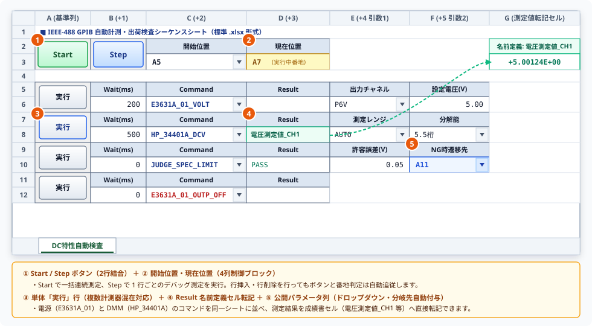

# Excelアドイン取扱説明書 (User Manual)

本ドキュメントは、Excel 上から GPIB（IEEE-488）計測機器のテストシーケンスを構築・実行するための **Excel アドイン（GpibAddIn）** の総合取扱説明書です。リボン共通機能、GPIB 制御機能、4 列制御ブロックと 3 種実行ボタン（単体・`Step`・`Start`）、Excel エクステンション順序制御、設定ファイル（`Setting.xml`）、除外キャッシュ機構、32bit / 64bit 動作環境、および関連マクロコマンドリファレンスを本書 1 冊に統合して解説します。

---

# 目次

- [📖 1. 概要](#-1-概要)
- [🛠️ 2. リボンメニューの説明 (個別機能)](#️-2-リボンメニューの説明-個別機能)
  - [2.1 【ツール】グループ (`tool`：全製品共通リボン機能)](#21-ツールグループ-tool全製品共通リボン機能)
  - [2.2 【GPIB制御】グループ (`GPIB`：GPIB専用リボン機能)](#22-gpib制御グループ-gpibgpib専用リボン機能)
- [🗂️ 3. シート上の実行ボタンと順序制御仕様](#️-3-シート上の実行ボタンと順序制御仕様)
- [💾 4. 設定の自動保存・復元機能](#-4-設定の自動保存復元機能)
- [⚙️ 5. 設定ファイル (Setting.xml) について](#️-5-設定ファイル-settingxml-について)
- [⚡ 6. 高速ファイルオープンと除外キャッシュ機能（オーバーヘッド防止）](#-6-高速ファイルオープンと除外キャッシュ機能オーバーヘッド防止)
- [💻 7. 動作環境と Excel 32bit / 64bit 運用上の留意事項](#-7-動作環境と-excel-32bit--64bit-運用上の留意事項)
- [📚 8. マクロコマンド・関連マニュアル一覧](#-8-マクロコマンド関連マニュアル一覧)

---

## 📖 1. 概要
本 Excel アドイン（GpibAddIn）は、Excel のワークシート上に計測器制御コマンドのシーケンス（実行手順）を 2 行 1 ステップ構成で定義し、単体実行・1 ステップ実行（`Step`）・連続一括実行（`Start`）を非同期に行えるアドインです。コマンド名や待機時間（ウェイト）、パラメータ、条件分岐・ループ遷移先、測定データ出力先を Excel 画面上で視覚的に管理・編集できます。

### 💡 本アドイン最大の特長：VBAマクロ不要・標準 `.xlsx` 形式での完全動作
*   **マクロ無効形式（`.xlsx`）のまま動作**:
    一般的なマクロ機能とは異なり、ブック内部に VBA コードを一切保持しません。Excel シート上のコマンド実行ボタン（ActiveX ボタン）はアドイン側から動的に制御されるため、 **標準的な `.xlsx` 形式のままボタンの配置・保存・自動実行が可能** です。
*   **セキュリティ警告・ブロックの解消**:
    マクロ有効ブック（`.xlsm`）を使用しないため、セキュリティポリシーによるマクロ実行ブロックや警告に煩わされることなく、安全にシーケンスシートを作成・運用・共有できます。
*   **VBE（マクロ）の保守不要**:
    Excel のバージョンアップによる参照設定トラブルやマクロコード破損の心配がなく、長期的なシステムの安定性を保ちます。

### 📌 共通基盤アーキテクチャの責務
1. **VBA/VBE 参照の完全非依存**:
   * マクロ有効形式（`.xlsm`）や VBE 参照を必要とせず、標準的な `.xlsx` 形式のまま動作します。
2. **ActiveX 動的生成・行移動追従・GC 生存管理**:
   * `Forms.CommandButton.1` を OLEObject として動的配置し、クリック発生時点のセル行座標をリアルタイム取得するため、新規配置直後から行挿入・行削除に自動追従します。また COM 参照およびイベントデリゲートを `ActiveXEventManager` により GC 回収から保護します。
3. **安全な COM リソース解放**:
   * シート操作・セル走査完了後は `Marshal.FinalReleaseComObject` を徹底し、Excel プロセスの残存を完全に防止します。
4. **多重起動禁止（シングルインスタンス保護）**:
   * GPIB 通信制御アプリケーション（`GpibMainForm` / `GPIB.exe`）は、バス競合や排他エラーを防止するためシステム全体で **多重起動禁止** に統一されています。Excel アドインから起動する場合も同一インスタンスが調停・前面表示されます。
5. **多層動的リンク解決との統合**:
   * 各種ドキュメント参照は `DocPathResolver` を経由し、ユーザー作業フォルダ（`<設定場所>\Manual\`）・開発環境・GitHub Web・AppData を動的に切り替えます。

---

## 🛠️ 2. リボンメニューの説明 (個別機能)
Excel の上部メニュー（Office のアドインタブ `TabAddIns`：表示名 **「アドイン」** ）に追加される専用リボン内の各ボタンの個別説明です。  
リボンは共通機能である **「ツール (`tool`)」** グループと、個別機能である **「GPIB制御 (`GPIB`)」** グループの 2 つで構成されています。  
※ `GpibAddIn` と `TermAddIn`（および将来の拡張アドイン）を同一 PC に同時導入した場合、プロセス環境変数のオーナー調停機構（`ClaimCommonToolGroupOwnership`）により、アドインタブ（`TabAddIns`）内には共通の **「ツール」** グループが 1 つだけ表示され、その横に **「GPIB制御」「Term制御」** が並んで表示されます。

| 図番 | グループID / 表示名 | ボタンID / 表示名 | 主な機能概要 |
| :---: | :--- | :--- | :--- |
| **①〜②** | **`tool`** (ツール) | **`Make_Doc`** (マニュアル配置) | 共通基盤（`Core`）および `GpibAddIn`（・導入済み製品）の取扱説明書一式を `<設定場所>\Manual\` へ差分同期展開 |
| **②** | | **`Save_Style`** (スタイル保存) | 選択行（単体実行行 9 キー／制御ブロック行 6 キー）のセル書式を既定テンプレートとして `Setting.xml` へ保存 |
| **②** | | **`Start`** (Startボタン配置) | シート上に 4 列制御ブロック（`Start` ボタン・`Step` ボタン・`開始位置`・`現在位置`）を動的配置 |
| **②** | | **`Delete_Sequence`** (シーケンス削除) | 選択中のシーケンス行（2行分）または制御ブロック行（`Start` / `Step` 両ボタン含む）を安全に削除 |
| **③** | **`GPIB`** (GPIB制御) | **`ToolOpen`** (ツール起動) | GPIB 通信制御用メイン画面を起動・最前面表示（シングルインスタンス保護） |
| **③** | | **`Make_Sequence`** (シーケンス配置) | 選択セルを起点として実行ボタン・待機時間・コマンド・結果・公開パラメータの 2 行構成を基準列へ自動生成 |

---

### 2.1 【ツール】グループ (`tool`：全製品共通リボン機能)

#### 🔘 マニュアル配置 ボタン (`Make_Doc`)
*   **機能**: アドインに同梱された全製品の技術ドキュメント（総合取扱説明書、各画面マニュアル、共通基盤 `Core` 6 ドメイン・全 42 コマンド仕様書、および GPIB 通信制御全 27 コマンド仕様書）を、設定ファイルと同一階層の `Manual` フォルダへ安全に差分同期展開します。
*   **用途**: 各種コマンドの仕様や取扱説明書をオフライン環境や手元のフォルダで確認したい場合に実行します。
*   **展開される資材一式**:
    *   **共通基盤マニュアル (`Manual\Core\`)**: `Param`, `Array`, `Sequence`, `File`, `Work`, および Excel シート順序制御 `Excel`（全 8 件）を含む全 42 コマンド仕様書
    *   **GpibAddIn マニュアル (`Manual\GpibAddIn\`)**: 画面別取扱説明書（5 件）および `GPIB` 全 27 コマンド仕様書（同環境に `TermAddIn` 資材が存在する場合は `Manual\TermAddIn\` も一括同期されます）
    *   ※ 標準インストーラー供給元が見つからない特殊環境でのみフォールバックデプロイヤーが動作し、同梱アセット（`ListSample` 含む）を展開します。
*   **展開先ディレクトリと安全性**:
    *   **展開先パス**: `<設定ファイルの場所>\Manual\`（既定では `%USERPROFILE%\Desktop\Monaca\Manual\`）
    *   **差分同期（高速スキップ）**: 既存ファイルを無条件に削除せず、ファイルサイズと最終更新日時を比較して未配置または更新されたファイルのみを安全にコピーします。

#### 🔘 スタイル保存 ボタン (`Save_Style`)
*   **機能**: 現在アクティブなセルが属する 2 行ブロックの各種書式スタイル情報を読み取り、既定テンプレートとして設定ファイル（`Setting.xml` の共通 `Common` テーブル内 `Styles` セクション）に永続化します。
*   **用途**: セルの背景色や罫線、フォント、文字揃え、列幅などのデザインをカスタマイズした後に、それを今後の新規配置時の「既定のスタイル」として登録したい場合に使用します。
*   **保存対象のスタイル要素と全 15 キー別管理**:
    1. **保存されるセル装飾プロパティ**:
       * 背景色（`Interior.Color`）、罫線の太さ・線種・色（上下左右）、フォント名・サイズ・太字・斜体・文字色、文字配置（水平・垂直・折り返し）
       * 列の幅（`ColumnWidth`： **※単体実行シーケンス行の 9 キーのみ保存・復元対象** ）
    2. **単体実行シーケンス行（9 キー）と制御ブロック行（6 キー）の自動判別・別管理**:
       * **単体実行シーケンス行を選択して保存した場合**: `Label`（実行ボタン列）、`WaitLabel` / `WaitValue`、`CommandLabel` / `CommandValue`、`ResultLabel` / `ResultValue`、`ParamHelp` / `ParamValue` の **9 キー** が列幅（`ColumnWidth`）を含めて保存されます。
       * **Start / Step 制御ブロック行を選択して保存した場合**: 基準列から順に `StartButton`（`col`）、`StepButton`（`col + 1`）、`StartLabel` / `StartValue`（`col + 2`）、`CurrentLabel` / `CurrentValue`（`col + 3`）の **6 キー** が個別スタイルとして保存されます。ただし **制御ブロック 4 列のセル幅（`ColumnWidth`）は保存・復元の管理対象から除外されており、次回配置時も単体実行シーケンス行側で設定された列幅がそのまま維持されます** （列幅の上書き干渉を防止）。

#### 🔘 Startボタン配置 ボタン (`Start`)
*   **機能**: シーケンス全体の一括実行および 1 ステップずつのデバッグ実行を統括する **4 列構成の制御ブロック** を、シートの基準列に揃えて縦 2 行で動的配置します。
*   **配置される 4 列制御ブロックの構成（基準列 `col` 起点）**:
    1. **`col` 列：`[ Start ]` ボタン（縦 2 行結合）**: ActiveX コマンドボタン（`MonacaBtn_Start_*`）。`現在位置`（空白時は `開始位置`）から連続実行を開始・途中再開します。
    2. **`col + 1` 列：`[ Step ]` ボタン（縦 2 行結合）**: ActiveX コマンドボタン（`MonacaBtn_Step_*`）。`現在位置`（空白時は `開始位置`）の 1 ステップのみを実行し、次の遷移先番地を `現在位置` へ記録します。
    3. **`col + 2` 列：`開始位置`（上段ラベル／下段ドロップダウン）**: シート内に配置されているすべての単体実行ボタン行のセル番地（例: `A5`, `A7` 等）が自動収集されて入力規則リストに設定されます（初期値は先頭のシーケンス行番地）。Excel 名前定義も指定可能です。
    4. **`col + 3` 列：`現在位置`（上段ラベル／下段プログラムカウンタ）**: 次に実行すべき対象行のセル番地を保持するセルです（初期値は空白）。実行完了時または `Excel_Exit` 到達時に自動で空白へクリアされます。
*   **双方向の基準列整列と二重配置防止**:
    *   先に単体実行シーケンス行がある場合も、先に Start 制御ブロックを配置してから単体実行行を追加する場合も、自動的に同一の先頭基準列に揃えて配置されます。
    *   選択した 2 行領域にすでにボタンが存在する場合は警告ダイアログを表示し、ボタンの重畳配置を防止します。
*   **実行の中断と安全ガード**:
    *   `Start` 一括実行中は共通中断ダイアログ（`CancelDialog`）が表示され、任意のタイミングで安全に中断できます（中断時点の再開番地は `現在位置` に保持されます）。
    *   最大走査行数 `MaxRows`（既定 `500`）および最大連続実行ステップ数 `MaxExecutionSteps`（既定 `10,000`）により、意図しない無限ループによるフリーズを自動防止します。

#### 🔘 シーケンス削除 ボタン (`Delete_Sequence`)
*   **機能**: アクティブセルが存在する単体実行シーケンス行（2 行分）、または制御ブロック行（`Start` ボタン・`Step` ボタンを含む 2 行分）をシート上から安全に削除します。
*   **確認ダイアログと COM/ActiveX 安全解放**: 削除確認ダイアログで [はい] を選択した場合のみ、対象 2 行上のすべての OLEObject（`Start` / `Step` / 単体 `実行` ボタン）およびイベント登録を安全に解放したうえで行削除（上方向シフト）を実行します。

---

### 2.2 【GPIB制御】グループ (`GPIB`：GPIB専用リボン機能)

#### 🔘 ツール起動 ボタン (`ToolOpen`)
*   **機能**: GPIB 通信制御用アプリケーションのメイン画面（[メイン画面取扱説明書](./メイン画面取扱説明書.Md)）を起動して表示します。
*   **多重起動禁止・前面化仕様**:
    *   `GpibMainForm` は **多重起動禁止（シングルインスタンス）** で保護されています。すでに画面が起動中の場合は新規画面を開かず、既存のメイン画面を最前面にアクティブ化（最小化時は元のサイズへ復元）します。

#### 🔘 シーケンス配置 ボタン (`Make_Sequence`)
*   **機能**: コマンド編集画面（[コマンド編集画面取扱説明書](./コマンド編集画面取扱説明書.Md)）で選択・設定したコマンドをもとに、個別実行ボタン（基準列 `baseCol`：`MonacaBtn_Gpib_*`）、待機時間セル（`+1` 列）、コマンド名セル（`+2` 列）、結果指定セル（`+3` 列）、外部公開パラメータセル（`+4` 列以降、列数上限なし）の 2 行構成シーケンス行を自動生成します。
*   **ミニシーケンス未読み込み時の安全ガード**:
    *   利用可能なコマンドが 1 件も登録されていない状態で実行した場合は警告メッセージを表示し、空行の不正配置を防止します。
*   **双方向の基準カラム自動統一と任意列実行**:
    *   シート内で最初にボタン（単体実行行または Start 制御ブロック）を配置した任意の列（A 列以外でも可）が基準カラムとして自動認識され、配置時・実行時ともにその基準カラムを起点に読み書きします。
*   **既存ボタン行での自動シフト挿入確認**:
    *   既存ボタンがある行を選択して実行した場合は確認ダイアログを表示し、[はい] 選択時に直下へ 2 行を自動挿入して新規シーケンスを配置します。
*   **外部公開パラメータ展開（`Work` 型除外）とジャンプ先候補リスト自動付与**:
    *   ミニシーケンス内で内部作業用に定義された `Work` 型（`-Work` 含む）パラメータはシート列へ展開せず、外部公開パラメータのみを `1`〜`N` 番目としてシートへ展開します。
    *   コマンド内の `Excel_Jump`・`Excel_Judge`・`Excel_Loop`・`Excel_Break`・`Excel_Msg_Box` からジャンプ先・脱出先として参照されている公開パラメータ列には、 **シート内の全単体実行ボタン番地（`A5`, `A7` 等）と Excel 名前定義の統合候補リスト** がドロップダウン入力規則として自動設定されます。
*   **`Result`（結果出力セル）の名前定義セル転記仕様**:
    *   `ResultItem` が定義されたコマンドでは、ブック内の名前定義から出力先を選択できます。
    *   `Result` 下段セルに名前定義（例: `電圧測定値_CH1`）や別セル番地が設定されている場合、測定データや実行ステータスは **その指定先セルへ転記され、`Result` 下段セル自身の名前定義文字列は上書きされずに保持** されます（`Result` 下段が空欄の場合のみ `Result` 下段セル自身へ書き込まれます）。

---

## 🗂️ 3. シート上の実行ボタンと順序制御仕様

シート上に配置される 3 種類の ActiveX ボタンはいずれも配置直後から行挿入・行削除に自動追従し、ブック保存・再オープン時には単体実行ボタンの有効接続数が 1 件以上ある場合に `Start`・`Step` の双方が自動活性化されます。

*   **① `[ Start ]` / `[ Step ]` ボタン（基準列・`+1` 列、縦 2 行結合）**: 連続一括測定および 1 行ごとのステップデバッグ測定を開始します。
*   **② `開始位置` / `現在位置` セル（`+2` 列・`+3` 列）**: `開始位置` にはシート内の全シーケンス行番地のドロップダウンが自動設定され、`現在位置` には現在実行中または一時停止中の行番地が表示されます。
*   **③ 単体 `[ 実行 ]` ボタンと複数計測器の混在制御**: 直流安定化電源（例: `E3631A_01_VOLT`）やデジタルマルチメータ（例: `HP_34401A_DCV`）など複数台・複数機種のコマンドを同一シート上に並べて順番に制御できます。
*   **④ `Result` 名前定義セルへの測定値自動転記**: `Result` 下段セルに成績書上の名前定義（例: `電圧測定値_CH1`）を指定しておくと、取得した測定データは指定先セルへ自動転記され、`Result` セル自身の名前定義指定は上書きされずに保持されます。
*   **⑤ 外部公開パラメータ列（`+4` 列以降）**: CSV 定義の `Work` 型（内部作業変数）は自動除外され、公開パラメータのみがドロップダウン入力規則や遷移先候補リスト付きで展開されます。

### 🔘 1. 単体実行ボタン（各シーケンス行の「実行」ボタン）
*   **配置**: 各シーケンス行の基準列（縦 2 行結合セル、`MonacaBtn_Gpib_*`）に配置されます。
*   **動作**: クリックしたその行の 1 ステップのみを単発実行します。コマンド内に `Excel_Jump` 等のフロー制御コマンドが含まれていても、制御ブロックの `開始位置`・`現在位置` およびシート単位ループスタックは **一切変更しません** 。

### 🔘 2. ステップ実行ボタン（制御ブロックの「Step」ボタン）
*   **配置**: 制御ブロックの `col + 1` 列（縦 2 行結合セル、`MonacaBtn_Step_*`）に配置されます。
*   **動作**: `現在位置` セル（空欄時は `開始位置` セル）が指すシーケンス行を **1 ステップだけ実行** し、解析エンジンから返却されたフロー制御識別子（次行進行・ジャンプ・ループ開始／折り返し・脱出・終了）を判定して、 **次に実行すべき行番地を `現在位置` セルへ書き込みます** （末尾到達または `Excel_Exit` 実行時は `現在位置` を空白クリア）。測定器の応答や遷移先を 1 行ずつ確認するステップデバッグに最適です。

### 🔘 3. 一括実行ボタン（制御ブロックの「Start」ボタン）
*   **配置**: 制御ブロックの基準列 `col`（縦 2 行結合セル、`MonacaBtn_Start_*`）に配置されます。
*   **動作**: `現在位置` セルが空欄の場合は `開始位置` から新規開始し、`現在位置` に番地が入っている場合（`Step` 実行の途中、`Excel_Break` による一時停止後、またはキャンセル中断後）は **その `現在位置` の続きから途中再開** して、1 ステップごとに `現在位置` を動的更新しながら連続実行します。ライセンス未認証等で無効化（`Enabled = false`）されたボタン行は `"NOP"` として自動スキップして進行し、正常完走または `Excel_Exit` 到達時に `現在位置` とループスタックをクリアします。

### 🔀 4. Excel エクステンション共通コマンドによる順序制御
専用ボタンを増やすことなく、通常のミニシーケンス（`,SEQUENCE`）内に `Core\Excel` ドメインの 8 コマンド（`Excel_Jump`, `Excel_Judge`, `Excel_Loop`, `Excel_Next`, `Excel_Break`, `Excel_Wait`, `Excel_Msg_Box`, `Excel_Exit`）を記述することで、測定値に応じたシート行の条件分岐ジャンプや複数行区間の反復ループを実行できます。ミニシーケンス側ではジャンプ先を **1 始まりの公開パラメータ番号** で指定し、実際の遷移先セル番地（`A12` 等）または Excel 名前定義はシート側の対応パラメータ列で柔軟に指定します。

---

## 💾 4. 設定の自動保存・復元機能
*   **Excel セルの装飾テンプレート（全 15 キー）**: 「スタイル保存」で登録した単体実行行（9 キー）および制御ブロック行（6 キー、列幅非干渉）の書式は `Setting.xml` に自動保存され、次回配置時にそのまま再現されます。
*   **GPIB ドライバー・コマンド定義・画面座標設定**: DLL メーカー種別、登録コマンドファイル、および各画面の表示位置は `Setting.xml` に自動保存・復元されます。

---

## ⚙️ 5. 設定ファイル (Setting.xml) について
本システム（Excel アドイン、メイン画面、編集画面、プロパティ設定画面）の動作環境や装飾スタイル情報は、以下の設定ファイルに一元管理されています。

*   **保存先パス**: `%USERPROFILE%\Desktop\Monaca\Setting.xml`（既定のデスクトップ `Monaca` フォルダ）
*   **ファイル形式**: XML 形式

### ① 主な記録内容と設定詳細

| 分類 | 設定セクション | 主な設定項目 (キー) | 説明 |
| :--- | :--- | :--- | :--- |
| **Excelスタイル関連** | `Styles`（`Common` テーブル内） | 単体実行行 9 キー（`Label`, `WaitLabel`, `WaitValue`, `CommandLabel`, `CommandValue`, `ResultLabel`, `ResultValue`, `ParamHelp`, `ParamValue`） 制御ブロック 6 キー（`StartButton`, `StepButton`, `StartLabel`, `StartValue`, `CurrentLabel`, `CurrentValue`） | 各キーにつきカンマ（`,`）区切り 1 行 CSV 形式（4 辺罫線は `:` 区切り）で背景色・罫線・フォント・配置・列幅（制御ブロック 6 キーは列幅除外）を保持します（旧形式の設定が存在する場合は自動移行）。 |
| **シーケンス実行上限** | `Sequence` | `MaxRows`（既定 `500`） `MaxExecutionSteps`（既定 `10000`） | シーケンス走査時の最大行数および `Start` 連続実行時の無限ループ防止上限ステップ数を指定します。 |
| **機器・コマンド設定** | `Command` | `COMMAND00` 〜 `COMMAND03` / `SELECT` | 制御対象とする各機器名称とコマンド定義（CSV）ファイルへのパスを紐づけて管理します。 |
| **DLL種別設定** | `DLLType` | `DLLMaker` / `DebugDLL` | `"CONTEC"` または `"Interface"` の選択、およびシミュレーション（デバッグモード）の有効／無効フラグを保持します。 |
| **システムログ設定** | `Log` | `Dir` / `File` / `Level` | ログ保存先フォルダ、ファイル名、および出力レベル（`Error`, `Warning`, `Info`, `Debug`, `Save`）を指定します。 |
| **画面の位置・サイズ** | `Point` | 各画面識別名 | メイン画面・編集画面・プロパティ設定画面の最終表示座標と寸法を保持します。 |
| **表示フォント・言語設定** | `Properties` / `Setting` | `Font_Name`, `Font_Size`, `ForeColor` / `Language` | 通信ログ表示フォント設定および UI 表示言語（`""`, `"ja-JP"`, `"en-US"`）を保持します。 |

### ② 保守・管理について
*   **設定のバックアップ**: PC 移行時は `Setting.xml` を移行先の `%USERPROFILE%\Desktop\Monaca\` へコピーすることで、通信環境や 15 キーのスタイル設定をそのまま引き継げます。
*   **設定変更履歴（監査ログ）**: 環境設定や通信設定が保存された際は、ログファイル（既定 `info.log`）へ変更前後の履歴が自動記録されます。
*   **設定の初期化**: `Setting.xml` を削除（または退避）して再起動すると、初期設定ファイルが自動再生成されます。

---

## ⚡ 6. 高速ファイルオープンと除外キャッシュ機能（オーバーヘッド防止）

本アドインでは、日常業務で関係のない通常の Excel ファイルを開いた際に動作が重くならないよう、 **オーバーヘッドを実質ゼロにする高速スキップおよび除外キャッシュ機構** を備えています。

### ① 拡張子による早期判定（Fast Path スキップ）
ActiveX コントロールを保持できない非ブック形式（`.csv`, `.tsv`, `.txt`, `.xml` 等）を開いた場合は、シート走査やライセンス検証を行わず **0ms で即座に処理をスキップ** します（標準対応形式である `.xlsx` / `.xlsm` はボタン存在確認を実施）。

### ② ボタン非存在時の無効判定と除外キャッシュの永続化
走査の結果 `MonacaBtn_*` ボタンが存在しない無関係なファイルは「対象外」と判定され、`%USERPROFILE%\Desktop\Monaca\IgnoredWorkbooks.txt`（全 Monaca アドイン共通）へ記録されて 2 回目以降のオープン時は即座にバイパスされます。

### ③ 手動キャッシュクリアとボタン操作時の自動昇格・降格
*   `%USERPROFILE%\Desktop\Monaca\IgnoredWorkbooks.txt` ファイルを削除するだけでキャッシュは即座にクリアされます。
*   リボンから「Startボタン配置」「シーケンス配置」「シーケンス削除」を実行した際は、該当ブックの除外キャッシュが自動解除され、最新のボタン有無に応じて再判定されます。

---

## 💻 7. 動作環境と Excel 32bit / 64bit 運用上の留意事項

本アドインは Excel 32bit 版および Excel 64bit 版のいずれの環境でもインストールして利用可能です。ただし、接続する計測器の GPIB 通信ドライバー（ネイティブ DLL）や運用モードによって動作条件が異なります。

### ① Excel 32bit / 64bit 対応状況まとめ

| 運用形態 | Excel 32bit 版 | Excel 64bit 版 | 備考・注意点 |
| :--- | :---: | :---: | :--- |
| **シミュレーション（Debugモード）** | ◯ 動作可能 | ◯ 動作可能 | 物理ドライバー DLL を使用しないため、ビット数に関係なく利用可能。 |
| **CONTEC 製ドライバー（`CGPIB.DLL`）** | ◯ 動作可能 | △ 条件付き | 64bit Excel では CONTEC 公式の **64bit 対応ドライバー（API-GPIB x64）** が必須。 |
| **Interface 製ドライバー（`gpc4304.dll`）** | ◯ 動作可能 | ✕ 非対応 | ライブラリが 32bit 専用（サポート終了）のため、64bit Excel プロセスからは直接ロード不可。 |

### ② シミュレーション（Debugモード）の制限事項
*   物理ドライバー DLL をロードしないため Excel 32bit / 64bit を問わず動作し、シーケンス構築・セル書式設定・順序制御（ジャンプ／ループ）・結果セル転記の検証に最適です（実機への電気信号送受信や SRQ 割り込み再現は行われません）。

### ③ CONTEC 製ドライバー運用の制限事項
*   Excel 64bit 環境で運用する場合は、CONTEC の **64bit 対応版ドライバー（API-GPIB(WDM) x64）** を導入してください（32bit 専用ドライバー環境では `BadImageFormatException` が発生します）。

### ④ Interface 製ドライバー運用の制限事項
*   Interface 製 GPIB ドライバー（`gpc4304.dll`）は 32bit 専用ライブラリであるため、 **Interface 製 GPIB ボードで実機自動測定を行う場合は、必ず Excel 32bit 環境をご利用ください** 。

---

## 📚 8. マクロコマンド・関連マニュアル一覧

本アドインのシーケンス内で利用可能な GPIB 固有コマンド（全 27 コマンド）および全製品共通基盤コマンド（6 ドメイン・全 42 コマンド）のリファレンス案内です（総合計 69 コマンド）。

### ① 画面操作マニュアル・マクロ総合ガイド
*   [メイン画面取扱説明書 (`メイン画面取扱説明書.Md`)](./メイン画面取扱説明書.Md)
*   [コマンド編集画面取扱説明書 (`コマンド編集画面取扱説明書.Md`)](./コマンド編集画面取扱説明書.Md)
*   [プロパティ設定画面取扱説明書 (`プロパティ設定画面取扱説明書.Md`)](./プロパティ設定画面取扱説明書.Md)
*   [マクロスクリプト取扱説明書 (`マクロスクリプト取扱説明書.Md`)](./マクロスクリプト取扱説明書.Md)

### ② GPIB 通信制御コマンド（[全27コマンド個別マニュアル目次](../README.md#42-gpib-通信制御コマンドドメインgpib全27コマンド)）
GPIB (IEEE-488) バスを介した計測器・電源・オシロスコープ制御用の専用コマンド群です。

| コマンド名 | 概要・役割 | 詳細リファレンス |
| :--- | :--- | :--- |
| **`Gpib_Open`** | GPIB 物理インターフェースの接続確立・バス初期化 | [Gpib_Open コマンド仕様](./GPIB/Gpib_Open.Md) |
| **`Gpib_Send`** | 計測器への ASCII 制御コマンド送信 | [Gpib_Send コマンド仕様](./GPIB/Gpib_Send.Md) |
| **`Gpib_Receive`** | 計測器からの測定値・応答データ受信 | [Gpib_Receive コマンド仕様](./GPIB/Gpib_Receive.Md) |
| **`Gpib_Close`** | 通信回線の切断・リソース解放 | [Gpib_Close コマンド仕様](./GPIB/Gpib_Close.Md) |

*   **初期化・接続**: [`Gpib_Open`](./GPIB/Gpib_Open.Md), [`Gpib_Close`](./GPIB/Gpib_Close.Md), [`Gpib_Reset`](./GPIB/Gpib_Reset.Md), [`Gpib_Init`](./GPIB/Gpib_Init.Md), [`Gpib_IFC`](./GPIB/Gpib_IFC.Md)
*   **データ送受信**: [`Gpib_Send`](./GPIB/Gpib_Send.Md), [`Gpib_Receive`](./GPIB/Gpib_Receive.Md), [`Gpib_SendReceive`](./GPIB/Gpib_SendReceive.Md), [`Gpib_SendDirect`](./GPIB/Gpib_SendDirect.Md), [`Gpib_ReceiveDirect`](./GPIB/Gpib_ReceiveDirect.Md), [`Gpib_SendFile`](./GPIB/Gpib_SendFile.Md), [`Gpib_DebugData`](./GPIB/Gpib_DebugData.Md)
*   **バス制御・トリガ**: [`Gpib_DCL`](./GPIB/Gpib_DCL.Md), [`Gpib_SDC`](./GPIB/Gpib_SDC.Md), [`Gpib_GET`](./GPIB/Gpib_GET.Md), [`Gpib_GTL`](./GPIB/Gpib_GTL.Md), [`Gpib_LLO`](./GPIB/Gpib_LLO.Md), [`Gpib_REN`](./GPIB/Gpib_REN.Md)
*   **ポーリング・SRQ・非同期転送**: [`Gpib_SPL`](./GPIB/Gpib_SPL.Md), [`Gpib_PPL`](./GPIB/Gpib_PPL.Md), [`Gpib_Wait`](./GPIB/Gpib_Wait.Md), [`Gpib_SRQSend`](./GPIB/Gpib_SRQSend.Md), [`Gpib_Find`](./GPIB/Gpib_Find.Md), [`Gpib_ReadRegisterByte`](./GPIB/Gpib_ReadRegisterByte.Md), [`Gpib_WriteRegisterByte`](./GPIB/Gpib_WriteRegisterByte.Md), [`Gpib_StartAsyncTransfer`](./GPIB/Gpib_StartAsyncTransfer.Md), [`Gpib_WaitAsyncTransfer`](./GPIB/Gpib_WaitAsyncTransfer.Md)

### ③ 共通基盤マクロコマンド（[全42コマンド共通基盤マニュアル目次](../README.md)）
通信プロトコルやハードウェアの種類に依存しない、全製品共通の Excel シート順序制御・ミニシーケンス内部制御・パラメータ演算・配列操作・ファイル・ワーク処理コマンド群です。

*   **Excel シート順序制御エクステンション（`Core\Excel`：全 8 コマンド）**:
    *   [シート行無条件ジャンプ (`Excel_Jump`)](./Core/Excel/Excel_Jump.Md) / [シート行条件分岐判定 (`Excel_Judge`)](./Core/Excel/Excel_Judge.Md)
    *   [シート行ループ開始 (`Excel_Loop`)](./Core/Excel/Excel_Loop.Md) / [シート行ループ終端 (`Excel_Next`)](./Core/Excel/Excel_Next.Md) / [ループ脱出・一時中断 (`Excel_Break`)](./Core/Excel/Excel_Break.Md)
    *   [ミリ秒待機 (`Excel_Wait`)](./Core/Excel/Excel_Wait.Md) / [対話確認・分岐 (`Excel_Msg_Box`)](./Core/Excel/Excel_Msg_Box.Md) / [シート実行終了・停止 (`Excel_Exit`)](./Core/Excel/Excel_Exit.Md)
*   **ミニシーケンス内部制御（`Sequence` / `Param`）**:
    *   [合否・条件一致判定 (`Judge`)](./Core/Sequence/Judge.Md) / [無条件ラベルジャンプ (`Jump`)](./Core/Sequence/Jump.Md) / [サブルーチン呼出 (`Call`)](./Core/Param/Call.Md) / [シーケンス終了・復帰 (`Exit`)](./Core/Param/Exit.Md)
    *   [回数指定ループ (`Loop`)](./Core/Param/Loop.Md) / [ループ終端 (`Next`)](./Core/Param/Next.Md) / [ループ脱出 (`Break`)](./Core/Param/Break.Md)
*   **パラメータ演算（`Param`）**:
    *   [パラメータ設定 (`Param_Set`)](./Core/Param/Param_Set.Md) / [パラメータ取得 (`Param_Get`)](./Core/Param/Param_Get.Md) / [パラメータ転送 (`Param_Move`)](./Core/Param/Param_Move.Md)
    *   [加算 (`Param_Add`)](./Core/Param/Param_Add.Md) / [乗算 (`Param_Mul`)](./Core/Param/Param_Mul.Md) / [除算 (`Param_Div`)](./Core/Param/Param_Div.Md) / [剰余 (`Param_Mod`)](./Core/Param/Param_Mod.Md)
*   **配列操作（`Array`）**:
    *   [配列初期化 (`Array_Init`)](./Core/Array/Array_Init.Md) / [要素設定 (`Array_Set`)](./Core/Array/Array_Set.Md) / [要素・行取得 (`Array_Get`)](./Core/Array/Array_Get.Md) / [矩形分割 (`Array_Split`)](./Core/Array/Array_Split.Md) / [水平結合 (`Array_Join`)](./Core/Array/Array_Join.Md) / [文字列置換 (`Array_Replace`)](./Core/Array/Array_Replace.Md) / [行列転置 (`Array_Transpose`)](./Core/Array/Array_Transpose.Md)
*   **待機・外部起動・ワーク・ファイル処理（`Sequence` / `Work` / `File`）**:
    *   [ミリ秒待機 (`Wait`)](./Core/Sequence/Wait.Md) / [外部プロセス呼出 (`Ext_Call`)](./Core/Sequence/Ext_Call.Md) / [メッセージ表示 (`Msg_Box`)](./Core/Sequence/Msg_Box.Md)
    *   [タイムスタンプ (`Time_Stamp`)](./Core/Work/Time_Stamp.Md) / [受信データ取込 (`Set_Data`)](./Core/Work/Set_Data.Md) / [指定行抽出 (`Get_Line`)](./Core/Work/Get_Line.Md) / [データスキップ (`Skip_Data`)](./Core/Work/Skip_Data.Md) / [行スキップ (`Skip_Line`)](./Core/Work/Skip_Line.Md)
    *   [ファイル読込 (`Read_File`)](./Core/File/Read_File.Md) / [ファイル書込 (`Write_File`)](./Core/File/Write_File.Md) / [ファイル追記 (`Append_File`)](./Core/File/Append_File.Md) / [行読込 (`Read_Line`)](./Core/File/Read_Line.Md) / [行書込 (`Write_Line`)](./Core/File/Write_Line.Md)
