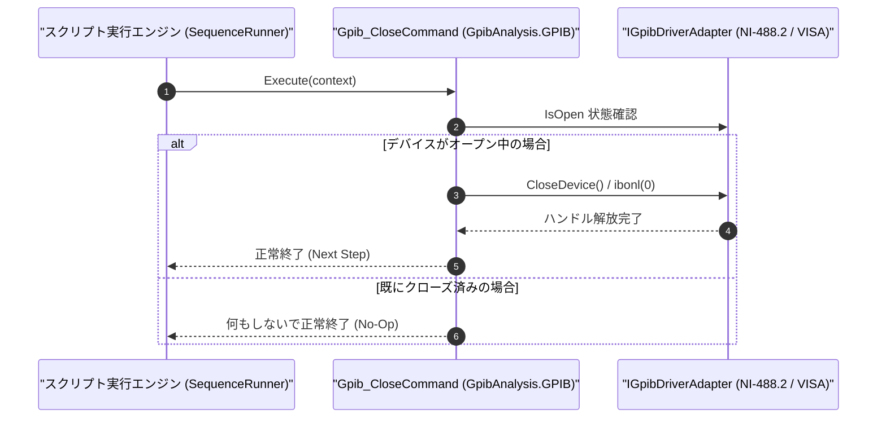

# コマンドリファレンス：Gpib_Close

## 概要

**Gpib_Close** は、現在オープンされている GPIB デバイスディスクリプタ（およびインターフェースボードハンドル）をオフライン化して解放し、GPIB 通信セッションを安全に終了するコマンドです。

> 💡 **補足**: NI-488.2 の `ibonl(ud, 0)` 相当のハンドル解放処理を行い、他のアプリケーションが GPIB バスを使用できる状態に戻します。

---

## 💡 書式・パラメータ仕様

### コマンド構文

```csv
,SEQUENCE, [ステップキー], Gpib_Close, "[BoardNum: 0]"
```

### パラメータ（引数）一覧

| 引数位置 | 引数名 | 説明 | 指定方法 / 有効な入力値 |
| :--- | :--- | :--- | :--- |
| 引数1 | `BoardNum` | 切断・オフライン化する対象の GPIB インターフェースボード番号（任意・省略時既定値: `0`）。 | `0` 以上の整数（例: `0`）または `$PARAM$` 置換 |

---

## 🔄 特殊置換規約・分岐規約の適用

本コマンドの引数における特殊記法および解釈ルールです。
* **動的置換（`$`）**: 引数内で `$PARAMキー$` のように記述すると、実行時に変数プール（PARAM）の値へ動的置換されます。（適用可能な引数: 全引数対応）
* **ジャンプ先指定（`#`）**: 本コマンドはジャンプ制御を行わないため適用されません。（適用可能な引数: 非適用）
* **共通コマンド指定（`@`）**: 本コマンドは外部マクロを呼び出さないため適用されません。（適用可能な引数: 非適用）
* **カンマのエスケープ**: SCPI コマンド等、引数文字列自体にカンマを含める場合は、必ず `","` と二重引用符で囲んで記述します。
* **エイリアス（別名）**: `Close`, `GpibClose`

---

## 💡 動作例（正しい構文での記述例）

### スクリプト記述例

※COMMAND ブロック配下の子要素行（PARAM, SEQUENCE）は必ず行頭カンマから開始し、スペースインデントや行末コメント（`;`）は記述しないでください。

```csv
COMMAND, "GPIB_SESSION_END", "IDN_RES"
,PARAM, "IDN_RES", Work, "機器識別情報", ""
,SEQUENCE, 010, Gpib_Open, 0
,SEQUENCE, 020, Gpib_SendReceive, "*IDN?", "IDN_RES"
; 測定完了後にローカル制御へ戻して GPIB ボード 0 を安全にクローズ
,SEQUENCE, 030, Gpib_GTL
,SEQUENCE, 040, Gpib_Close, 0
,SEQUENCE, 050, Exit
```

### 実行時の挙動・変数変化

* **実行前の状態**: GPIB ボード `0` がオープンされ、測定器との通信セッションが確立されている状態。
* **実行後の状態**: ステップ `040` の `Gpib_Close` 実行により GPIB ボードハンドルが解放され、接続ステータスがオフラインへ遷移します（取得済みの `"IDN_RES"` や `SBuf` データは保持されます）。

---

## 🔄 動作フロー（シーケンス図）



---

## 🚫 エラーハンドリング・安全設計（仕様制限）

1. **未オープン時の安全な無視（No-Op 保証）**:
   - `Gpib_Open` されていない状態で `Gpib_Close` を実行してもエラーにはならず、安全に正常終了します。
2. **受信バッファ（`SBuf`）データの保持**:
   - `Gpib_Close` 実行後も、すでに `SBuf` に格納されている受信データは消去されず、後続の `Set_Data` 等で参照可能です。

---

## 🧪 ユニットテスト仕様

本コマンドクラス（`Gpib_CloseCommand.cs`）に実装されている `RunUnitTest()` メソッドが検証するユニットテストの仕様です。

### テスト実行前提条件

* **実行トリガー**: `RunUnitTest()` メソッドの呼び出し
* **有効化条件**: システム全体の最小ログレベル（`ErrorLogger.MinimumLevel`）が `LogLevel.Test` であること（それ以外の場合は無効化ガードにより早期リターン）
* **検証結果出力**: `_log.LogTest` によるログ出力。検証失敗時は `_log.LogError`、予期せぬ例外発生時は `_log.LogCritical` で記録し、`finally` ブロックで実行前のボード接続状態（`OpenGpibBoards` / `CloseGpibBoards`）および `GpibDLL.DebugDLL`・`DebugReceiveData` を復元します。

### テストケース一覧

| No | テストカテゴリ | テスト条件（入力値） | 期待される結果（出力値） | 検証の目的 / 観点 |
| :---: | :--- | :--- | :--- | :--- |
| **1** | 正常系 | `GetDisconnectionStates()` 判定およびボード番号 `("0")` を指定して `Func` を実行 | `(false, ButtonStatus.Off, true)` が返却され、`!HasError` でシミュレーション切断が完了する | 切断時の UI 状態（REN オフ・赤色 LED 点灯）およびクローズ動作の検証 |
| **2** | 異常系 | 負のボード番号 `("-1")` および余剰引数 `("0", "EXTRA")` を指定して `Func` を実行 | 両ケースとも `HasError == true` かつ `IsCommandGo == false` となり安全停止する | 範囲外 `BoardNum` および引数個数超過時のバリデーション防護検証 |
