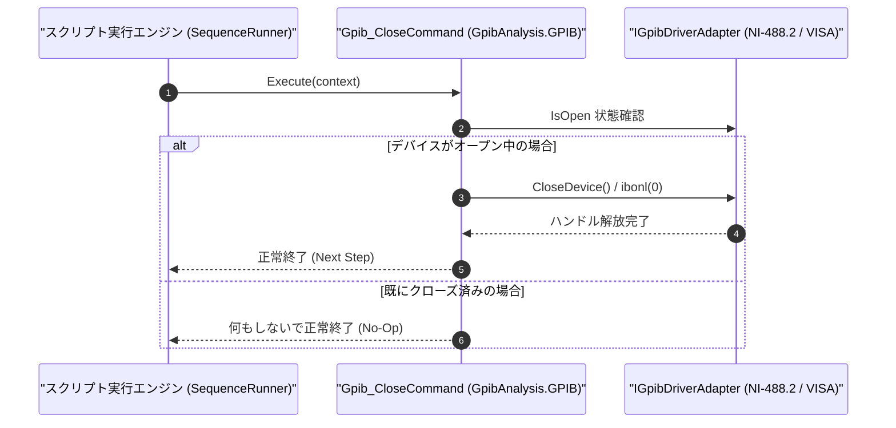

# コマンドリファレンス：Gpib_Close

---

## 概要

**Gpib_Close** は、現在オープンされている GPIB デバイスディスクリプタ（およびインターフェースボードハンドル）をオフライン化して解放し、GPIB 通信セッションを安全に終了するコマンドです。

> 💡 **補足**: NI-488.2 の `ibonl(ud, 0)` 相当のハンドル解放処理を行い、他のアプリケーションが GPIB バスを使用できる状態に戻します。

---

## 💡 書式・パラメータ仕様

### コマンド構文

```csv
,SEQUENCE,Gpib_Close
```

### パラメータ（引数）一覧

| 引数位置 | パラメータ名 | 必須/任意 | 型・制約 | 説明 |
| :--- | :--- | :---: | :--- | :--- |
| （引数なし） | - | - | - | 現在接続中の GPIB デバイスハンドルを解放・クローズします。 |

---

## 🔄 特殊置換規約・分岐規約の適用

1. **引数なしコマンド**:
   - 引数を取らないため、変数展開（`$` / `#` / `@`）は使用しません。
2. **レガシー別名互換**:
   - 旧表記の `GpibClose` や `GPIB_CLOSE` は内部正規化により本 `Gpib_Close` コマンドへマッピングされます。

---

## 💡 動作例（正しい構文での記述例）

### スクリプト記述例

```csv
,SEQUENCE,Gpib_Open, "10"
,SEQUENCE,Gpib_SendReceive, "*IDN?", "@IDN_RES"
,SEQUENCE,Set_Data, "$DEVICE_NAME", "SBuf", "1"

; 測定完了後にGPIBデバイスをローカル制御へ戻してクローズ
,SEQUENCE,Gpib_GTL
,SEQUENCE,Gpib_Close
,SEQUENCE,Exit
```

### 実行時の挙動・変数変化

1. `Gpib_GTL` で測定器をローカル操作可能状態に戻した後、`Gpib_Close` により GPIB ドライバハンドルが解放されます。

---

## 🔄 動作フロー（シーケンス図）



---

## 🚫 エラーハンドリング・安全設計（仕様制限）

1. **未オープン時の安全な無視（No-Op 保証）**:
   - `Gpib_Open` されていない状態で `Gpib_Close` を実行してもエラーにはならず、安全に正常終了します。
2. **受信バッファ（`SBuf`）データの保持**:
   - `Gpib_Close` 実行後も、すでに `SBuf` に格納されている受信データは消去されず、後続の `Set_Data` 等で参照可能です。

---

## 🧪 ユニットテスト仕様

### テスト実行前提条件
- **対象クラス**: `GpibAnalysis.GPIB.Gpib_CloseCommand`（`Gpib_CloseCommand.cs`）
- **モック環境**: `IGpibDriverAdapter` モックが注入されていること。

### テストケース一覧

| テストID | テスト観点 | 入力スクリプト | 期待される動作・検証項目 |
| :--- | :--- | :--- | :--- |
| `UT-GPIB-CLOSE-01` | 正常クローズ | `,SEQUENCE,Gpib_Close`（オープン中） | ドライバの `IsOpen` が `false` になり、ハンドルが解放されること。 |
| `UT-GPIB-CLOSE-02` | 未接続時の再クローズ | `,SEQUENCE,Gpib_Close`（未オープン時） | 例外が発生せず正常終了すること。 |

