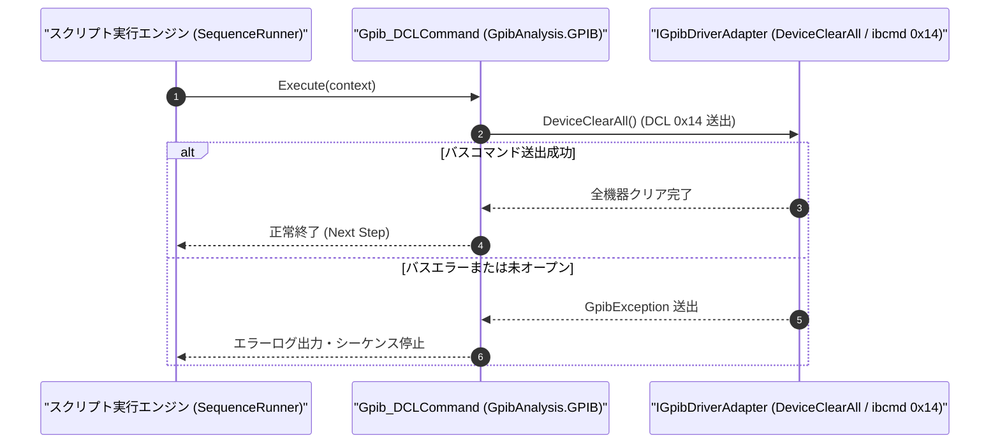

# コマンドリファレンス：Gpib_DCL

---

## 概要

**Gpib_DCL** は、GPIB バス上の全測定器に対してユニバーサルコマンド **DCL（Device Clear: `0x14`）** を一斉送出し、バスに接続されているすべてのデバイスの入出力バッファおよびコマンドパーサを初期状態へクリアするコマンドです。

> 💡 **補足**: 特定の 1 台のみをクリアしたい場合は [`Gpib_SDC`](./Gpib_SDC.Md) を使用し、バス上の全測定器を一括クリアしたい場合は本 `Gpib_DCL` を使用します。

---

## 💡 書式・パラメータ仕様

### コマンド構文

```csv
,SEQUENCE,Gpib_DCL
```

### パラメータ（引数）一覧

| 引数位置 | パラメータ名 | 必須/任意 | 型・制約 | 説明 |
| :--- | :--- | :---: | :--- | :--- |
| （引数なし） | - | - | - | バス上の全デバイスへ Device Clear (`0x14`) コマンドを送出します。 |

---

## 🔄 特殊置換規約・分岐規約の適用

1. **引数なしコマンド**:
   - 引数を取らないため、変数展開（`$` / `#` / `@`）は使用しません。
2. **レガシー別名互換**:
   - 旧表記の `GpibDCL` や `GPIB_DCL` は内部正規化により本 `Gpib_DCL` コマンドへマッピングされます。

---

## 💡 動作例（正しい構文での記述例）

### スクリプト記述例

```csv
,SEQUENCE,Gpib_Open, "1"
,SEQUENCE,Gpib_IFC
,SEQUENCE,Gpib_REN, "ON"

; バス上の全測定器のGPIBバッファを一括クリア(DCL)して測定準備を整える
,SEQUENCE,Gpib_DCL
,SEQUENCE,Wait, "100"
,SEQUENCE,Gpib_SendReceive, "*IDN?", "@DEV_ID"
,SEQUENCE,Gpib_Close
,SEQUENCE,Exit
```

### 実行時の挙動・変数変化

1. `Gpib_DCL` により ATN ラインアサート状態で `0x14`（DCL）が送出され、GPIB バス上の全機器の未読出力キューや構文エラー状態がリセットされます。

---

## 🔄 動作フロー（シーケンス図）



---

## 🚫 エラーハンドリング・安全設計（仕様制限）

1. **未オープン時の実行防止**:
   - GPIB ボード・セッションが初期化されていない状態で呼び出された場合は `InvalidOperationException` を送出します。
2. **バスエラー監視**:
   - バス上にリスナーが 1 台も存在しない場合（`ENOL`）やタイムアウト発生時は `GpibException` を送出して停止します。

---

## 🧪 ユニットテスト仕様

### テスト実行前提条件
- **対象クラス**: `GpibAnalysis.GPIB.Gpib_DCLCommand`（`Gpib_DCLCommand.cs`）
- **モック環境**: `IGpibDriverAdapter` モックが注入されていること。

### テストケース一覧

| テストID | テスト観点 | 入力スクリプト | 期待される動作・検証項目 |
| :--- | :--- | :--- | :--- |
| `UT-GPIB-DCL-01` | 正常系（DCL一斉送出） | `,SEQUENCE,Gpib_DCL` | モックドライバの `DeviceClearAll()` が呼び出されること。 |
| `UT-GPIB-DCL-02` | 大文字小文字非区別 | `,SEQUENCE,gpib_dcl` | `Gpib_DCLCommand` が正常に実行されること。 |
| `UT-GPIB-DCL-03` | 異常系（バスエラー） | モックが `GpibException` を投げる設定時 | エラーログが出力されシーケンスが停止すること。 |

