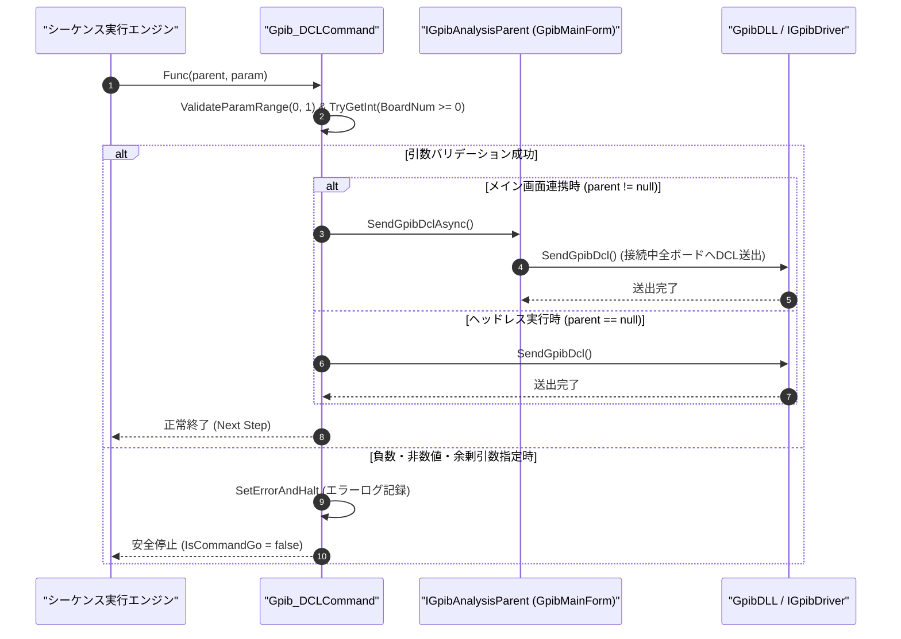

# コマンドリファレンス：Gpib_DCL

## 概要

**Gpib_DCL** は、オープン中の全 GPIB ボードに対してユニバーサルコマンド **DCL（Device Clear: `0x14`）** を一斉送出し、バスに接続されているすべてのデバイスの入出力バッファおよびコマンドパーサを初期状態へクリアするコマンドです。

> 💡 **補足**: 特定の選択中機器 1 台のみをクリアしたい場合は [`Gpib_SDC`](./Gpib_SDC.Md) を使用し、バス上の全測定器を一括クリアしたい場合は本 `Gpib_DCL` を使用します（CONTEC ドライバおよび Interface ドライバ双方でバス全体の DCL と機器単体の SDC は明確に分離されています）。

---

## 💡 書式・パラメータ仕様

### コマンド構文

```csv
,SEQUENCE, [ステップキー], Gpib_DCL, "[BoardNum: 0]"
```

### パラメータ（引数）一覧

| 引数位置 | 引数名 | 説明 | 指定方法 / 有効な入力値 |
| :--- | :--- | :--- | :--- |
| 引数1 | `BoardNum` | DCL（Device Clear）を送出する GPIB ボード番号（任意・省略時既定値: `0`）。※引数バリデーション（`0` 以上の整数）のみ行われ、実際の送出はオープン中の全 GPIB ボードに対して一括実行されます。 | `0` 以上の整数（例: `0`）または `$PARAM$` 置換 |

---

## 🔄 特殊置換規約・分岐規約の適用

本コマンドの引数における特殊記法および解釈ルールです。
* **動的置換（`$`）**: 引数内で `$PARAMキー$` のように記述すると、実行時に変数プール（PARAM）の値へ動的置換されます。（適用可能な引数: 全引数対応）
* **ジャンプ先指定（`#`）**: 本コマンドはジャンプ制御を行わないため適用されません。（適用可能な引数: 非適用）
* **共通コマンド指定（`@`）**: 本コマンドは外部マクロを呼び出さないため適用されません。（適用可能な引数: 非適用）
* **カンマのエスケープ**: SCPI コマンド等、引数文字列自体にカンマを含める場合は、必ず `","` と二重引用符で囲んで記述します。
* **エイリアス（別名）**: `DCL`, `GpibDCL`

---

## 💡 動作例（正しい構文での記述例）

### スクリプト記述例

※COMMAND ブロック配下の子要素行（PARAM, SEQUENCE）は必ず行頭カンマ（`,`）から開始してください（行頭スペースのみでは認識されません）。なお、`;` で始まる行やクォート外の `;` 以降はコメントとして自動除去されます。

```csv
COMMAND, "SAMPLE_GPIB_DCL", "DEV_ID"
,PARAM, "DEV_ID", Work, "機器識別情報", ""
,SEQUENCE, 010, Gpib_Open, 0
,SEQUENCE, 020, Gpib_IFC
,SEQUENCE, 030, Gpib_REN, "ON"
; バス上の全測定器のGPIBバッファを一括クリア(DCL)して測定準備を整える
,SEQUENCE, 040, Gpib_DCL
,SEQUENCE, 050, Wait, "100"
,SEQUENCE, 060, Gpib_SendReceive, "*IDN?", "DEV_ID"
,SEQUENCE, 070, Gpib_Close
,SEQUENCE, 080, Exit
```

### 実行時の挙動・変数変化

* **実行前の状態**: GPIB 通信環境および対象コマンドの PARAM 初期値が設定され、ステップ実行待機中である状態。
* **実行後の状態**: `Gpib_DCL` によりオープン中の全 GPIB ボードからユニバーサルコマンド DCL（Interface ドライバ時はボード ID に対する `PciGpibExExecDevClear`）が送出され、GPIB バス上の全機器の未読出力キューや構文エラー状態がリセットされます。

---

## 🔄 動作フロー（シーケンス図）



---

## 🚫 エラーハンドリング・安全設計（仕様制限）

1. **引数境界・型バリデーション保護**:
   - `ValidateParamRange(0, 1)` 違反（2 個以上の引数指定）または `BoardNum` に負数・非数値文字列が指定された場合は、`SetErrorAndHalt` によりエラーログを出力してシーケンスを安全停止します。
2. **未接続・物理ドライバエラー時の継続設計**:
   - ポート未接続時（`CanSendDcl == false`）は物理送出を安全にスキップします。また、ドライバ API がエラーコードを返した場合は `GpibDLL` 内でエラーログを記録しますが、例外クラッシュや強制停止は行わず次ステップへ継続します（予期せぬランタイム例外発生時のみ `_log.LogCritical` と `SetErrorAndHalt(-1, ex.Message)` で安全停止します）。

---

## 🧪 ユニットテスト仕様

本コマンドクラス（`Gpib_DCLCommand.cs`）に実装されている `RunUnitTest()` メソッドが検証するユニットテストの仕様です。

### テスト実行前提条件

* **実行トリガー**: `RunUnitTest()` メソッドの呼び出し
* **有効化条件**: システム全体の最小ログレベル（`ErrorLogger.MinimumLevel`）が `LogLevel.Test` であること（それ以外の場合は無効化ガードにより早期リターン）
* **検証結果出力**: `_log.LogTest` によるログ出力。検証失敗時は `_log.LogError`、予期せぬ例外発生時は `_log.LogCritical` で記録し、`finally` ブロックで `GpibDLL.DebugDLL` および `GpibDLL.DebugReceiveData` を元の状態へ復元します。

### テストケース一覧

| No | テストカテゴリ | テスト条件（入力値） | 期待される結果（出力値） | 検証の目的 / 観点 |
| :---: | :--- | :--- | :--- | :--- |
| **1** | 正常系 | `CanSendDcl(true)`（接続中）および `CanSendDcl(false)`（未接続）を実行 | 接続中は `true`、未接続時は `false` を返す | 回線接続状態に応じた DCL 送出可否判定の検証 |
| **2** | 正常系 | `GetButtonUiState(true)`（処理中）および `GetButtonUiState(false)`（待機中）を実行 | 処理中は `(false, Color.Aqua)`、待機中は `(true, Color.Gainsboro)` を返す | DCL 送出中の UI ボタン活性・背景色制御の検証 |
| **3** | 異常系 | 非数値ボード番号 `("INVALID")` を指定して `Func` を実行 | `HasError == true` かつ `IsCommandGo == false` となり安全停止する | 不正な `BoardNum` 指定時の型変換エラー停止検証 |
