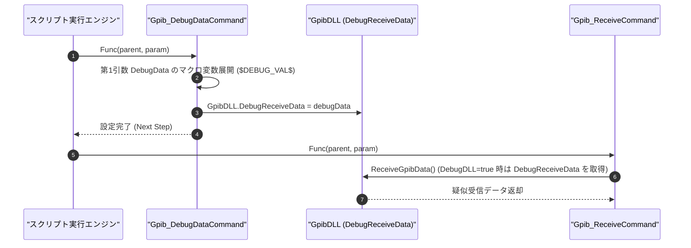

# コマンドリファレンス：Gpib_DebugData

---

## 概要

**Gpib_DebugData**（別名：`DebugData`）は、デバッグシミュレーション実行モード（`GpibDLL.DebugDLL = true`）において、直後の `Gpib_Receive`（または `Gpib_ReceiveDirect` / `Gpib_SendReceive`）が読み取る疑似受信データ（`GpibDLL.DebugReceiveData`）を事前設定するコマンドです。

> 💡 **補足**: 実機（GPIBボードおよび測定器）が未接続の環境であっても、Excel シート上のパラメータ（`Text` 型等）から任意の模擬応答データを注入し、マクロスクリプトのパース処理（`Set_Data`）やループ制御を完全に検証できます。

---

## 💡 書式・パラメータ仕様

### コマンド構文

```csv
,SEQUENCE, [ステップキー], Gpib_DebugData, "[DebugData]"
```

### パラメータ（引数）一覧

| 引数位置 | パラメータ名 | 必須/任意 | 型・制約 | 説明 |
| :---: | :--- | :---: | :--- | :--- |
| 第1引数 | `DebugData` | 任意 | 文字列（既定値: `""`） | `GpibDLL.DebugReceiveData` にセットする疑似受信データ文字列（例: `"+1.23456E+00"`, `"$DEBUG_VAL$"`）を指定します。 |

---

## 🔄 特殊置換規約・分岐規約の適用

1. **変数展開（`$`）**:
   - 第 1 引数 `DebugData` には `$DEBUG_VAL$` のように `PARAM` キーを指定可能です。Excel アドインから模擬データを変更できるよう、対象パラメータは `Work` 型ではなく `Text` 型（または `Value` 型）で定義することを推奨します。
2. **配置順序の鉄則**:
   - `Gpib_Receive` が実行される直前のステップに配置してください（`Gpib_Receive` の後に記述しても直前の受信処理には反映されません）。
3. **レガシー別名互換**:
   - `DebugData` および `GpibDebugData` は本 `Gpib_DebugData` コマンドと同一コマンドとして動作します。

---

## 💡 動作例（正しい構文での記述例）

### スクリプト記述例

```csv
COMMAND, "MEAS_VOLT", "RESULT_DATA"
,PARAM, "RESULT_DATA", Range, "測定データ結果", ""
,PARAM, "DEBUG_VAL", Text, "デバッグ疑似データ", "+1.23456E+00"
,SEQUENCE, 10, Gpib_Send, ":MEASure?"
,SEQUENCE, 20, Gpib_DebugData, "$DEBUG_VAL$"
,SEQUENCE, 30, Gpib_Receive
,SEQUENCE, 40, Set_Data, "RESULT_DATA", "R:%f", "%0.6f"
,SEQUENCE, 50, Exit
```

### 実行時の挙動・変数変化

1. `Gpib_DebugData, "$DEBUG_VAL$"` により、`GpibDLL.DebugReceiveData` に `"+1.23456E+00"` が格納されます。
2. 直後の `Gpib_Receive` 実行時、デバッグモード（`DebugDLL = true`）であれば `"R:+1.23456E+00"` が受信バッファへ格納され、`Set_Data` により `"1.234560"` が `"RESULT_DATA"` に格納されます。

---

## 🔄 動作フロー（シーケンス図）



---

## 🧪 ユニットテスト仕様

### テスト実行前提条件
- **対象クラス**: `Monaca.GPIB.Analysis.GPIB.Gpib_DebugDataCommand`（`Gpib_DebugDataCommand.cs`）
- **検証内容**: 第 1 引数に指定した文字列が `GpibDLL.DebugReceiveData` に正しく設定され、テスト完了後に元の値へ復元されることを検証します。
