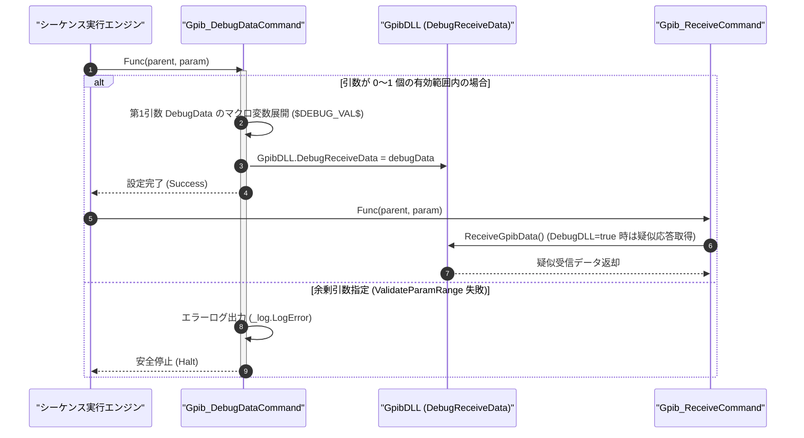

# コマンドリファレンス：Gpib_DebugData

## 概要

**Gpib_DebugData** （別名：`DebugData`）は、デバッグシミュレーション実行モード（`GpibDLL.DebugDLL = true`）において、直後の `Gpib_Receive`（または `Gpib_ReceiveDirect` / `Gpib_SendReceive`）が読み取る疑似受信データ（`GpibDLL.DebugReceiveData`）を事前設定するコマンドです。

> 💡 **補足**: 実機（GPIBボードおよび測定器）が未接続の環境であっても、Excel シート上のパラメータ（`Text` 型等）から任意の模擬応答データを注入し、マクロスクリプトのパース処理（`Set_Data`）やループ制御を完全に検証できます。

---

## 💡 書式・パラメータ仕様

### コマンド構文

```csv
,SEQUENCE, [ステップキー], Gpib_DebugData, "[DebugData]"
```

### パラメータ（引数）一覧

| 引数位置 | パラメータ名 | 必須/任意 | 型・制約 | 説明 |
| :---: | :--- | :---: | :--- | :--- |
| 第1引数 | `DebugData` | 任意 | 文字列（既定値: `""`） | `GpibDLL.DebugReceiveData` にセットする疑似受信データ文字列（例: `"+1.23456E+00"`, `"$DEBUG_VAL$"`）を指定します。 |

---

## 🔄 特殊置換規約・分岐規約の適用

本コマンドの引数における特殊記法および解釈ルールです。
* **動的置換（`$`）**: 引数内で `$PARAMキー$` のように記述すると、実行時に変数プール（PARAM）の値へ動的置換されます。（適用可能な引数: 全引数対応）
* **ジャンプ先指定（`#`）**: 本コマンドはジャンプ制御を行わないため適用されません。（適用可能な引数: 非適用）
* **共通コマンド指定（`@`）**: 本コマンドは外部マクロを呼び出さないため適用されません。（適用可能な引数: 非適用）
* **カンマのエスケープ**: SCPI コマンド等、引数文字列自体にカンマを含める場合は、必ず `","` と二重引用符で囲んで記述します。
* **エイリアス（別名）**: `DebugData`, `GpibDebugData`

---

## 💡 動作例（正しい構文での記述例）

### スクリプト記述例

※COMMAND ブロック配下の子要素行（PARAM, SEQUENCE）は必ず行頭カンマ（`,`）から開始してください（行頭スペースのみでは認識されません）。なお、`;` で始まる行やクォート外の `;` 以降はコメントとして自動除去されます。

```csv
COMMAND, "MEAS_VOLT_SIM", "RESULT_DATA"
,PARAM, "RESULT_DATA", Range, "測定データ結果", ""
,PARAM, "DEBUG_VAL", Text, "デバッグ疑似データ", "+1.23456E+00"
,SEQUENCE, 010, Gpib_Send, ":MEASure?"
,SEQUENCE, 020, Gpib_DebugData, "$DEBUG_VAL$"
,SEQUENCE, 030, Gpib_Receive, "RESULT_DATA"
,SEQUENCE, 040, Exit
```

### 実行時の挙動・変数変化

* **実行前の状態**: デバッグシミュレーションモード（`GpibDLL.DebugDLL == true`）で、`"DEBUG_VAL"` に `"+1.23456E+00"` が設定されている状態。
* **実行後の状態**: ステップ `020` で `GpibDLL.DebugReceiveData` に `"+1.23456E+00"` が登録され、直後のステップ `030`（`Gpib_Receive`）で模擬応答として `"RESULT_DATA"` に格納されます。

---

## 🔄 動作フロー（シーケンス図）



---

## 🚫 エラーハンドリング・安全設計（仕様制限）

入力データの異常や実行時エラーに対し、解析・実行エンジンが実行するセーフティ規約です。

1. **実機通信モード時の非干渉安全設計**:
   - 実機ドライバ接続時（`GpibDLL.DebugDLL == false`）に本コマンドが残っていても物理バスへ不要な信号を送出せず、実機からの正式な受信データを優先します。
2. **引数個数超過時の事前バリデーション保護**:
   - `ValidateParamRange(0, 1)` により 2 個以上の不正な引数が指定された場合はエラーログを記録して安全に停止します。

---

## 🧪 ユニットテスト仕様

本コマンドクラス（`Gpib_DebugDataCommand.cs`）に実装されている `RunUnitTest()` メソッドが検証するユニットテストの仕様です。

### テスト実行前提条件

* **実行トリガー**: `RunUnitTest()` メソッドの呼び出し
* **有効化条件**: システム全体の最小ログレベル（`ErrorLogger.MinimumLevel`）が `LogLevel.Test` であること（それ以外の場合は無効化ガードにより早期リターン）
* **検証結果出力**: `_log.LogTest` によるログ出力。検証失敗時は `_log.LogError`、予期せぬ例外発生時は `_log.LogCritical` で記録し、`finally` ブロックで `DebugReceiveData` を元の状態へ復元します。

### テストケース一覧

| No | テストカテゴリ | テスト条件（入力値） | 期待される結果（出力値） | 検証の目的 / 観点 |
| :---: | :--- | :--- | :--- | :--- |
| **1** | 正常系 | 疑似応答文字列 `("TestParamValue")` を指定して `Func` を実行 | `!HasError` かつ `GpibDLL.DebugReceiveData == "TestParamValue"` となる | デバッグ疑似受信データ注入の検証 |
| **2** | 異常系 | 余剰引数 2 個 `("Val1", "ExtraInvalidArg")` を指定して `Func` を実行 | `HasError == true` かつ `IsCommandGo == false` となり安全停止する | 引数境界バリデーション（`ValidateParamRange(0, 1)`）と状態復元の検証 |
