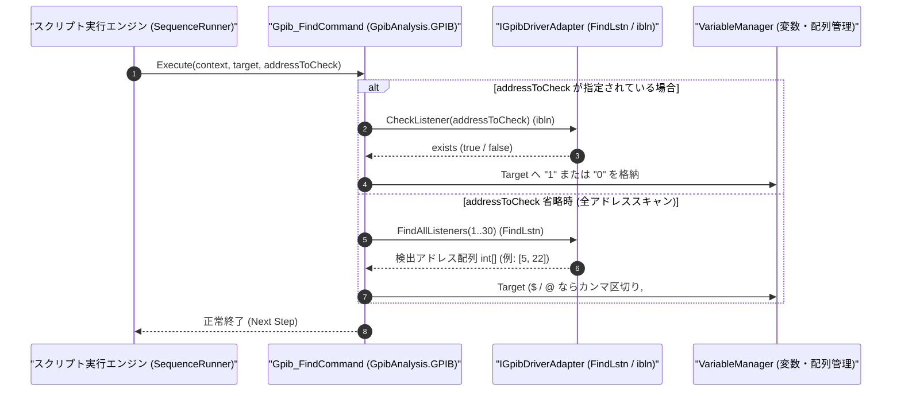

# コマンドリファレンス：Gpib_Find

---

## 概要

**Gpib_Find** は、GPIB バス上（プライマリアドレス `1`〜`30`）をスキャンして応答可能なリスナー機器（接続されている測定器）を検索（NI-488.2 `FindLstn` / `ibln` 相当）し、検出されたアドレス一覧または指定アドレスの存在有無をターゲット変数（または配列）へ格納するコマンドです。

> 💡 **補足**: シーケンス開始前の測定器接続確認（電源入れ忘れや GPIB ケーブル抜けの自動チェック）に使用します。

---

## 💡 書式・パラメータ仕様

### コマンド構文

```csv
,SEQUENCE,Gpib_Find, "[Target]", "[AddressToCheck]"
```

### パラメータ（引数）一覧

| 引数位置 | パラメータ名 | 必須/任意 | 型・制約 | 説明 |
| :---: | :--- | :---: | :--- | :--- |
| 第1引数 | `Target` | 任意 | 変数名（`$` / `@`）または配列名（`#`） | 検出結果を格納するターゲットを指定します。<br>・第2引数省略時：検出された全アドレスのカンマ区切り文字列（例: `"1,5,22"`）または配列要素を格納します。<br>・第2引数指定時：該当アドレスが存在すれば `"1"`（または `"TRUE"`）、不在なら `"0"`（`"FALSE"`）を格納します。 |
| 第2引数 | `AddressToCheck` | 任意 | 整数（`0`〜`30`） | 特定の GPIB アドレス 1 台のみの存在確認を行いたい場合にそのアドレスを指定します。 |

---

## 🔄 特殊置換規約・分岐規約の適用

1. **スカラー変数・配列の双方への出力対応**:
   - 第 1 引数に `#FOUND_LIST`（配列）を指定すると、検出された各アドレスが `#FOUND_LIST[0]`, `#FOUND_LIST[1]`, ... に格納されます。
2. **レガシー別名互換**:
   - 旧表記の `GpibFind` や `GPIB_FIND` は内部正規化により本 `Gpib_Find` コマンドへマッピングされます。

---

## 💡 動作例（正しい構文での記述例）

### スクリプト記述例

```csv
,PARAM,IS_DMM_ALIVE,0
,PARAM,ALL_LISTENERS,

,SEQUENCE,Gpib_Init
; 1. アドレス22のマルチメータがバス上に存在するか確認
,SEQUENCE,Gpib_Find, "$IS_DMM_ALIVE", "22"
,SEQUENCE,Judge, "$IS_DMM_ALIVE", "==", "0", "DEV_NOT_FOUND"

; 2. バス上の全接続機器アドレス一覧を取得して $ALL_LISTENERS へ格納
,SEQUENCE,Gpib_Find, "$ALL_LISTENERS"
,SEQUENCE,Exit

:DEV_NOT_FOUND
,SEQUENCE,Msg_Box, "エラー：GPIBアドレス22の測定器が見つかりません（電源を確認してください）"
,SEQUENCE,Exit
```

### 実行時の挙動・変数変化

1. 1 回目の `Gpib_Find` ではアドレス `22` に対してリスナー存在チェックが行われ、応答があれば `$IS_DMM_ALIVE` に `"1"`、なければ `"0"` が格納されます。
2. 2 回目の `Gpib_Find` ではアドレス `1`〜`30` が走査され、応答した機器のアドレス一覧（例: `"5,22"`）が `$ALL_LISTENERS` に格納されます。

---

## 🔄 動作フロー（シーケンス図）



---

## 🚫 エラーハンドリング・安全設計（仕様制限）

1. **未検出時の安全な結果格納**:
   - バス上に機器が 1 台も見つからない場合でも例外でクラッシュせず、空文字列 `""`（または個別チェック時は `"0"`）を格納して `Judge` で分岐処理できるようにします。
2. **アドレス範囲（`0`〜`30`）の検証**:
   - 第 2 引数に範囲外の数値が指定された場合は `ArgumentOutOfRangeException` を送出します。

---

## 🧪 ユニットテスト仕様

### テスト実行前提条件
- **対象クラス**: `GpibAnalysis.GPIB.Gpib_FindCommand`（`Gpib_FindCommand.cs`）
- **モック環境**: アドレス `5` と `22` が存在すると応答する `IGpibDriverAdapter` モックが注入されていること。

### テストケース一覧

| テストID | テスト観点 | 入力スクリプト | 期待される動作・検証項目 |
| :--- | :--- | :--- | :--- |
| `UT-GPIB-FIND-01` | 全リスナー検索 | `,SEQUENCE,Gpib_Find, "$LIST"` | `$LIST` に `"5,22"` が格納されること。 |
| `UT-GPIB-FIND-02` | 特定アドレス存在確認（あり） | `,SEQUENCE,Gpib_Find, "$EX", "22"` | `$EX` に `"1"` が格納されること。 |
| `UT-GPIB-FIND-03` | 特定アドレス存在確認（なし） | `,SEQUENCE,Gpib_Find, "$EX", "10"` | `$EX` に `"0"` が格納されること。 |

