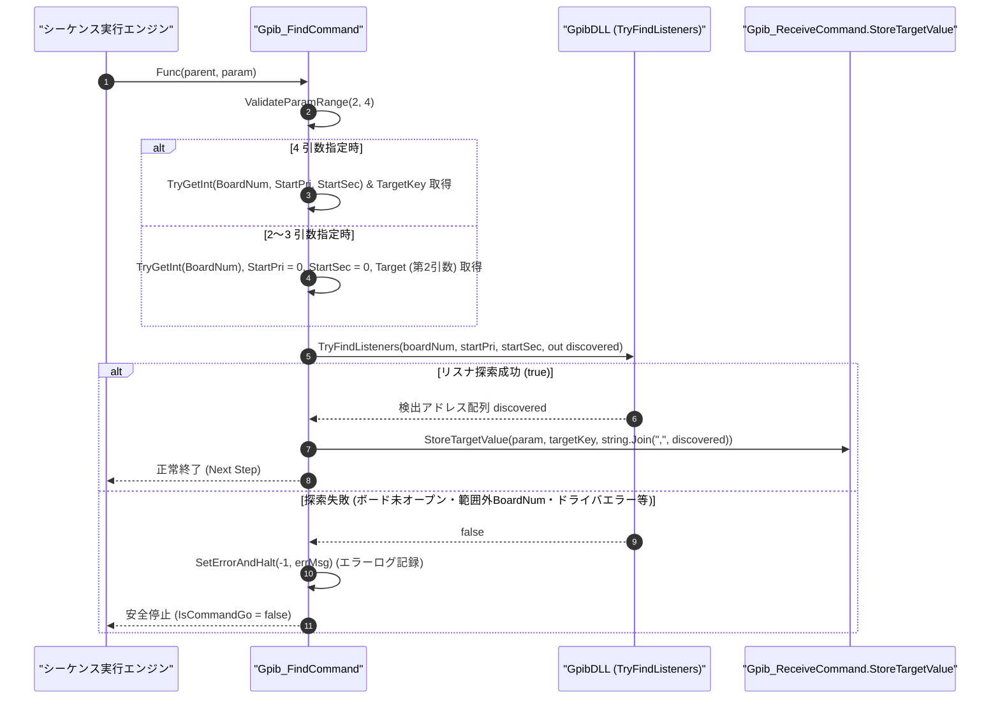

# コマンドリファレンス：Gpib_Find

## 概要

**Gpib_Find** は、指定した GPIB ボード上のバスをスキャンして応答可能なリスナー機器（接続されている測定器）を検索（`GpibDLL.TryFindListeners`）し、検出されたアドレス一覧をカンマ区切り文字列として指定変数へ格納するコマンドです。

> 💡 **補足**: シーケンス開始前の測定器接続確認（電源入れ忘れや GPIB ケーブル抜けの自動チェック）に使用します。

---

## 💡 書式・パラメータ仕様

### コマンド構文

```csv
; 短縮 2 引数構文（探索開始プライマリ 0 / セカンダリ 0 固定）
,SEQUENCE, [ステップキー], Gpib_Find, [BoardNum], [Target]

; 完全 4 引数構文（探索開始プライマリ・セカンダリアドレス指定）
,SEQUENCE, [ステップキー], Gpib_Find, [BoardNum], [StartPri], [StartSec], [TargetKey]
```

### パラメータ（引数）一覧

| 引数位置 | 引数名 | 説明 | 指定方法 / 有効な入力値 |
| :--- | :--- | :--- | :--- |
| 引数1 | `BoardNum` | リスナ探索を行う GPIB ボード番号（必須。`ParameterSpec` 上の制約は `min: 0` の整数、`Func` 実行時は整数型検証後に負数指定時は `TryFindListeners` が `false` を返し安全停止）。 | `0` 以上の整数（例: `0`）または `$PARAM$` 置換 |
| 引数2 | `StartPriOrTarget` | `ParameterSpec` 上は必須文字列。<br> **2〜3 引数指定時** ：検出結果の格納先キー名（`Target` 必須、`StartPri=0` / `StartSec=0` として動作）。<br> **4 引数指定時** ：探索開始プライマリアドレス（`StartPri`：`Func` 内で整数検証、既定値 `0`）。 | 格納先 `PARAM` キー名（2〜3 引数時）、または整数（4 引数時） |
| 引数3 | `StartSec` | `ParameterSpec` 上は任意整数（`min: 0`, `defaultValue: 0`）。<br> **4 引数指定時** ：探索開始セカンダリアドレス（`Func` 内で整数検証、既定値 `0`）。※ 3 引数指定時は `Func` 内で第 3 引数は参照されないため、2 引数または 4 引数で指定してください。 | `0` 以上の整数（例: `0`） |
| 引数4 | `TargetKey` | **4 引数指定時** ：検出リスナ一覧の格納先パラメータキー名（必須）。 | 格納先 `PARAM` キー名 |

---

## 🔄 特殊置換規約・分岐規約の適用

本コマンドの引数における特殊記法および解釈ルールです。
* **動的置換（`$`）**: 引数内で `$PARAMキー$` のように記述すると、実行時に変数プール（PARAM）の値へ動的置換されます。（適用可能な引数: 全引数対応）
* **ジャンプ先指定（`#`）**: 本コマンドはジャンプ制御を行わないため適用されません。（適用可能な引数: 非適用）
* **共通コマンド指定（`@`）**: 本コマンドは外部マクロを呼び出さないため適用されません。（適用可能な引数: 非適用）
* **カンマのエスケープ**: SCPI コマンド等、引数文字列自体にカンマを含める場合は、必ず `","` と二重引用符で囲んで記述します。
* **エイリアス（別名）**: `Find`, `GpibFind`

---

## 💡 動作例（正しい構文での記述例）

### スクリプト記述例

※COMMAND ブロック配下の子要素行（PARAM, SEQUENCE）は必ず行頭カンマ（`,`）から開始してください（行頭スペースのみでは認識されません）。なお、`;` で始まる行やクォート外の `;` 以降はコメントとして自動除去されます。

```csv
COMMAND, "SCAN_GPIB_BUS", "ALL_LISTENERS"
,PARAM, "ALL_LISTENERS", Work, "検出アドレス一覧", ""
,SEQUENCE, 010, Gpib_Open, 0
; ボード 0 上のアクティブなリスナを探索して ALL_LISTENERS へ格納
,SEQUENCE, 020, Gpib_Find, 0, "ALL_LISTENERS"
; Judge は条件不成立時にジャンプするため、空文字と異なる(NEQ)＝発見成功なら次行へ、空文字(不成立)なら #NO_DEVICE# へ分岐
,SEQUENCE, 030, Judge, NEQ, "$ALL_LISTENERS$", "", #NO_DEVICE#
,SEQUENCE, 040, Exit
,SEQUENCE, #NO_DEVICE#, Msg_Box, "GPIBバス上に応答する測定器が見つかりません。"
,SEQUENCE, 060, Exit
```

### 実行時の挙動・変数変化

* **実行前の状態**: GPIB ボード `0` がオープン済みで、`"ALL_LISTENERS"` が空文字列 `""` の状態。
* **実行後の状態**: ステップ `020` の `Gpib_Find` によりバス上の応答機器アドレス一覧がカンマ区切り文字列（例: `"1,5,22"`、応答機器 0 台時は `""`）として `"ALL_LISTENERS"` に格納されます。ステップ `030` の `Judge, NEQ` により、機器が 1 台以上見つかっていればステップ `040` で正常終了し、1 台も見つからず `""` の場合（`NEQ` 不成立）は `#NO_DEVICE#` へジャンプして警告を表示します。

---

## 🔄 動作フロー（シーケンス図）



---

## 🚫 エラーハンドリング・安全設計（仕様制限）

1. **引数個数・数値型バリデーション保護**:
   - `ValidateParamRange(2, 4)` により引数が 1 個以下または 5 個以上の場合、および `BoardNum`（4 引数時は `StartPri`・`StartSec` も含む）が整数変換できない場合や格納先キー名が空文字列の場合は、`TryGetInt` / `TryGetString` 内のエラー処理によりエラーログを出力して安全停止します。
2. **探索結果の格納形式とドライバ失敗時の安全停止**:
   - 探索自体は成功して応答機器が 0 台だった場合は空文字列 `""` が格納されるため、後続の `Judge` コマンド（`NEQ` 判定）で未接続分岐を行えます。一方、負の `BoardNum` 指定・ボード未初期化・ハードウェア異常により `GpibDLL.TryFindListeners` が `false` を返した場合は `_log.LogError` を記録し、`SetErrorAndHalt(-1, errMsg)` により後続ステップを安全停止します。

---

## 🧪 ユニットテスト仕様

本コマンドクラス（`Gpib_FindCommand.cs`）に実装されている `RunUnitTest()` メソッドが検証するユニットテストの仕様です。

### テスト実行前提条件

* **実行トリガー**: `RunUnitTest()` メソッドの呼び出し
* **有効化条件**: システム全体の最小ログレベル（`ErrorLogger.MinimumLevel`）が `LogLevel.Test` であること（それ以外の場合は無効化ガードにより早期リターン）
* **検証結果出力**: `_log.LogTest` によるログ出力。検証失敗時は `_log.LogError`、予期せぬ例外発生時は `_log.LogCritical` で記録し、`finally` ブロックで実行前のボード接続状態（`OpenGpibBoards` / `CloseGpibBoards`）および `GpibDLL.DebugDLL`・`DebugReceiveData` を復元します。

### テストケース一覧

| No | テストカテゴリ | テスト条件（入力値） | 期待される結果（出力値） | 検証の目的 / 観点 |
| :---: | :--- | :--- | :--- | :--- |
| **1** | 正常系 | 2 引数指定 `("0", "FOUND_LIST")` および 4 引数指定 `("0", "1", "0", "FOUND_LIST4")` で `Func` を実行 | 両ケースとも `!HasError` となり、`Variables["FOUND_LIST"]` および `Variables["FOUND_LIST4"]` に探索結果が格納される | 短縮 2 引数構文・完全 4 引数構文でのリスナ探索および変数格納の検証 |
| **2** | 異常系 | 引数不足の 1 引数指定 `("0")` および非数値ボード番号 `("INVALID", "FOUND_LIST")` で `Func` を実行 | 両ケースとも `HasError == true` かつ `IsCommandGo == false` となり安全停止する | 引数個数不足（`ValidateParamRange(2, 4)`）および型変換エラー時の安全停止検証 |
