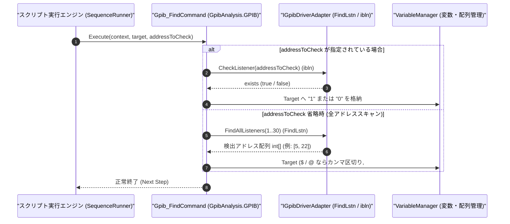

# コマンドリファレンス：Gpib_Find

## 概要

**Gpib_Find** は、GPIB バス上（プライマリアドレス `1`〜`30`）をスキャンして応答可能なリスナー機器（接続されている測定器）を検索（NI-488.2 `FindLstn` / `ibln` 相当）し、検出されたアドレス一覧または指定アドレスの存在有無をターゲット変数（または配列）へ格納するコマンドです。

> 💡 **補足**: シーケンス開始前の測定器接続確認（電源入れ忘れや GPIB ケーブル抜けの自動チェック）に使用します。

---

## 💡 書式・パラメータ仕様

### コマンド構文

```csv
,SEQUENCE, [ステップキー], Gpib_Find, [BoardNum], [StartPriOrTarget], "[StartSec]", "[TargetKey]"
```

### パラメータ（引数）一覧

| 引数位置 | 引数名 | 説明 | 指定方法 / 有効な入力値 |
| :--- | :--- | :--- | :--- |
| 引数1 | `BoardNum` | リスナ探索を行う GPIB ボード番号（必須・既定値: `0`）。 | `0` 以上の整数（例: `0`）または `$PARAM$` 置換 |
| 引数2 | `StartPri` / `Target` | 4 引数指定時は探索開始プライマリアドレス（`0`〜`30`）、2 引数短縮指定時は検出結果の格納先キー（必須）。 | 整数（`0`〜`30`）または格納先 `PARAM` キー名 |
| 引数3 | `StartSec` | 4 引数指定時の探索開始セカンダリアドレス（任意・省略可・不使用時は `0`）。 | 整数（`0` または `96`〜`126`） |
| 引数4 | `TargetKey` | 4 引数指定時における検出リスナ一覧の格納先パラメータキー名（任意・2 引数指定時は省略）。 | 格納先 `PARAM` キー名 |

---

## 🔄 特殊置換規約・分岐規約の適用

本コマンドの引数における特殊記法および解釈ルールです。
* **動的置換（`$`）**: 引数内で `$PARAMキー$` のように記述すると、実行時に変数プール（PARAM）の値へ動的置換されます。（適用可能な引数: 全引数対応）
* **ジャンプ先指定（`#`）**: 本コマンドはジャンプ制御を行わないため適用されません。（適用可能な引数: 非適用）
* **共通コマンド指定（`@`）**: 本コマンドは外部マクロを呼び出さないため適用されません。（適用可能な引数: 非適用）
* **カンマのエスケープ**: SCPI コマンド等、引数文字列自体にカンマを含める場合は、必ず `","` と二重引用符で囲んで記述します。
* **エイリアス（別名）**: `Find`, `GpibFind`

---

## 💡 動作例（正しい構文での記述例）

### スクリプト記述例

※COMMAND ブロック配下の子要素行（PARAM, SEQUENCE）は必ず行頭カンマから開始し、スペースインデントや行末コメント（`;`）は記述しないでください。

```csv
COMMAND, "SCAN_GPIB_BUS", "ALL_LISTENERS"
,PARAM, "ALL_LISTENERS", Work, "検出アドレス一覧", ""
,SEQUENCE, 010, Gpib_Init, 0
; ボード 0 上のアクティブなリスナを探索して ALL_LISTENERS へ格納
,SEQUENCE, 020, Gpib_Find, 0, "ALL_LISTENERS"
,SEQUENCE, 030, Judge, EQU, "$ALL_LISTENERS$", "", #NO_DEVICE#
,SEQUENCE, 040, Exit
,SEQUENCE, #NO_DEVICE#, Msg_Box, "GPIBバス上に応答する測定器が見つかりません。"
,SEQUENCE, 060, Exit
```

### 実行時の挙動・変数変化

* **実行前の状態**: GPIB ボード `0` が初期化済みで、`"ALL_LISTENERS"` が空文字列 `""` の状態。
* **実行後の状態**: ステップ `020` の `Gpib_Find` によりバス上の応答機器アドレス一覧（例: `"1,5,22"`）が `"ALL_LISTENERS"` に格納されます。

---

## 🔄 動作フロー（シーケンス図）



---

## 🚫 エラーハンドリング・安全設計（仕様制限）

1. **未検出時の安全な結果格納**:
   - バス上に機器が 1 台も見つからない場合でも例外でクラッシュせず、空文字列 `""`（または個別チェック時は `"0"`）を格納して `Judge` で分岐処理できるようにします。
2. **アドレス範囲（`0`〜`30`）の検証**:
   - 第 2 引数に範囲外の数値が指定された場合は `ArgumentOutOfRangeException` を送出します。

---

## 🧪 ユニットテスト仕様

本コマンドクラス（`Gpib_FindCommand.cs`）に実装されている `RunUnitTest()` メソッドが検証するユニットテストの仕様です。

### テスト実行前提条件

* **実行トリガー**: `RunUnitTest()` メソッドの呼び出し
* **有効化条件**: システム全体の最小ログレベル（`ErrorLogger.MinimumLevel`）が `LogLevel.Test` であること（それ以外の場合は無効化ガードにより早期リターン）
* **検証結果出力**: `_log.LogTest` によるログ出力。検証失敗時は `_log.LogError`、予期せぬ例外発生時は `_log.LogCritical` で記録し、`finally` ブロックで実行前のボード接続状態（`OpenGpibBoards` / `CloseGpibBoards`）および `GpibDLL.DebugDLL`・`DebugReceiveData` を復元します。

### テストケース一覧

| No | テストカテゴリ | テスト条件（入力値） | 期待される結果（出力値） | 検証の目的 / 観点 |
| :---: | :--- | :--- | :--- | :--- |
| **1** | 正常系 | 2 引数指定 `("0", "FOUND_LIST")` および 4 引数指定 `("0", "1", "0", "FOUND_LIST4")` で `Func` を実行 | 両ケースとも `!HasError` となり、`Variables["FOUND_LIST"]` および `Variables["FOUND_LIST4"]` に探索結果が格納される | 短縮 2 引数構文・完全 4 引数構文でのリスナ探索および変数格納の検証 |
| **2** | 異常系 | 引数不足の 1 引数指定 `("0")` および非数値ボード番号 `("INVALID", "FOUND_LIST")` で `Func` を実行 | 両ケースとも `HasError == true` かつ `IsCommandGo == false` となり安全停止する | 引数個数不足（`ValidateParamRange(2, 4)`）および型変換エラー時の安全停止検証 |
