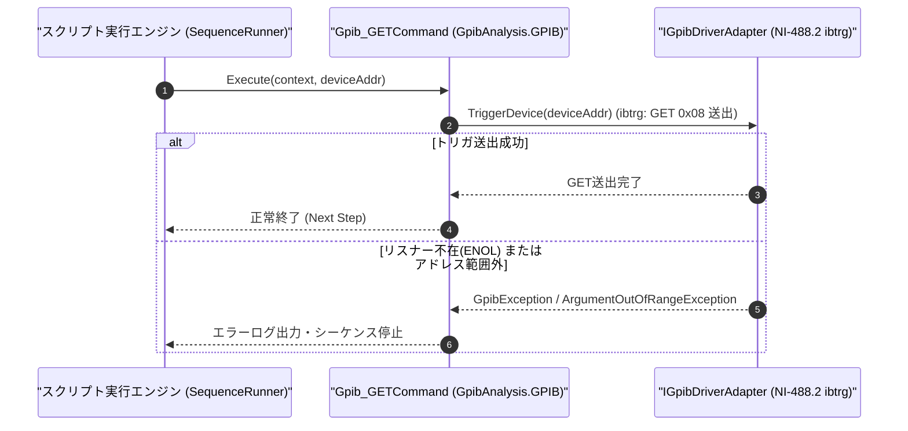

# コマンドリファレンス：Gpib_GET

---

## 概要

**Gpib_GET** は、対象 GPIB デバイス（または指定アドレスの測定器）に対して IEEE 488 アドレス指定コマンド **GET（Group Execute Trigger: `0x08`、NI-488.2 `ibtrg` 相当）** を送出し、ハードウェアバスレベルの測定開始トリガをかけるコマンドです。

> 💡 **補足**: SCPI 文字列の `"*TRG"` よりも低遅延・高精度な同期トリガが可能であり、トリガ待機状態（`TRIG:SOUR BUS` / `INIT`）にある測定器を瞬時にトリガ起動する際に使用します。

---

## 💡 書式・パラメータ仕様

### コマンド構文

```csv
,SEQUENCE,Gpib_GET, "[DeviceAddress]"
```

### パラメータ（引数）一覧

| 引数位置 | パラメータ名 | 必須/任意 | 型・制約 | 説明 |
| :---: | :--- | :---: | :--- | :--- |
| 第1引数 | `DeviceAddress` | 任意 | 整数（`0`〜`30`） | トリガを送出する対象機器のプライマリアドレスを指定します。省略時は現在 `Gpib_Open` されている対象機器へ送出します。 |

---

## 🔄 特殊置換規約・分岐規約の適用

1. **変数展開（`$` / `@` / `#`）**:
   - 第 1 引数 `DeviceAddress` には変数を指定可能です（例: `"$DMM_ADDR"`）。
2. **レガシー別名互換**:
   - 旧表記の `GpibGET` や `GPIB_GET` は内部正規化により本 `Gpib_GET` コマンドへマッピングされます。

---

## 💡 動作例（正しい構文での記述例）

### スクリプト記述例

```csv
,PARAM,MEAS_VAL,0.0

,SEQUENCE,Gpib_Open, "22"
; 1. トリガソースをGPIBバス(BUS)に設定してトリガ待機状態(INIT)へ移行
,SEQUENCE,Gpib_Send, "TRIG:SOUR BUS;INIT"
,SEQUENCE,Wait, "50"

; 2. GET (Group Execute Trigger: 0x08) を送出して測定を実行し、結果を取得
,SEQUENCE,Gpib_GET
,SEQUENCE,Gpib_SendReceive, "FETCH?", "$MEAS_VAL"

,SEQUENCE,Gpib_Close
,SEQUENCE,Exit
```

### 実行時の挙動・変数変化

1. `TRIG:SOUR BUS;INIT` により測定器がバストリガ待ち状態になります。
2. `Gpib_GET` の実行により ATN アサート状態で `GET (0x08)` が送出され、即座にサンプリングが開始されます。
3. 続く `Gpib_SendReceive, "FETCH?", "$MEAS_VAL"` で測定結果が `$MEAS_VAL` に格納されます。

---

## 🔄 動作フロー（シーケンス図）



---

## 🚫 エラーハンドリング・安全設計（仕様制限）

1. **アドレス範囲（`0`〜`30`）の検証**:
   - 第 1 引数に `0`〜`30` 以外の数値が指定された場合は `ArgumentOutOfRangeException` を送出します。
2. **バスエラー監視**:
   - 対象機器が応答しない場合は `GpibException` を送出して停止します。

---

## 🧪 ユニットテスト仕様

### テスト実行前提条件
- **対象クラス**: `GpibAnalysis.GPIB.Gpib_GETCommand`（`Gpib_GETCommand.cs`）
- **モック環境**: `IGpibDriverAdapter` モックが注入されていること。

### テストケース一覧

| テストID | テスト観点 | 入力スクリプト | 期待される動作・検証項目 |
| :--- | :--- | :--- | :--- |
| `UT-GPIB-GET-01` | 正常系（カレント機器トリガ） | `,SEQUENCE,Gpib_GET` | オープン中の機器に対して `TriggerDevice` が呼ばれること。 |
| `UT-GPIB-GET-02` | 正常系（アドレス指定トリガ） | `,SEQUENCE,Gpib_GET, "22"` | アドレス `22` に対して `TriggerDevice(22)` が呼ばれること。 |
| `UT-GPIB-GET-03` | 異常系（アドレス範囲外） | `,SEQUENCE,Gpib_GET, "35"` | `ArgumentOutOfRangeException` が送出されること。 |

