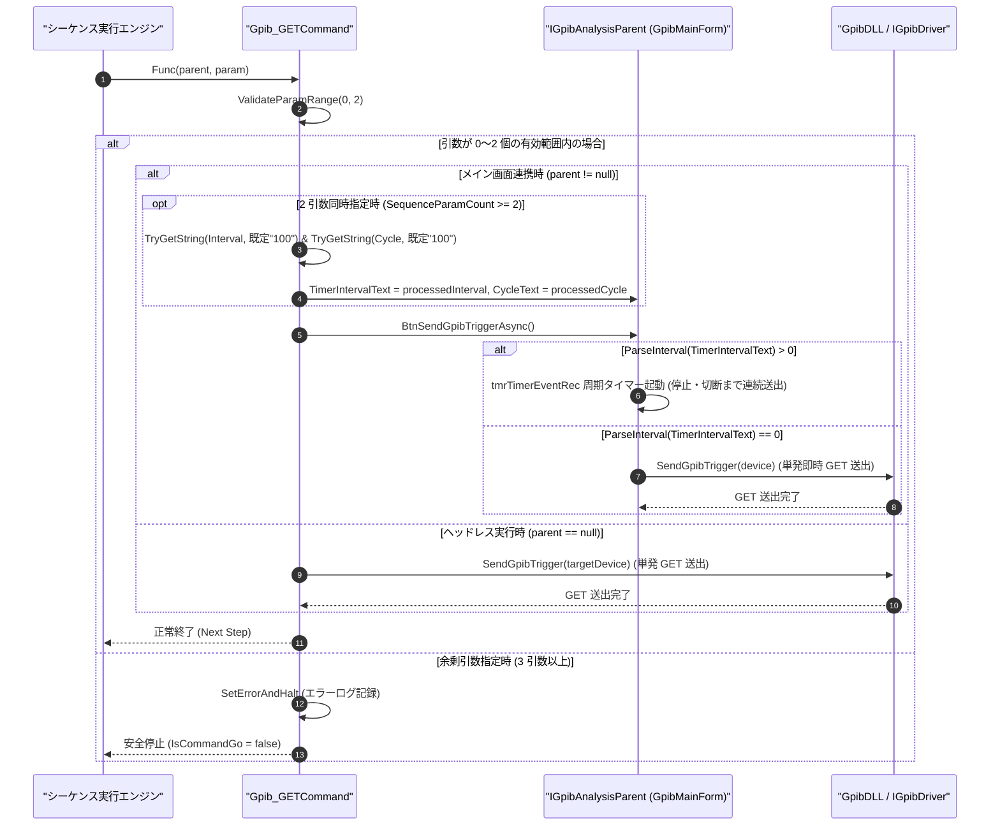

# コマンドリファレンス：Gpib_GET

## 概要

**Gpib_GET** は、現在選択されている対象 GPIB 機器に対して IEEE 488 アドレス指定コマンド **GET（Group Execute Trigger: `0x08`）** を送出し、ハードウェアバスレベルの測定開始トリガ（単発または周期連続トリガ）をかけるコマンドです。

> 💡 **補足**: SCPI 文字列の `"*TRG"` よりも低遅延・高精度な同期トリガが可能であり、トリガ待機状態（`TRIG:SOUR BUS` / `INIT`）にある測定器を瞬時にトリガ起動する際に使用します。メイン画面連携時は 2 引数を同時指定することで画面上の「実行周期」と「実行回数」テキスト欄を更新でき、`Interval` に `1` 以上のミリ秒を指定した場合は周期タイマーが起動して停止操作または切断まで連続トリガを送出します（単発の即時トリガ送出を行う場合は `Interval` に `"0"` を指定します）。

---

## 💡 書式・パラメータ仕様

### コマンド構文

```csv
,SEQUENCE, [ステップキー], Gpib_GET, "[Interval: 100]", "[Cycle: 1]"
```

### パラメータ（引数）一覧

| 引数位置 | 引数名 | 説明 | 指定方法 / 有効な入力値 |
| :--- | :--- | :--- | :--- |
| 引数1 | `Interval` | GET 送出インターバル時間［ミリ秒］（任意・`ParameterSpec` および `Func` 既定値: `"100"`）。※メイン画面連携時は **第 1 引数 `Interval` と第 2 引数 `Cycle` の 2 引数を同時に指定した場合のみ** 画面の周期・回数入力欄へ反映されます（0〜1 引数時は画面の現在設定値をそのまま使用）。`1` 以上の値を指定した場合は周期タイマーを起動して連続送出し、 **`"0"` 以下を指定した場合は単発 GET トリガを即時送出** します。 | `0` 以上の整数文字列（単発即時: `"0"`、周期連続: `"100"` 等）または `$PARAM$` 置換 |
| 引数2 | `Cycle` | GET トリガのサイクル表示値（任意・`ParameterSpec` 既定値: `"1"`、`Func` 2 引数指定時の空文字フォールバック既定値: `"100"`）。※メイン画面連携時は画面の「実行回数」欄へ表示反映されますが、周期タイマー実行時の自動回数減算・自動停止は行われません。ヘッドレス実行時（`parent == null`）は周期・回数に関わらずカレント機器へ単発の GET を送出します。 | 整数文字列（例: `"1"`, `"5"`）または `$PARAM$` 置換 |

---

## 🔄 特殊置換規約・分岐規約の適用

本コマンドの引数における特殊記法および解釈ルールです。
* **動的置換（`$`）**: 引数内で `$PARAMキー$` のように記述すると、実行時に変数プール（PARAM）の値へ動的置換されます。（適用可能な引数: 全引数対応）
* **ジャンプ先指定（`#`）**: 本コマンドはジャンプ制御を行わないため適用されません。（適用可能な引数: 非適用）
* **共通コマンド指定（`@`）**: 本コマンドは外部マクロを呼び出さないため適用されません。（適用可能な引数: 非適用）
* **カンマのエスケープ**: SCPI コマンド等、引数文字列自体にカンマを含める場合は、必ず `","` と二重引用符で囲んで記述します。
* **エイリアス（別名）**: `GET`, `GpibGET`

---

## 💡 動作例（正しい構文での記述例）

### スクリプト記述例

※COMMAND ブロック配下の子要素行（PARAM, SEQUENCE）は必ず行頭カンマ（`,`）から開始してください（行頭スペースのみでは認識されません）。なお、`;` で始まる行やクォート外の `;` 以降はコメントとして自動除去されます。

```csv
COMMAND, "SAMPLE_GPIB_GET", "MEAS_VAL"
,PARAM, "MEAS_VAL", Text, "測定結果", "0.0"
,SEQUENCE, 010, Gpib_Open, 0
; 1. トリガソースをGPIBバス(BUS)に設定してトリガ待機状態(INIT)へ移行
,SEQUENCE, 020, Gpib_Send, "TRIG:SOUR BUS;INIT"
,SEQUENCE, 030, Wait, "50"
; 2. 単発即時実行 ("0", "1") で GET (Group Execute Trigger) を送出し、結果を取得
,SEQUENCE, 040, Gpib_GET, "0", "1"
,SEQUENCE, 050, Gpib_SendReceive, "FETCH?", "MEAS_VAL"
,SEQUENCE, 060, Gpib_Close
,SEQUENCE, 070, Exit
```

### 実行時の挙動・変数変化

* **実行前の状態**: GPIB 通信環境および対象コマンドの PARAM 初期値が設定され、ステップ実行待機中である状態。
* **実行後の状態**: `TRIG:SOUR BUS;INIT` により測定器がバストリガ待ち状態になります。 `Gpib_GET, "0", "1"` の実行により対象機器へ単発の GET トリガが即時送出されてサンプリングが開始され、続く `Gpib_SendReceive, "FETCH?", "MEAS_VAL"` で測定結果が `"MEAS_VAL"` に格納されます。

---

## 🔄 動作フロー（シーケンス図）



---

## 🚫 エラーハンドリング・安全設計（仕様制限）

1. **引数個数の事前バリデーション保護**:
   - `ValidateParamRange(0, 2)` により 3 個以上の引数が指定された場合は `_log.LogError` を記録し、`SetErrorAndHalt` によりシーケンスを安全停止します。
2. **異常な周期・回数入力時のフォールバック設計**:
   - 周期文字列の解析（`ParseInterval`）において負数・非数値・空文字が渡された場合は `0`（待機なし即時）へフォールバックし、回数文字列の解析（`CalculateNextCycle`）で非数値が渡された場合も例外を出さず既定値で安全に処理します。
3. **ポート未接続時の安全スキップ**:
   - 通信ポートが未接続（`CanSendTrigger == false`）の状態では物理バスへの送出を行わず安全にスキップします。

---

## 🧪 ユニットテスト仕様

本コマンドクラス（`Gpib_GETCommand.cs`）に実装されている `RunUnitTest()` メソッドが検証するユニットテストの仕様です。

### テスト実行前提条件

* **実行トリガー**: `RunUnitTest()` メソッドの呼び出し
* **有効化条件**: システム全体の最小ログレベル（`ErrorLogger.MinimumLevel`）が `LogLevel.Test` であること（それ以外の場合は無効化ガードにより早期リターン）
* **検証結果出力**: `_log.LogTest` によるログ出力。検証失敗時は `_log.LogError`、予期せぬ例外発生時は `_log.LogCritical` で記録し、`finally` ブロックで `GpibDLL.DebugDLL` および `GpibDLL.DebugReceiveData` を元の状態へ復元します。

### テストケース一覧

| No | テストカテゴリ | テスト条件（入力値） | 期待される結果（出力値） | 検証の目的 / 観点 |
| :---: | :--- | :--- | :--- | :--- |
| **1** | 正常系・異常系 | `ParseInterval` に `"500"`・`"-100"`・`"invalid"`・`""` を指定して実行 | `"500"` は `500`、負数・非数値・空文字はすべて `0` を返す | トリガ周期文字列の数値解析および異常入力フォールバックの検証 |
| **2** | 正常系・異常系 | `CalculateNextCycle` に `"10"`・`"1"`・`"invalid"` を指定して実行 | それぞれ `9`・`0`・`99`（既定 `100 - 1`）を返す | サイクル数デクリメント計算および非数値フォールバックの検証 |
| **3** | 正常系 | `GetButtonUiState(true)` および `GetButtonUiState(false)` を実行 | 処理中は `(false, Color.Aqua)`、待機中は `(true, Color.Gainsboro)` を返す | GET 送出ボタンの活性状態および背景色遷移の検証 |
| **4** | 正常系・異常系 | `CanSendTrigger(true)` / `(false)` 判定、および余剰引数 `("100", "1", "EXTRA")` 指定で `Func` を実行 | オープン時のみ `true` を返し、3 引数指定時は `HasError == true`・`IsCommandGo == false` で安全停止する | ポート状態判定および引数個数超過（`ValidateParamRange(0, 2)`）時の安全停止検証 |
