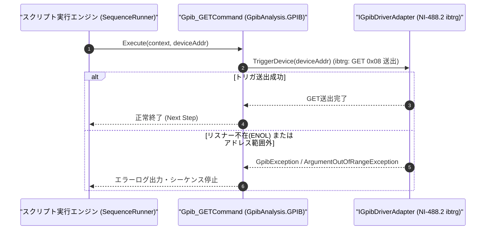

# コマンドリファレンス：Gpib_GET

## 概要

**Gpib_GET** は、対象 GPIB デバイス（または指定アドレスの測定器）に対して IEEE 488 アドレス指定コマンド **GET（Group Execute Trigger: `0x08`、NI-488.2 `ibtrg` 相当）** を送出し、ハードウェアバスレベルの測定開始トリガをかけるコマンドです。

> 💡 **補足**: SCPI 文字列の `"*TRG"` よりも低遅延・高精度な同期トリガが可能であり、トリガ待機状態（`TRIG:SOUR BUS` / `INIT`）にある測定器を瞬時にトリガ起動する際に使用します。

---

## 💡 書式・パラメータ仕様

### コマンド構文

```csv
,SEQUENCE, [ステップキー], Gpib_GET, "[Interval: 100]", "[Cycle: 1]"
```

### パラメータ（引数）一覧

| 引数位置 | 引数名 | 説明 | 指定方法 / 有効な入力値 |
| :--- | :--- | :--- | :--- |
| 引数1 | `Interval` | GET（Group Execute Trigger）連続送出時のインターバル時間［ミリ秒］（任意・省略時既定値: `"100"`）。 | 正の整数文字列（例: `"100"`）または `$PARAM$` 置換 |
| 引数2 | `Cycle` | GET トリガの送出サイクル回数（任意・省略時既定値: `"1"`）。 | 正の整数文字列（例: `"1"`, `"5"`）または `$PARAM$` 置換 |

---

## 🔄 特殊置換規約・分岐規約の適用

本コマンドの引数における特殊記法および解釈ルールです。
* **動的置換（`$`）**: 引数内で `$PARAMキー$` のように記述すると、実行時に変数プール（PARAM）の値へ動的置換されます。（適用可能な引数: 全引数対応）
* **ジャンプ先指定（`#`）**: 本コマンドはジャンプ制御を行わないため適用されません。（適用可能な引数: 非適用）
* **共通コマンド指定（`@`）**: 本コマンドは外部マクロを呼び出さないため適用されません。（適用可能な引数: 非適用）
* **カンマのエスケープ**: SCPI コマンド等、引数文字列自体にカンマを含める場合は、必ず `","` と二重引用符で囲んで記述します。
* **エイリアス（別名）**: `GET`, `GpibGET`

---

## 💡 動作例（正しい構文での記述例）

### スクリプト記述例

※COMMAND ブロック配下の子要素行（PARAM, SEQUENCE）は必ず行頭カンマから開始し、スペースインデントや行末コメント（;）は記述しないでください。

```csv
COMMAND, "SAMPLE_GPIB_GET", ""
,PARAM, "MEAS_VAL", Text, "MEAS_VAL", "0.0"
,SEQUENCE, 010, Gpib_Open, "22"
; 1. トリガソースをGPIBバス(BUS)に設定してトリガ待機状態(INIT)へ移行
,SEQUENCE, 020, Gpib_Send, "TRIG:SOUR BUS;INIT"
,SEQUENCE, 030, Wait, "50"
; 2. GET (Group Execute Trigger: 0x08) を送出して測定を実行し、結果を取得
,SEQUENCE, 040, Gpib_GET
,SEQUENCE, 050, Gpib_SendReceive, "FETCH?", "$MEAS_VAL$"
,SEQUENCE, 060, Gpib_Close
,SEQUENCE, 070, Exit
```

### 実行時の挙動・変数変化

* **実行前の状態**: GPIB 通信環境および対象コマンドの PARAM 初期値が設定され、ステップ実行待機中である状態。
* **実行後の状態**: `TRIG:SOUR BUS;INIT` により測定器がバストリガ待ち状態になります。 `Gpib_GET` の実行により ATN アサート状態で `GET (0x08)` が送出され、即座にサンプリングが開始されます。 続く `Gpib_SendReceive, "FETCH?", "$MEAS_VAL"` で測定結果が `$MEAS_VAL` に格納されます。

---

## 🔄 動作フロー（シーケンス図）



---

## 🚫 エラーハンドリング・安全設計（仕様制限）

1. **アドレス範囲（`0`〜`30`）の検証**:
   - 第 1 引数に `0`〜`30` 以外の数値が指定された場合は `ArgumentOutOfRangeException` を送出します。
2. **バスエラー監視**:
   - 対象機器が応答しない場合は `GpibException` を送出して停止します。

---

## 🧪 ユニットテスト仕様

本コマンドクラス（`Gpib_GETCommand.cs`）に実装されている `RunUnitTest()` メソッドが検証するユニットテストの仕様です。

### テスト実行前提条件

* **実行トリガー**: `RunUnitTest()` メソッドの呼び出し
* **有効化条件**: システム全体の最小ログレベル（`ErrorLogger.MinimumLevel`）が `LogLevel.Test` であること（それ以外の場合は無効化ガードにより早期リターン）
* **検証結果出力**: `_log.LogTest` によるログ出力。検証失敗時は `_log.LogError`、予期せぬ例外発生時は `_log.LogCritical` で記録し、`finally` ブロックで `GpibDLL.DebugDLL` および `GpibDLL.DebugReceiveData` を元の状態へ復元します。

### テストケース一覧

| No | テストカテゴリ | テスト条件（入力値） | 期待される結果（出力値） | 検証の目的 / 観点 |
| :---: | :--- | :--- | :--- | :--- |
| **1** | 正常系・異常系 | `ParseInterval` に `"500"`・`"-100"`・`"invalid"`・`""` を指定して実行 | `"500"` は `500`、負数・非数値・空文字はすべて `0` を返す | トリガ周期文字列の数値解析および異常入力フォールバックの検証 |
| **2** | 正常系・異常系 | `CalculateNextCycle` に `"10"`・`"1"`・`"invalid"` を指定して実行 | それぞれ `9`・`0`・`99`（既定 `100 - 1`）を返す | サイクル数デクリメント計算および非数値フォールバックの検証 |
| **3** | 正常系 | `GetButtonUiState(true)` および `GetButtonUiState(false)` を実行 | 処理中は `(false, Color.Aqua)`、待機中は `(true, Color.Gainsboro)` を返す | GET 送出ボタンの活性状態および背景色遷移の検証 |
| **4** | 正常系・異常系 | `CanSendTrigger(true)` / `(false)` 判定、および余剰引数 `("100", "1", "EXTRA")` 指定で `Func` を実行 | オープン時のみ `true` を返し、3 引数指定時は `HasError == true`・`IsCommandGo == false` で安全停止する | ポート状態判定および引数個数超過（`ValidateParamRange(0, 2)`）時の安全停止検証 |
