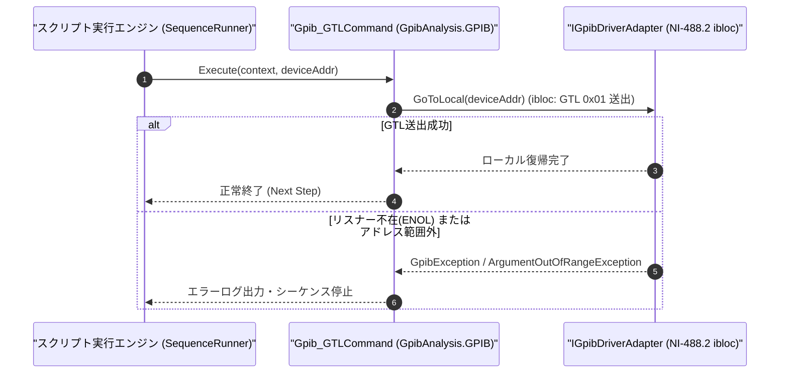

# コマンドリファレンス：Gpib_GTL

---

## 概要

**Gpib_GTL** は、対象 GPIB デバイス（または指定アドレスの測定器）に対して IEEE 488 アドレス指定コマンド **GTL（Go To Local: `0x01`、NI-488.2 `ibloc` 相当）** を送出し、その測定器をリモート制御状態（REM）からフロントパネル手動操作可能なローカル状態（LOC）へ復帰させるコマンドです。

> 💡 **補足**: REN ライン全体を OFF にする [`Gpib_REN`](./Gpib_REN.Md)（バス上の全機器がローカル化）とは異なり、特定の測定器 1 台のみをローカル操作に戻したい場合にも使用できます。

---

## 💡 書式・パラメータ仕様

### コマンド構文

```csv
,SEQUENCE,Gpib_GTL, "[DeviceAddress]"
```

### パラメータ（引数）一覧

| 引数位置 | パラメータ名 | 必須/任意 | 型・制約 | 説明 |
| :---: | :--- | :---: | :--- | :--- |
| 第1引数 | `DeviceAddress` | 任意 | 整数（`0`〜`30`） | ローカル復帰させる対象機器のプライマリアドレスを指定します。省略時は現在 `Gpib_Open` されている対象機器へ送出します。 |

---

## 🔄 特殊置換規約・分岐規約の適用

1. **変数展開（`$` / `@` / `#`）**:
   - 第 1 引数 `DeviceAddress` には変数を指定可能です（例: `"$OSC_ADDR"`）。
2. **レガシー別名互換**:
   - 旧表記の `GpibGTL` や `GPIB_GTL` は内部正規化により本 `Gpib_GTL` コマンドへマッピングされます。

---

## 💡 動作例（正しい構文での記述例）

### スクリプト記述例

```csv
,SEQUENCE,Gpib_Open, "7"
,SEQUENCE,Gpib_Send, "AUTOSCALE"
,SEQUENCE,Wait, "1000"

; オシロスコープをローカル状態(GTL)に戻し、作業者が波形をパネル操作で確認できるようにする
,SEQUENCE,Gpib_GTL
,SEQUENCE,Msg_Box, "オシロスコープの波形を確認し、OKを押してください"

,SEQUENCE,Gpib_Close
,SEQUENCE,Exit
```

### 実行時の挙動・変数変化

1. `Gpib_Send, "AUTOSCALE"` によりオシロスコープがリモート制御されます。
2. `Gpib_GTL` の実行により `GTL (0x01)` が送出され、オシロスコープのフロントパネルノブ・ボタン操作が有効に戻ります。

---

## 🔄 動作フロー（シーケンス図）



---

## 🚫 エラーハンドリング・安全設計（仕様制限）

1. **アドレス範囲（`0`〜`30`）の検証**:
   - 第 1 引数に `0`〜`30` 以外の数値が指定された場合は `ArgumentOutOfRangeException` を送出します。
2. **未接続時の安全なエラー検出**:
   - デバイスがオープンされておらず第 1 引数も省略されている場合は `InvalidOperationException` を送出します。

---

## 🧪 ユニットテスト仕様

### テスト実行前提条件
- **対象クラス**: `GpibAnalysis.GPIB.Gpib_GTLCommand`（`Gpib_GTLCommand.cs`）
- **モック環境**: `IGpibDriverAdapter` モックが注入されていること。

### テストケース一覧

| テストID | テスト観点 | 入力スクリプト | 期待される動作・検証項目 |
| :--- | :--- | :--- | :--- |
| `UT-GPIB-GTL-01` | 正常系（カレント機器GTL） | `,SEQUENCE,Gpib_GTL` | オープン中の機器に対して `GoToLocal` が呼ばれること。 |
| `UT-GPIB-GTL-02` | 正常系（アドレス指定GTL） | `,SEQUENCE,Gpib_GTL, "7"` | アドレス `7` に対して `GoToLocal(7)` が呼ばれること。 |
| `UT-GPIB-GTL-03` | 異常系（アドレス範囲外） | `,SEQUENCE,Gpib_GTL, "-5"` | `ArgumentOutOfRangeException` が送出されること。 |

