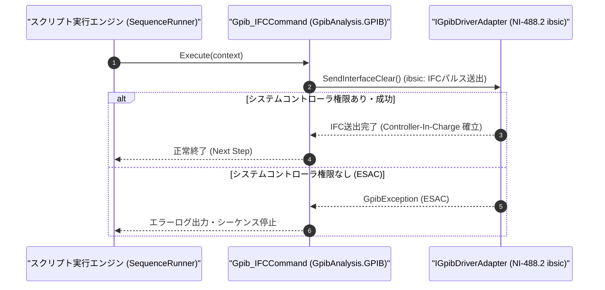

# コマンドリファレンス：Gpib_IFC

---

## 概要

**Gpib_IFC** は、GPIB バス上の **IFC（Interface Clear）単一制御ライン** を一定時間（規定 100μs 以上）アサートしてバス上の全デバイスのインターフェース機能（Talker / Listener 状態等）を強制初期化し、コントローラ（PC）へバスの主導権を取り戻すコマンドです。

> 💡 **補足**: 測定器の応答ハングアップ等で GPIB バスがロックした際の緊急バスリセット（NI-488.2 `ibsic` 相当）や、シーケンス冒頭でのバス初期化に使用します。

---

## 💡 書式・パラメータ仕様

### コマンド構文

```csv
,SEQUENCE,Gpib_IFC
```

### パラメータ（引数）一覧

| 引数位置 | パラメータ名 | 必須/任意 | 型・制約 | 説明 |
| :--- | :--- | :---: | :--- | :--- |
| （引数なし） | - | - | - | GPIB バスの IFC ラインをパルス送出してバスインターフェースをクリアします。 |

---

## 🔄 特殊置換規約・分岐規約の適用

1. **引数なしコマンド**:
   - 引数を取らないため、変数展開（`$` / `#` / `@`）は使用しません。
2. **レガシー別名互換**:
   - 旧表記の `GpibIFC` や `GPIB_IFC` は内部正規化により本 `Gpib_IFC` コマンドへマッピングされます。

---

## 💡 動作例（正しい構文での記述例）

### スクリプト記述例

```csv
,SEQUENCE,Gpib_Open, "5"

; 1. IFCを送出してGPIBバス上のTalker/Listener状態を初期化し、RENをONにする
,SEQUENCE,Gpib_IFC
,SEQUENCE,Gpib_REN, "ON"

; 2. 正常化したバスでID照会を実行
,SEQUENCE,Gpib_SendReceive, "*IDN?", "@DEV_ID"
,SEQUENCE,Gpib_Close
,SEQUENCE,Exit
```

### 実行時の挙動・変数変化

1. `Gpib_IFC` により GPIB バスの IFC ラインが約 100μs アサートされ、すべてのスレーブ機器の GPIB インターフェース状態がアイドル（Untalk / Unlisten）にリセットされます（測定器内部の測定設定自体は維持されます）。

---

## 🔄 動作フロー（シーケンス図）



---

## 🚫 エラーハンドリング・安全設計（仕様制限）

1. **システムコントローラ権限（`ESAC`）の確認**:
   - IFC ラインの駆動は System Controller のみに許可されているため、権限がない場合は `GpibException` を送出します。
2. **`Gpib_DCL` との役割分担**:
   - `Gpib_IFC` は通信インターフェース状態のみをクリアします。機器内部のバッファや設定をクリアしたい場合は [`Gpib_DCL`](./Gpib_DCL.Md) または [`Gpib_SDC`](./Gpib_SDC.Md) を使用します。

---

## 🧪 ユニットテスト仕様

### テスト実行前提条件
- **対象クラス**: `GpibAnalysis.GPIB.Gpib_IFCCommand`（`Gpib_IFCCommand.cs`）
- **モック環境**: `IGpibDriverAdapter` モックが注入されていること。

### テストケース一覧

| テストID | テスト観点 | 入力スクリプト | 期待される動作・検証項目 |
| :--- | :--- | :--- | :--- |
| `UT-GPIB-IFC-01` | 正常系（IFC送出） | `,SEQUENCE,Gpib_IFC` | モックドライバの `SendInterfaceClear()` が 1 回呼び出されること。 |
| `UT-GPIB-IFC-02` | 大文字小文字非区別 | `,SEQUENCE,gpib_ifc` | `Gpib_IFCCommand` が正常に実行されること。 |
| `UT-GPIB-IFC-03` | 異常系（権限エラー） | モックが `ESAC` エラーを返す設定時 | `GpibException` が送出されること。 |

