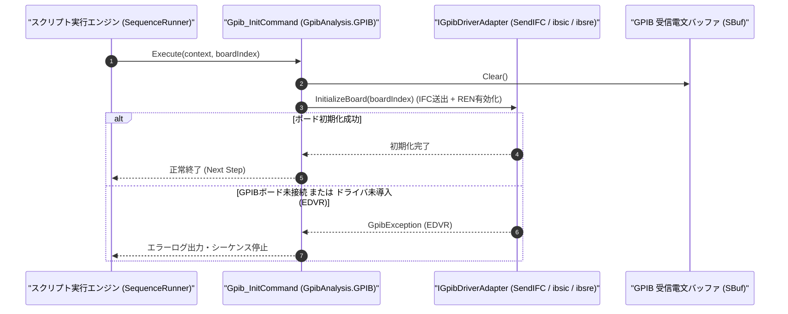

# コマンドリファレンス：Gpib_Init

---

## 概要

**Gpib_Init** は、PC 側の GPIB インターフェースボード（`GPIB0` 等）をシステムコントローラ（Controller-In-Charge）として初期化し、IFC（Interface Clear）送出および REN（Remote Enable）ライン有効化を一括で実行するボード初期化コマンドです。

> 💡 **補足**: シーケンス開始時に GPIB バス全体をクリーンな初期状態へセットアップする際に使用します。

---

## 💡 書式・パラメータ仕様

### コマンド構文

```csv
,SEQUENCE,Gpib_Init, "[BoardIndex: 0]"
```

### パラメータ（引数）一覧

| 引数位置 | パラメータ名 | 必須/任意 | 型・制約 | 説明 |
| :---: | :--- | :---: | :--- | :--- |
| 第1引数 | `BoardIndex` | 任意 | 整数（`0` 以上、既定値: `0`） | 初期化する GPIB インターフェースボードのインデックス番号（`GPIB0` は `0`）を指定します。 |

---

## 🔄 特殊置換規約・分岐規約の適用

1. **変数展開（`$` / `@` / `#`）**:
   - 第 1 引数 `BoardIndex` には変数を指定可能です（例: `"$BOARD_NO"`）。
2. **レガシー別名互換**:
   - 旧表記の `GpibInit` や `GPIB_INIT` は内部正規化により本 `Gpib_Init` コマンドへマッピングされます。

---

## 💡 動作例（正しい構文での記述例）

### スクリプト記述例

```csv
; 1. GPIBボード0を初期化し、バス上の機器を検索してからオープン
,SEQUENCE,Gpib_Init, "0"
,SEQUENCE,Gpib_Find, "@DEVICES"
,SEQUENCE,Gpib_Open, "5"
,SEQUENCE,Gpib_SendReceive, "*IDN?", "@IDN"
,SEQUENCE,Gpib_Close
,SEQUENCE,Exit
```

### 実行時の挙動・変数変化

1. `Gpib_Init, "0"` により `GPIB0` ボードが初期化され、IFC パルス送出・REN アサート・内部受信バッファ（`SBuf`）のクリアが一括で行われます。

---

## 🔄 動作フロー（シーケンス図）



---

## 🚫 エラーハンドリング・安全設計（仕様制限）

1. **ボード番号の検証**:
   - 負のボードインデックス番号が指定された場合は `ArgumentOutOfRangeException` を送出します。
2. **ハードウェア不在時の明確なエラー通知**:
   - 指定された GPIB ボード（PCIe / USB-GPIB アダプタ等）が PC に認識されていない場合は、`GpibException` を送出してハードウェア未接続を通知します。

---

## 🧪 ユニットテスト仕様

### テスト実行前提条件
- **対象クラス**: `GpibAnalysis.GPIB.Gpib_InitCommand`（`Gpib_InitCommand.cs`）
- **モック環境**: `IGpibDriverAdapter` モックが注入されていること。

### テストケース一覧

| テストID | テスト観点 | 入力スクリプト | 期待される動作・検証項目 |
| :--- | :--- | :--- | :--- |
| `UT-GPIB-INIT-01` | 正常系（引数省略） | `,SEQUENCE,Gpib_Init` | ボード番号 `0` で `InitializeBoard(0)` が呼ばれ、`SBuf` がクリアされること。 |
| `UT-GPIB-INIT-02` | 正常系（ボード番号指定） | `,SEQUENCE,Gpib_Init, "1"` | ボード番号 `1` で `InitializeBoard(1)` が呼ばれること。 |
| `UT-GPIB-INIT-03` | 異常系（負のボード番号） | `,SEQUENCE,Gpib_Init, "-1"` | `ArgumentOutOfRangeException` が送出されること。 |

