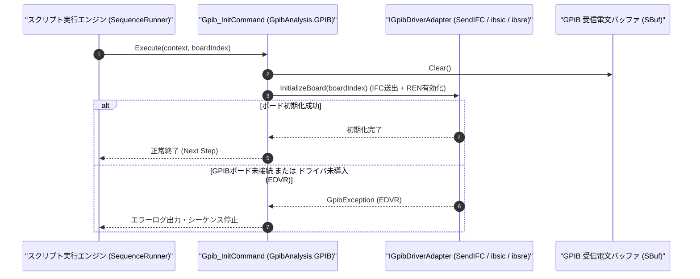

# コマンドリファレンス：Gpib_Init

## 概要

**Gpib_Init** は、PC 側の GPIB インターフェースボード（`GPIB0` 等）をシステムコントローラ（Controller-In-Charge）として初期化し、IFC（Interface Clear）送出および REN（Remote Enable）ライン有効化を一括で実行するボード初期化コマンドです。

> 💡 **補足**: シーケンス開始時に GPIB バス全体をクリーンな初期状態へセットアップする際に使用します。

---

## 💡 書式・パラメータ仕様

### コマンド構文

```csv
,SEQUENCE, [ステップキー], Gpib_Init, "[BoardIndex: 0]"
```

### パラメータ（引数）一覧

| 引数位置 | パラメータ名 | 必須/任意 | 型・制約 | 説明 |
| :---: | :--- | :---: | :--- | :--- |
| 第1引数 | `BoardIndex` | 任意 | 整数（`0` 以上、既定値: `0`） | 初期化する GPIB インターフェースボードのインデックス番号（`GPIB0` は `0`）を指定します。 |

---

## 🔄 特殊置換規約・分岐規約の適用

本コマンドの引数における特殊記法および解釈ルールです。
* **動的置換（`$`）**: 引数内で `$PARAMキー$` のように記述すると、実行時に変数プール（PARAM）の値へ動的置換されます。（適用可能な引数: 全引数対応）
* **ジャンプ先指定（`#`）**: 本コマンドはジャンプ制御を行わないため適用されません。（適用可能な引数: 非適用）
* **共通コマンド指定（`@`）**: 本コマンドは外部マクロを呼び出さないため適用されません。（適用可能な引数: 非適用）
* **カンマのエスケープ**: SCPI コマンド等、引数文字列自体にカンマを含める場合は、必ず `","` と二重引用符で囲んで記述します。
* **エイリアス（別名）**: `Init`, `GpibInit`

---

## 💡 動作例（正しい構文での記述例）

### スクリプト記述例

※COMMAND ブロック配下の子要素行（PARAM, SEQUENCE）は必ず行頭カンマから開始し、スペースインデントや行末コメント（;）は記述しないでください。

```csv
COMMAND, "SAMPLE_GPIB_INIT", ""
; 1. GPIBボード0を初期化し、バス上の機器を検索してからオープン
,SEQUENCE, 010, Gpib_Init, "0"
,SEQUENCE, 020, Gpib_Find, "@DEVICES"
,SEQUENCE, 030, Gpib_Open, "5"
,SEQUENCE, 040, Gpib_SendReceive, "*IDN?", "@IDN"
,SEQUENCE, 050, Gpib_Close
,SEQUENCE, 060, Exit
```

### 実行時の挙動・変数変化

* **実行前の状態**: GPIB 通信環境および対象コマンドの PARAM 初期値が設定され、ステップ実行待機中である状態。
* **実行後の状態**: `Gpib_Init, "0"` により `GPIB0` ボードが初期化され、IFC パルス送出・REN アサート・内部受信バッファ（`SBuf`）のクリアが一括で行われます。

---

## 🔄 動作フロー（シーケンス図）



---

## 🚫 エラーハンドリング・安全設計（仕様制限）

1. **ボード番号の検証**:
   - 負のボードインデックス番号が指定された場合は `ArgumentOutOfRangeException` を送出します。
2. **ハードウェア不在時の明確なエラー通知**:
   - 指定された GPIB ボード（PCIe / USB-GPIB アダプタ等）が PC に認識されていない場合は、`GpibException` を送出してハードウェア未接続を通知します。

---

## 🧪 ユニットテスト仕様

本コマンドクラス（`Gpib_InitCommand.cs`）に実装されている `RunUnitTest()` メソッドが検証するユニットテストの仕様です。

### テスト実行前提条件

* **実行トリガー**: `RunUnitTest()` メソッドの呼び出し
* **有効化条件**: システム全体の最小ログレベル（`ErrorLogger.MinimumLevel`）が `LogLevel.Test` であること（それ以外の場合は無効化ガードにより早期リターン）
* **検証結果出力**: `_log.LogTest` によるログ出力。検証失敗時は `_log.LogError`、予期せぬ例外発生時は `_log.LogCritical` で記録し、`finally` ブロックで `GpibDLL.DebugDLL` および `GpibDLL.DebugReceiveData` を元の状態へ復元します。

### テストケース一覧

| No | テストカテゴリ | テスト条件（入力値） | 期待される結果（出力値） | 検証の目的 / 観点 |
| :---: | :--- | :--- | :--- | :--- |
| **1** | 異常系 | `CanInitialize(null)` 判定、デバイス未設定（0 引数）での実行、および負のボード番号 `("-1")` 指定での `Func` 実行 | `CanInitialize` が `false` を返し、両 `Func` 実行とも `HasError == true`・`IsCommandGo == false` で安全停止する | デバイス `null` ガードおよび不正 `BoardNum` 指定時の安全停止検証 |
| **2** | 正常系 | 有効な `GpibDevice`（`Name = "TestDevice"`, `BoardNum = 0`）での `CanInitialize` 判定および `("0")` 指定での `Func` 実行 | `CanInitialize` が `true` を返し、`!HasError` で機器登録・デリミタ設定が正常完了する | 有効デバイス存在時のシミュレーション初期化動作の検証 |
