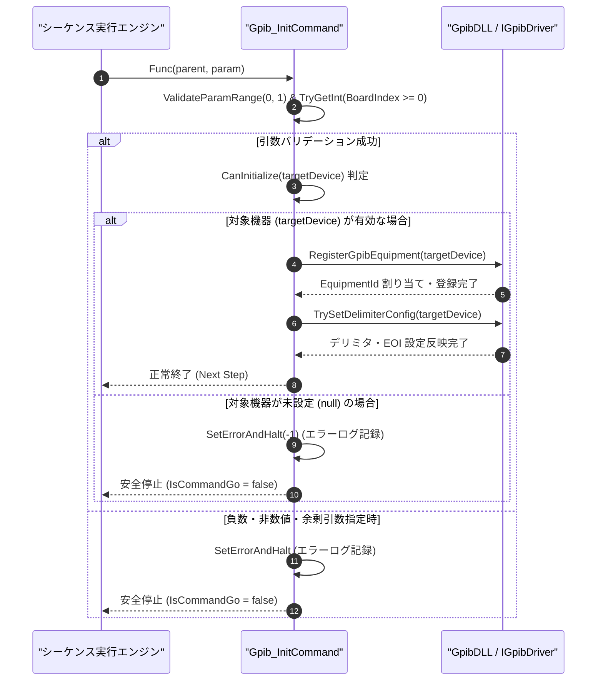

# コマンドリファレンス：Gpib_Init

## 概要

**Gpib_Init** は、現在選択されている対象 GPIB 機器（`GpibDevice`）をドライバへ登録（`GpibDLL.RegisterGpibEquipment`）し、機器固有のデリミタおよび EOI 設定をハードウェアへ反映（`GpibDLL.TrySetDelimiterConfig`）するデバイス初期化コマンドです。

> 💡 **補足**: 本コマンド単体では IFC（Interface Clear）送出や REN（Remote Enable）ライン変更、受信バッファクリアは行いません。バス全体のポートオープン・IFC/DCL/REN 一括初期化を行う場合は [`Gpib_Open`](./Gpib_Open.Md) を使用し、個別機器のハンドル再登録やデリミタ設定の再適用を行いたい場合に本 `Gpib_Init` を使用します。

---

## 💡 書式・パラメータ仕様

### コマンド構文

```csv
,SEQUENCE, [ステップキー], Gpib_Init, "[BoardIndex: 0]"
```

### パラメータ（引数）一覧

| 引数位置 | パラメータ名 | 必須/任意 | 型・制約 | 説明 |
| :---: | :--- | :---: | :--- | :--- |
| 第1引数 | `BoardIndex` | 任意 | 整数（`0` 以上、既定値: `0`） | 互換性のための任意ボードインデックス番号です（`0` 以上の整数であるか検証のみ行われ、実際の機器登録・デリミタ設定は現在の実行対象 `GpibDevice` の設定値を用いて実行されます）。 |

---

## 🔄 特殊置換規約・分岐規約の適用

本コマンドの引数における特殊記法および解釈ルールです。
* **動的置換（`$`）**: 引数内で `$PARAMキー$` のように記述すると、実行時に変数プール（PARAM）の値へ動的置換されます。（適用可能な引数: 全引数対応）
* **ジャンプ先指定（`#`）**: 本コマンドはジャンプ制御を行わないため適用されません。（適用可能な引数: 非適用）
* **共通コマンド指定（`@`）**: 本コマンドは外部マクロを呼び出さないため適用されません。（適用可能な引数: 非適用）
* **カンマのエスケープ**: SCPI コマンド等、引数文字列自体にカンマを含める場合は、必ず `","` と二重引用符で囲んで記述します。
* **エイリアス（別名）**: `Init`, `GpibInit`

---

## 💡 動作例（正しい構文での記述例）

### スクリプト記述例

※COMMAND ブロック配下の子要素行（PARAM, SEQUENCE）は必ず行頭カンマ（`,`）から開始してください（行頭スペースのみでは認識されません）。なお、`;` で始まる行やクォート外の `;` 以降はコメントとして自動除去されます。

```csv
COMMAND, "SAMPLE_GPIB_INIT", "IDN"
,PARAM, "DEVICES", Work, "検出機器一覧", ""
,PARAM, "IDN", Work, "機器識別情報", ""
; 1. GPIBボードをオープンし、カレント機器の登録・デリミタ設定(Gpib_Init)およびバス探索を実行
,SEQUENCE, 010, Gpib_Open, 0
,SEQUENCE, 020, Gpib_Init, 0
,SEQUENCE, 030, Gpib_Find, 0, "DEVICES"
,SEQUENCE, 040, Gpib_SendReceive, "*IDN?", "IDN"
,SEQUENCE, 050, Gpib_Close
,SEQUENCE, 060, Exit
```

### 実行時の挙動・変数変化

* **実行前の状態**: GPIB ボードがオープンされ、対象コマンドの実行対象デバイス（`GpibDevice`）が選択されている状態。
* **実行後の状態**: `Gpib_Init, 0` によりカレント機器が `GpibDLL.RegisterGpibEquipment` でドライバへ登録され、`GpibDLL.TrySetDelimiterConfig` により機器プロパティのデリミタ・EOI 設定が適用されます。

---

## 🔄 動作フロー（シーケンス図）



---

## 🚫 エラーハンドリング・安全設計（仕様制限）

1. **引数境界およびボード番号（`0` 以上）の事前検証**:
   - `ValidateParamRange(0, 1)` 違反（2 個以上の引数指定）または第 1 引数 `BoardIndex` に負数（`"-1"` 等）や非数値文字列が指定された場合は、`SetErrorAndHalt` によりエラーログを記録して安全停止します。
2. **対象機器未設定（`null`）時の安全停止ガード**:
   - 実行対象の `GpibDevice` が存在しない状態（`CanInitialize(device) == false`）で呼び出された場合は、ハードウェア API を呼ばずに `_log.LogError` を記録し、`SetErrorAndHalt(-1, ...)` でシーケンスを安全停止します。

---

## 🧪 ユニットテスト仕様

本コマンドクラス（`Gpib_InitCommand.cs`）に実装されている `RunUnitTest()` メソッドが検証するユニットテストの仕様です。

### テスト実行前提条件

* **実行トリガー**: `RunUnitTest()` メソッドの呼び出し
* **有効化条件**: システム全体の最小ログレベル（`ErrorLogger.MinimumLevel`）が `LogLevel.Test` であること（それ以外の場合は無効化ガードにより早期リターン）
* **検証結果出力**: `_log.LogTest` によるログ出力。検証失敗時は `_log.LogError`、予期せぬ例外発生時は `_log.LogCritical` で記録し、`finally` ブロックで `GpibDLL.DebugDLL` および `GpibDLL.DebugReceiveData` を元の状態へ復元します。

### テストケース一覧

| No | テストカテゴリ | テスト条件（入力値） | 期待される結果（出力値） | 検証の目的 / 観点 |
| :---: | :--- | :--- | :--- | :--- |
| **1** | 異常系 | `CanInitialize(null)` 判定、デバイス未設定（0 引数）での実行、および負のボード番号 `("-1")` 指定での `Func` 実行 | `CanInitialize` が `false` を返し、両 `Func` 実行とも `HasError == true`・`IsCommandGo == false` で安全停止する | デバイス `null` ガードおよび不正 `BoardNum` 指定時の安全停止検証 |
| **2** | 正常系 | 有効な `GpibDevice`（`Name = "TestDevice"`, `BoardNum = 0`）での `CanInitialize` 判定および `("0")` 指定での `Func` 実行 | `CanInitialize` が `true` を返し、`!HasError` で機器登録・デリミタ設定が正常完了する | 有効デバイス存在時のシミュレーション初期化動作の検証 |
