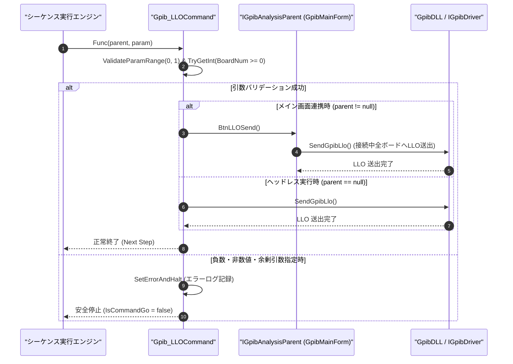

# コマンドリファレンス：Gpib_LLO

## 概要

**Gpib_LLO** は、オープン中の全 GPIB ボードに対してユニバーサルコマンド **LLO（Local Lockout: `0x11`）** を送出し、測定器本体のフロントパネルにある「LOCAL」キー操作によるローカル復帰を禁止（ロックアウト）するコマンドです。

> 💡 **補足**: 自動計測シーケンス実行中に作業者が誤って測定器のフロントパネルボタンに触れて設定が変わってしまう事故を防止するために使用します。解除には個別機器ローカル復帰の [`Gpib_GTL`](./Gpib_GTL.Md) またはバス全体の REN ラインをオフにする [`Gpib_REN`](./Gpib_REN.Md)（`Gpib_REN, "OFF"`）を使用します。

---

## 💡 書式・パラメータ仕様

### コマンド構文

```csv
,SEQUENCE, [ステップキー], Gpib_LLO, "[BoardNum: 0]"
```

### パラメータ（引数）一覧

| 引数位置 | 引数名 | 説明 | 指定方法 / 有効な入力値 |
| :--- | :--- | :--- | :--- |
| 引数1 | `BoardNum` | LLO（Local Lockout）ユニバーサルコマンドを送出する GPIB ボード番号（任意・省略時既定値: `0`）。※引数バリデーション（`0` 以上の整数）のみ行われ、実際の送出はオープン中の全 GPIB ボードに対して一括実行されます。 | `0` 以上の整数（例: `0`）または `$PARAM$` 置換 |

---

## 🔄 特殊置換規約・分岐規約の適用

本コマンドの引数における特殊記法および解釈ルールです。
* **動的置換（`$`）**: 引数内で `$PARAMキー$` のように記述すると、実行時に変数プール（PARAM）の値へ動的置換されます。（適用可能な引数: 全引数対応）
* **ジャンプ先指定（`#`）**: 本コマンドはジャンプ制御を行わないため適用されません。（適用可能な引数: 非適用）
* **共通コマンド指定（`@`）**: 本コマンドは外部マクロを呼び出さないため適用されません。（適用可能な引数: 非適用）
* **カンマのエスケープ**: SCPI コマンド等、引数文字列自体にカンマを含める場合は、必ず `","` と二重引用符で囲んで記述します。
* **エイリアス（別名）**: `LLO`, `GpibLLO`

---

## 💡 動作例（正しい構文での記述例）

### スクリプト記述例

※COMMAND ブロック配下の子要素行（PARAM, SEQUENCE）は必ず行頭カンマ（`,`）から開始してください（行頭スペースのみでは認識されません）。なお、`;` で始まる行やクォート外の `;` 以降はコメントとして自動除去されます。

```csv
COMMAND, "SAMPLE_GPIB_LLO", "V_RES"
,PARAM, "V_RES", Work, "電圧測定結果", ""
,SEQUENCE, 010, Gpib_Open, 0
,SEQUENCE, 020, Gpib_REN, "ON"
; 1. 測定中にパネル操作されないようローカルロックアウト(LLO)を送出
,SEQUENCE, 030, Gpib_LLO
,SEQUENCE, 040, Gpib_SendReceive, "MEAS:VOLT:DC?", "V_RES"
; 2. 測定終了後にREN OFF(またはGpib_GTL)でパネル操作ロックを解除
,SEQUENCE, 050, Gpib_REN, "OFF"
,SEQUENCE, 060, Gpib_Close
,SEQUENCE, 070, Exit
```

### 実行時の挙動・変数変化

* **実行前の状態**: GPIB 通信環境および対象コマンドの PARAM 初期値が設定され、ステップ実行待機中である状態。
* **実行後の状態**: `Gpib_LLO` の実行によりオープン中の全 GPIB ボードから LLO（`0x11`）が送出され、測定器の「LOCAL」ボタンが無効化されます。続く `Gpib_REN, "OFF"`（または [`Gpib_GTL`](./Gpib_GTL.Md)）によりロックアウトが解除され、手動操作が可能になります。

---

## 🔄 動作フロー（シーケンス図）



---

## 🚫 エラーハンドリング・安全設計（仕様制限）

1. **引数境界・型バリデーション保護**:
   - `ValidateParamRange(0, 1)` 違反（2 個以上の引数指定）または第 1 引数 `BoardNum` に負数・非数値文字列が指定された場合は、`SetErrorAndHalt` によりエラーログを記録して安全停止します。
2. **未接続時のスキップと終了時のロック解除推奨**:
   - ポート未接続時（`CanSendLlo == false`）は送出を安全にスキップします。また、`Gpib_LLO` を使用したシーケンスでは、終了前に `Gpib_REN, "OFF"` または `Gpib_GTL` を実行して測定器を手動操作可能状態へ戻す設計を推奨します。

---

## 🧪 ユニットテスト仕様

本コマンドクラス（`Gpib_LLOCommand.cs`）に実装されている `RunUnitTest()` メソッドが検証するユニットテストの仕様です。

### テスト実行前提条件

* **実行トリガー**: `RunUnitTest()` メソッドの呼び出し
* **有効化条件**: システム全体の最小ログレベル（`ErrorLogger.MinimumLevel`）が `LogLevel.Test` であること（それ以外の場合は無効化ガードにより早期リターン）
* **検証結果出力**: `_log.LogTest` によるログ出力。検証失敗時は `_log.LogError`、予期せぬ例外発生時は `_log.LogCritical` で記録し、`finally` ブロックで `GpibDLL.DebugDLL` および `GpibDLL.DebugReceiveData` を元の状態へ復元します。

### テストケース一覧

| No | テストカテゴリ | テスト条件（入力値） | 期待される結果（出力値） | 検証の目的 / 観点 |
| :---: | :--- | :--- | :--- | :--- |
| **1** | 正常系 | 回線接続中を模擬して `CanSendLlo(true)` を実行 | `true` が返却される | 接続時の LLO 送出許可判定の検証 |
| **2** | 異常系 | 未接続判定 `CanSendLlo(false)`、および非数値ボード番号 `("INVALID")` を指定して `Func` を実行 | `CanSendLlo` が `false` を返し、`Func` は `HasError == true`・`IsCommandGo == false` で安全停止する | 未接続時ガードおよび不正 `BoardNum` 指定時の安全停止検証 |
