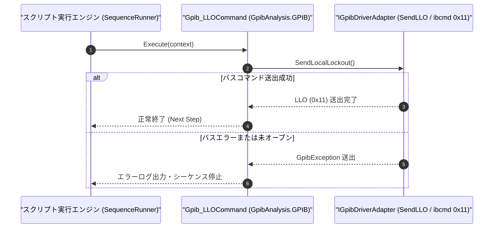

# コマンドリファレンス：Gpib_LLO

---

## 概要

**Gpib_LLO** は、GPIB バス上の全測定器に対してユニバーサルコマンド **LLO（Local Lockout: `0x11`）** を送出し、測定器本体のフロントパネルにある「LOCAL」キー操作によるローカル復帰を禁止（ロックアウト）するコマンドです。

> 💡 **補足**: 自動計測シーケンス実行中に作業者が誤って測定器のフロントパネルボタンに触れて設定が変わってしまう事故を防止するために使用します。解除には [`Gpib_GTL`](./Gpib_GTL.Md) または `Gpib_REN, "OFF"` を使用します。

---

## 💡 書式・パラメータ仕様

### コマンド構文

```csv
,SEQUENCE,Gpib_LLO
```

### パラメータ（引数）一覧

| 引数位置 | パラメータ名 | 必須/任意 | 型・制約 | 説明 |
| :--- | :--- | :---: | :--- | :--- |
| （引数なし） | - | - | - | バス上の全機器へ Local Lockout (`0x11`) コマンドを送出します。 |

---

## 🔄 特殊置換規約・分岐規約の適用

1. **引数なしコマンド**:
   - 引数を取らないため、変数展開（`$` / `#` / `@`）は使用しません。
2. **レガシー別名互換**:
   - 旧表記の `GpibLLO` や `GPIB_LLO` は内部正規化により本 `Gpib_LLO` コマンドへマッピングされます。

---

## 💡 動作例（正しい構文での記述例）

### スクリプト記述例

```csv
,SEQUENCE,Gpib_Open, "5"
,SEQUENCE,Gpib_REN, "ON"

; 1. 測定中にパネル操作されないようローカルロックアウト(LLO)を送出
,SEQUENCE,Gpib_LLO
,SEQUENCE,Gpib_SendReceive, "MEAS:VOLT:DC?", "@V_RES"

; 2. 測定終了後にGTL(Go To Local)でパネル操作ロックを解除
,SEQUENCE,Gpib_GTL
,SEQUENCE,Gpib_Close
,SEQUENCE,Exit
```

### 実行時の挙動・変数変化

1. `Gpib_LLO` の実行により ATN ラインアサート状態で `0x11`（LLO）がバス送出され、測定器の「LOCAL」ボタンが無効化されます。
2. `Gpib_GTL`（または `Gpib_REN, "OFF"`）によりロックアウトが解除され、手動操作が可能になります。

---

## 🔄 動作フロー（シーケンス図）



---

## 🚫 エラーハンドリング・安全設計（仕様制限）

1. **未オープン時の実行防止**:
   - GPIB セッションが開かれていない状態で実行された場合は `InvalidOperationException` を送出します。
2. **終了時のロック解除推奨**:
   - `Gpib_LLO` を使用したシーケンスでは、終了前に `Gpib_GTL` または `Gpib_REN, "OFF"` を実行して測定器を手動操作可能状態へ戻す設計を推奨します。

---

## 🧪 ユニットテスト仕様

### テスト実行前提条件
- **対象クラス**: `GpibAnalysis.GPIB.Gpib_LLOCommand`（`Gpib_LLOCommand.cs`）
- **モック環境**: `IGpibDriverAdapter` モックが注入されていること。

### テストケース一覧

| テストID | テスト観点 | 入力スクリプト | 期待される動作・検証項目 |
| :--- | :--- | :--- | :--- |
| `UT-GPIB-LLO-01` | 正常系（LLO送出） | `,SEQUENCE,Gpib_LLO` | モックドライバの `SendLocalLockout()` が呼び出されること。 |
| `UT-GPIB-LLO-02` | 大文字小文字非区別 | `,SEQUENCE,gpib_llo` | `Gpib_LLOCommand` が正常に実行されること。 |
| `UT-GPIB-LLO-03` | 異常系（バスエラー） | モックが例外を送出する設定時 | `GpibException` が捕捉されシーケンスが停止すること。 |

