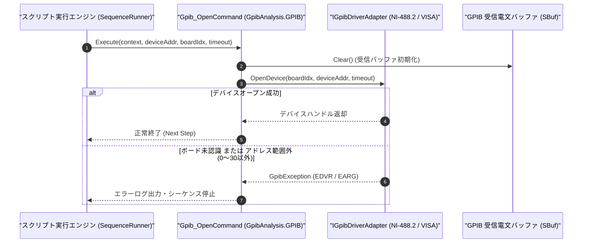

# コマンドリファレンス：Gpib_Open

## 概要

**Gpib_Open** は、指定された GPIB スレーブ機器アドレス（Primary Address: `0`〜`30`）または UI 設定の GPIB ボード／デバイス記述子を開き、GPIB バス通信セッションを初期化するコマンドです。
実行時に通信制御の排他選択モードを **GPIB モード** （`GpibAnalysis.GPIB.dll`）へ確定させます。

> 💡 **補足**: NI-488.2 / VISA 互換ドライバまたは抽象化インターフェース（`IGpibDriverAdapter`）を介して対象機器のデバイスディスクリプタを取得し、受信バッファ（`SBuf`）を初期化します。

---

## 💡 書式・パラメータ仕様

### コマンド構文

```csv
,SEQUENCE, [ステップキー], Gpib_Open, "[BoardNum: 0]"
```

### パラメータ（引数）一覧

| 引数位置 | 引数名 | 説明 | 指定方法 / 有効な入力値 |
| :--- | :--- | :--- | :--- |
| 引数1 | `BoardNum` | 接続オープンする GPIB インターフェースボード番号（任意・省略時既定値: `0`）。省略時は全設定ボードを一括オープンし IFC/DCL/REN 初期化を実行します。 | `0` 以上の整数（例: `0`）または `$PARAM$` 置換 |

---

## 🔄 特殊置換規約・分岐規約の適用

本コマンドの引数における特殊記法および解釈ルールです。
* **動的置換（`$`）**: 引数内で `$PARAMキー$` のように記述すると、実行時に変数プール（PARAM）の値へ動的置換されます。（適用可能な引数: 全引数対応）
* **ジャンプ先指定（`#`）**: 本コマンドはジャンプ制御を行わないため適用されません。（適用可能な引数: 非適用）
* **共通コマンド指定（`@`）**: 本コマンドは外部マクロを呼び出さないため適用されません。（適用可能な引数: 非適用）
* **カンマのエスケープ**: SCPI コマンド等、引数文字列自体にカンマを含める場合は、必ず `","` と二重引用符で囲んで記述します。
* **エイリアス（別名）**: `Open`, `GpibOpen`

---

## 💡 動作例（正しい構文での記述例）

### スクリプト記述例

※COMMAND ブロック配下の子要素行（PARAM, SEQUENCE）は必ず行頭カンマから開始し、スペースインデントや行末コメント（`;`）は記述しないでください。

```csv
COMMAND, "GPIB_SESSION_START", "DEV_ID"
,PARAM, "BOARD_NO", Number, "GPIBボード番号", "0"
,PARAM, "DEV_ID", Work, "機器ID応答", ""
; GPIBボード 0 をオープンし、機器リセット(*RST)とID照会(*IDN?)を実行
,SEQUENCE, 010, Gpib_Open, "$BOARD_NO$"
,SEQUENCE, 020, Gpib_Send, "*RST"
,SEQUENCE, 030, Gpib_SendReceive, "*IDN?", "DEV_ID"
,SEQUENCE, 040, Gpib_Close, 0
,SEQUENCE, 050, Exit
```

### 実行時の挙動・変数変化

* **実行前の状態**: GPIB ボードが未接続（オフライン）であり、`"BOARD_NO"` に `"0"` が設定されている状態。
* **実行後の状態**: ステップ `010` の `Gpib_Open` によりボードがオープンされて IFC・DCL・REN 有効化および緑色接続 LED 点灯が行われ、ステップ `030` で応答が `"DEV_ID"` に格納されます。

---

## 🔄 動作フロー（シーケンス図）



---

## 🚫 エラーハンドリング・安全設計（仕様制限）

1. **GPIB アドレス範囲（`0`〜`30`）の厳格検証**:
   - IEEE 488 規格外のプライマリアドレス（負数や `31`［Untalk/Unlisten 予約値］以上）が指定された場合は、`ArgumentOutOfRangeException` を送出してバス異常を防止します。
2. **二重オープンの安全な再バインド**:
   - すでにオープンされている状態で再度 `Gpib_Open` が呼ばれた場合は、既存ハンドルを安全に整理してから新規アドレスでオープンします。

---

## 🧪 ユニットテスト仕様

本コマンドクラス（`Gpib_OpenCommand.cs`）に実装されている `RunUnitTest()` メソッドが検証するユニットテストの仕様です。

### テスト実行前提条件

* **実行トリガー**: `RunUnitTest()` メソッドの呼び出し
* **有効化条件**: システム全体の最小ログレベル（`ErrorLogger.MinimumLevel`）が `LogLevel.Test` であること（それ以外の場合は無効化ガードにより早期リターン）
* **検証結果出力**: `_log.LogTest` によるログ出力。検証失敗時は `_log.LogError`、予期せぬ例外発生時は `_log.LogCritical` で記録し、`finally` ブロックで実行前のボード接続状態（`OpenGpibBoards` / `CloseGpibBoards`）および `GpibDLL.DebugDLL`・`DebugReceiveData` を復元します。

### テストケース一覧

| No | テストカテゴリ | テスト条件（入力値） | 期待される結果（出力値） | 検証の目的 / 観点 |
| :---: | :--- | :--- | :--- | :--- |
| **1** | 正常系 | `GetConnectionStates(true)` 判定およびボード番号 `("0")` を指定して `Func` を実行 | `(true, ButtonStatus.On, true)` が返却され、`!HasError` でシミュレーション接続が完了する | オープン成功時の UI 状態遷移およびボード接続動作の検証 |
| **2** | 異常系 | `GetConnectionStates(false)` 判定および負のボード番号 `("-1")` を指定して `Func` を実行 | `(false, ButtonStatus.Off, false)` が返却され、`HasError == true`・`IsCommandGo == false` で安全停止する | オープン失敗時の UI 状態判定および範囲外 `BoardNum` バリデーションの検証 |
