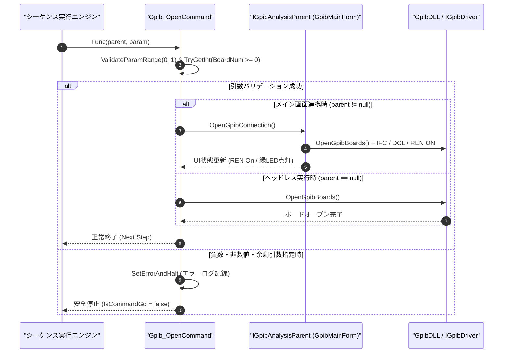

# コマンドリファレンス：Gpib_Open

## 概要

**Gpib_Open** は、システムに登録されている GPIB インターフェースボードを一括オープンし、GPIB バス通信セッションを開始するコマンドです。

> 💡 **補足**: メイン画面連携時（`parent != null`）は、設定されている全 GPIB ボードのオープン（`GpibDLL.OpenGpibBoards`）に加えて IFC 送出・DCL 送出・REN 有効化および接続ステータス LED（緑点灯）の更新を一括で実行します。

---

## 💡 書式・パラメータ仕様

### コマンド構文

```csv
,SEQUENCE, [ステップキー], Gpib_Open, "[BoardNum: 0]"
```

### パラメータ（引数）一覧

| 引数位置 | 引数名 | 説明 | 指定方法 / 有効な入力値 |
| :--- | :--- | :--- | :--- |
| 引数1 | `BoardNum` | 接続オープンする GPIB インターフェースボード番号（任意・省略時既定値: `0`）。※引数バリデーション（`0` 以上の整数）のみ行われ、実際のオープン処理は登録されている全設定ボードに対して一括実行されます。 | `0` 以上の整数（例: `0`）または `$PARAM$` 置換 |

---

## 🔄 特殊置換規約・分岐規約の適用

本コマンドの引数における特殊記法および解釈ルールです。
* **動的置換（`$`）**: 引数内で `$PARAMキー$` のように記述すると、実行時に変数プール（PARAM）の値へ動的置換されます。（適用可能な引数: 全引数対応）
* **ジャンプ先指定（`#`）**: 本コマンドはジャンプ制御を行わないため適用されません。（適用可能な引数: 非適用）
* **共通コマンド指定（`@`）**: 本コマンドは外部マクロを呼び出さないため適用されません。（適用可能な引数: 非適用）
* **カンマのエスケープ**: SCPI コマンド等、引数文字列自体にカンマを含める場合は、必ず `","` と二重引用符で囲んで記述します。
* **エイリアス（別名）**: `Open`, `GpibOpen`

---

## 💡 動作例（正しい構文での記述例）

### スクリプト記述例

※COMMAND ブロック配下の子要素行（PARAM, SEQUENCE）は必ず行頭カンマ（`,`）から開始してください（行頭スペースのみでは認識されません）。なお、`;` で始まる行やクォート外の `;` 以降はコメントとして自動除去されます。

```csv
COMMAND, "GPIB_SESSION_START", "DEV_ID"
,PARAM, "BOARD_NO", Number, "GPIBボード番号", "0"
,PARAM, "DEV_ID", Work, "機器ID応答", ""
; GPIBボードをオープンし、機器リセット(*RST)とID照会(*IDN?)を実行
,SEQUENCE, 010, Gpib_Open, "$BOARD_NO$"
,SEQUENCE, 020, Gpib_Send, "*RST"
,SEQUENCE, 030, Gpib_SendReceive, "*IDN?", "DEV_ID"
,SEQUENCE, 040, Gpib_Close, 0
,SEQUENCE, 050, Exit
```

### 実行時の挙動・変数変化

* **実行前の状態**: GPIB ボードが未接続（クローズ状態）であり、`"BOARD_NO"` に `"0"` が設定されている状態。
* **実行後の状態**: ステップ `010` の `Gpib_Open` により登録ボードがオープンされて IFC・DCL・REN 有効化および緑色接続 LED 点灯が行われ、ステップ `030` で応答が `"DEV_ID"` に格納されます。

---

## 🔄 動作フロー（シーケンス図）



---

## 🚫 エラーハンドリング・安全設計（仕様制限）

1. **引数境界およびボード番号（`0` 以上）の事前検証**:
   - `ValidateParamRange(0, 1)` 違反（2 個以上の引数指定）または第 1 引数 `BoardNum` に負数（`"-1"` 等）や非数値文字列が指定された場合は、`SetErrorAndHalt` によりエラーログを記録してシーケンスを安全停止します。
2. **オープン失敗時の UI 保護**:
   - 実機ドライバ未導入やボード未認識により `OpenGpibBoards()` が失敗した場合は、`GetConnectionStates(false)` に従い REN オフ・未接続状態を維持して誤操作を防止します。

---

## 🧪 ユニットテスト仕様

本コマンドクラス（`Gpib_OpenCommand.cs`）に実装されている `RunUnitTest()` メソッドが検証するユニットテストの仕様です。

### テスト実行前提条件

* **実行トリガー**: `RunUnitTest()` メソッドの呼び出し
* **有効化条件**: システム全体の最小ログレベル（`ErrorLogger.MinimumLevel`）が `LogLevel.Test` であること（それ以外の場合は無効化ガードにより早期リターン）
* **検証結果出力**: `_log.LogTest` によるログ出力。検証失敗時は `_log.LogError`、予期せぬ例外発生時は `_log.LogCritical` で記録し、`finally` ブロックで実行前のボード接続状態（`OpenGpibBoards` / `CloseGpibBoards`）および `GpibDLL.DebugDLL`・`DebugReceiveData` を復元します。

### テストケース一覧

| No | テストカテゴリ | テスト条件（入力値） | 期待される結果（出力値） | 検証の目的 / 観点 |
| :---: | :--- | :--- | :--- | :--- |
| **1** | 正常系 | `GetConnectionStates(true)` 判定およびボード番号 `("0")` を指定して `Func` を実行 | `(true, ButtonStatus.On, true)` が返却され、`!HasError` でシミュレーション接続が完了する | オープン成功時の UI 状態遷移およびボード接続動作の検証 |
| **2** | 異常系 | `GetConnectionStates(false)` 判定および負のボード番号 `("-1")` を指定して `Func` を実行 | `(false, ButtonStatus.Off, false)` が返却され、`HasError == true`・`IsCommandGo == false` で安全停止する | オープン失敗時の UI 状態判定および範囲外 `BoardNum` バリデーションの検証 |
