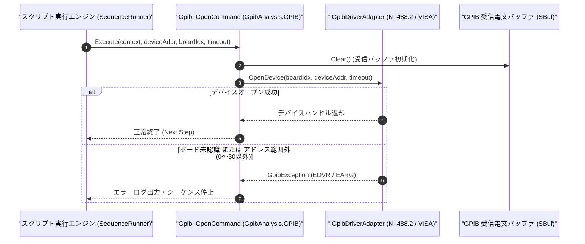

# コマンドリファレンス：Gpib_Open

---

## 概要

**Gpib_Open** は、指定された GPIB スレーブ機器アドレス（Primary Address: `0`〜`30`）または UI 設定の GPIB ボード／デバイス記述子を開き、GPIB バス通信セッションを初期化するコマンドです。
実行時に通信制御の排他選択モードを **GPIB モード**（`GpibAnalysis.GPIB.dll`）へ確定させます。

> 💡 **補足**: NI-488.2 / VISA 互換ドライバまたは抽象化インターフェース（`IGpibDriverAdapter`）を介して対象機器のデバイスディスクリプタを取得し、受信バッファ（`SBuf`）を初期化します。

---

## 💡 書式・パラメータ仕様

### コマンド構文

```csv
,SEQUENCE,Gpib_Open, "[DeviceAddress]", "[BoardIndex: 0]", "[TimeoutCode]"
```

### パラメータ（引数）一覧

| 引数位置 | パラメータ名 | 必須/任意 | 型・制約 | 説明 |
| :---: | :--- | :---: | :--- | :--- |
| 第1引数 | `DeviceAddress` | 任意 | 整数（`0`〜`30`） | 接続対象の GPIB 機器プライマリアドレス（PAD）を指定します。省略時は UI 上で設定されているデフォルトアドレスを使用します。 |
| 第2引数 | `BoardIndex` | 任意 | 整数（既定値: `0`） | 使用する GPIB インターフェースボード番号（`GPIB0` の場合は `0`）を指定します。 |
| 第3引数 | `TimeoutCode` | 任意 | 整数（ミリ秒またはタイムアウト定数、既定値: `10000`） | 通信タイムアウト時間を指定します。 |

---

## 🔄 特殊置換規約・分岐規約の適用

1. **変数展開（`$` / `@` / `#`）**:
   - 第 1 引数 `DeviceAddress` には `$DMM_ADDR` のような変数を指定して、接続先アドレスをパラメータ化できます。
2. **レガシー別名互換**:
   - 旧表記の `GpibOpen` や `GPIB_OPEN` は内部正規化により本 `Gpib_Open` コマンドへ統一マッピングされます。

---

## 💡 動作例（正しい構文での記述例）

### スクリプト記述例

```csv
,PARAM,TARGET_PAD,5

; 1. GPIBアドレス5の測定器をオープンし、機器リセット(*RST)とID照会(*IDN?)を実行
,SEQUENCE,Gpib_Open, "$TARGET_PAD"
,SEQUENCE,Gpib_Send, "*RST"
,SEQUENCE,Gpib_SendReceive, "*IDN?", "@DEV_ID"
,SEQUENCE,Gpib_Close
,SEQUENCE,Exit
```

### 実行時の挙動・変数変化

1. `Gpib_Open` により GPIB アドレス `5` のデバイスディスクリプタが開かれ、内部受信バッファ `SBuf` がクリアされます。
2. 後続の `Gpib_Send` / `Gpib_SendReceive` でアドレス指定を省略した場合、このオープン済みデバイスに対して通信が行われます。

---

## 🔄 動作フロー（シーケンス図）



---

## 🚫 エラーハンドリング・安全設計（仕様制限）

1. **GPIB アドレス範囲（`0`〜`30`）の厳格検証**:
   - IEEE 488 規格外のプライマリアドレス（負数や `31`［Untalk/Unlisten 予約値］以上）が指定された場合は、`ArgumentOutOfRangeException` を送出してバス異常を防止します。
2. **二重オープンの安全な再バインド**:
   - すでにオープンされている状態で再度 `Gpib_Open` が呼ばれた場合は、既存ハンドルを安全に整理してから新規アドレスでオープンします。

---

## 🧪 ユニットテスト仕様

### テスト実行前提条件
- **対象クラス**: `GpibAnalysis.GPIB.Gpib_OpenCommand`（`Gpib_OpenCommand.cs`）
- **モック環境**: `IGpibDriverAdapter` モックが注入されていること。

### テストケース一覧

| テストID | テスト観点 | 入力スクリプト | 期待される動作・検証項目 |
| :--- | :--- | :--- | :--- |
| `UT-GPIB-OPEN-01` | 正常オープン（アドレス指定） | `,SEQUENCE,Gpib_Open, "5"` | アドレス `5` でモックドライバがオープンされ、`SBuf` が初期化されること。 |
| `UT-GPIB-OPEN-02` | 正常オープン（引数省略） | `,SEQUENCE,Gpib_Open` | UI 既定アドレスでオープンされること。 |
| `UT-GPIB-OPEN-03` | 異常系（アドレス範囲外） | `,SEQUENCE,Gpib_Open, "35"` | `ArgumentOutOfRangeException` が送出されること。 |

