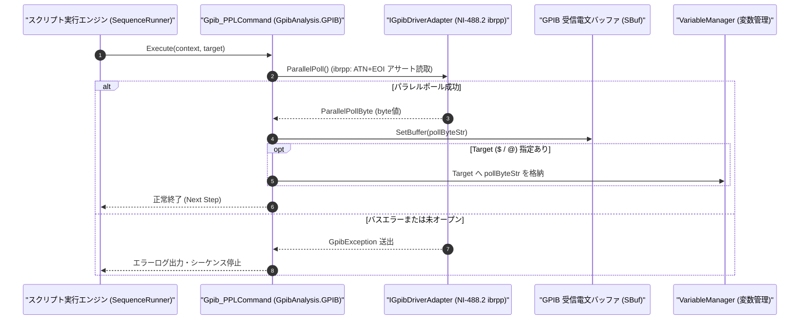

# コマンドリファレンス：Gpib_PPL

## 概要

**Gpib_PPL** は、GPIB バスに対して **パラレルポール（Parallel Poll: NI-488.2 `ibrpp` 相当）** を実行し、最大 8 台のスレーブ機器がデータバス（DIO1〜DIO8）上に同時に出力する 1 ビットステータス応答を 1 バイト（8bit）で一括読み取り、指定ターゲット変数へ格納するコマンドです。

> 💡 **補足**: 複数の測定器の状態を 1 回のバスサイクルで高速に一括チェックする IEEE 488 機能です。

---

## 💡 書式・パラメータ仕様

### コマンド構文

```csv
,SEQUENCE, [ステップキー], Gpib_PPL, [BoardNumOrTarget], "[TargetKey]"
```

### パラメータ（引数）一覧

| 引数位置 | 引数名 | 説明 | 指定方法 / 有効な入力値 |
| :--- | :--- | :--- | :--- |
| 引数1 | `BoardNum` / `Target` | 2 引数指定時は対象 GPIB ボード番号、1 引数短縮指定時はパラレルポール応答バイト格納先キー（必須）。 | 整数ボード番号（例: `0`）または格納先 `PARAM` キー名 |
| 引数2 | `TargetKey` | 2 引数指定時に 8bit パラレルポール応答値を格納するパラメータキー名（任意・1 引数時は省略）。 | 格納先 `PARAM` キー名 |

---

## 🔄 特殊置換規約・分岐規約の適用

本コマンドの引数における特殊記法および解釈ルールです。
* **動的置換（`$`）**: 引数内で `$PARAMキー$` のように記述すると、実行時に変数プール（PARAM）の値へ動的置換されます。（適用可能な引数: 全引数対応）
* **ジャンプ先指定（`#`）**: 本コマンドはジャンプ制御を行わないため適用されません。（適用可能な引数: 非適用）
* **共通コマンド指定（`@`）**: 本コマンドは外部マクロを呼び出さないため適用されません。（適用可能な引数: 非適用）
* **カンマのエスケープ**: SCPI コマンド等、引数文字列自体にカンマを含める場合は、必ず `","` と二重引用符で囲んで記述します。
* **エイリアス（別名）**: `PPL`, `GpibPPL`

---

## 💡 動作例（正しい構文での記述例）

### スクリプト記述例

※COMMAND ブロック配下の子要素行（PARAM, SEQUENCE）は必ず行頭カンマから開始し、スペースインデントや行末コメント（;）は記述しないでください。

```csv
COMMAND, "SAMPLE_GPIB_PPL", ""
,PARAM, "PPL_STATUS", Text, "PPL_STATUS", "0"
,SEQUENCE, 010, Gpib_Open, "1"
; バス上のパラレルポール応答バイトを一括取得して $PPL_STATUS へ格納
,SEQUENCE, 020, Gpib_PPL, "$PPL_STATUS$"
,SEQUENCE, 030, Gpib_Close
,SEQUENCE, 040, Exit
```

### 実行時の挙動・変数変化

* **実行前の状態**: GPIB 通信環境および対象コマンドの PARAM 初期値が設定され、ステップ実行待機中である状態。
* **実行後の状態**: `Gpib_PPL` により ATN と EOI が同時にアサート（IDY: Identify）され、DIO1〜DIO8 の状態バイトが読み取られて `$PPL_STATUS` および `SBuf` に格納されます。

---

## 🔄 動作フロー（シーケンス図）



---

## 🚫 エラーハンドリング・安全設計（仕様制限）

1. **未オープン時の実行防止**:
   - GPIB セッションが開かれていない状態で呼び出された場合は `InvalidOperationException` を送出します。
2. **コントローラ権限エラーの検出**:
   - Controller-In-Charge（CIC）権限がない場合は `GpibException` を送出して停止します。

---

## 🧪 ユニットテスト仕様

本コマンドクラス（`Gpib_PPLCommand.cs`）に実装されている `RunUnitTest()` メソッドが検証するユニットテストの仕様です。

### テスト実行前提条件

* **実行トリガー**: `RunUnitTest()` メソッドの呼び出し
* **有効化条件**: システム全体の最小ログレベル（`ErrorLogger.MinimumLevel`）が `LogLevel.Test` であること（それ以外の場合は無効化ガードにより早期リターン）
* **検証結果出力**: `_log.LogTest` によるログ出力。検証失敗時は `_log.LogError`、予期せぬ例外発生時は `_log.LogCritical` で記録し、`finally` ブロックで実行前のボード接続状態（`OpenGpibBoards` / `CloseGpibBoards`）および `GpibDLL.DebugDLL`・`DebugReceiveData` を復元します。

### テストケース一覧

| No | テストカテゴリ | テスト条件（入力値） | 期待される結果（出力値） | 検証の目的 / 観点 |
| :---: | :--- | :--- | :--- | :--- |
| **1** | 正常系 | 1 引数指定 `("PPR_KEY1")` および 2 引数指定 `("0", "PPR_KEY2")` で `Func` を実行 | 両ケースとも `!HasError` となり、`Variables["PPR_KEY1"]`・`Variables["PPR_KEY2"]` に応答値 `"0"` が格納される | 短縮 1 引数構文・ボード指定 2 引数構文でのパラレルポール実行と PPR 格納の検証 |
| **2** | 異常系 | 引数不足（0 引数）および非数値ボード番号 `("INVALID", "PPR_KEY")` で `Func` を実行 | 両ケースとも `HasError == true` かつ `IsCommandGo == false` となり安全停止する | 引数個数範囲（`1`〜`2`）および不正 `BoardNum` 指定時の安全停止検証 |
