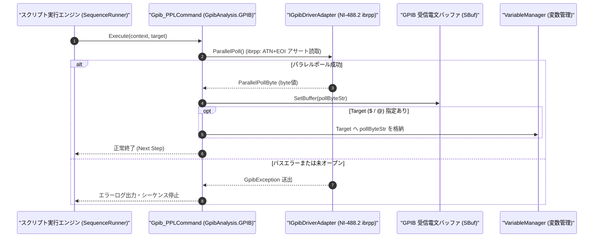

# コマンドリファレンス：Gpib_PPL

---

## 概要

**Gpib_PPL** は、GPIB バスに対して **パラレルポール（Parallel Poll: NI-488.2 `ibrpp` 相当）** を実行し、最大 8 台のスレーブ機器がデータバス（DIO1〜DIO8）上に同時に出力する 1 ビットステータス応答を 1 バイト（8bit）で一括読み取り、指定ターゲット変数へ格納するコマンドです。

> 💡 **補足**: 複数の測定器の状態を 1 回のバスサイクルで高速に一括チェックする IEEE 488 機能です。

---

## 💡 書式・パラメータ仕様

### コマンド構文

```csv
,SEQUENCE,Gpib_PPL, "[Target]"
```

### パラメータ（引数）一覧

| 引数位置 | パラメータ名 | 必須/任意 | 型・制約 | 説明 |
| :---: | :--- | :---: | :--- | :--- |
| 第1引数 | `Target` | 任意 | 変数名（`$` / `@`） | 読み取った 8bit パラレルポール応答バイト値を格納するターゲット変数を指定します。省略時は内部受信バッファ `SBuf` に格納されます。 |

---

## 🔄 特殊置換規約・分岐規約の適用

1. **ターゲット変数（`$` / `@`）への格納**:
   - 第 1 引数に `$PPL_BYTE` や `@PPL_RES` を指定すると、取得された 8bit 応答値が格納されます。
2. **レガシー別名互換**:
   - 旧表記の `GpibPPL` や `GPIB_PPL` は内部正規化により本 `Gpib_PPL` コマンドへマッピングされます。

---

## 💡 動作例（正しい構文での記述例）

### スクリプト記述例

```csv
,PARAM,PPL_STATUS,0

,SEQUENCE,Gpib_Open, "1"
; バス上のパラレルポール応答バイトを一括取得して $PPL_STATUS へ格納
,SEQUENCE,Gpib_PPL, "$PPL_STATUS"
,SEQUENCE,Gpib_Close
,SEQUENCE,Exit
```

### 実行時の挙動・変数変化

1. `Gpib_PPL` により ATN と EOI が同時にアサート（IDY: Identify）され、DIO1〜DIO8 の状態バイトが読み取られて `$PPL_STATUS` および `SBuf` に格納されます。

---

## 🔄 動作フロー（シーケンス図）



---

## 🚫 エラーハンドリング・安全設計（仕様制限）

1. **未オープン時の実行防止**:
   - GPIB セッションが開かれていない状態で呼び出された場合は `InvalidOperationException` を送出します。
2. **コントローラ権限エラーの検出**:
   - Controller-In-Charge（CIC）権限がない場合は `GpibException` を送出して停止します。

---

## 🧪 ユニットテスト仕様

### テスト実行前提条件
- **対象クラス**: `GpibAnalysis.GPIB.Gpib_PPLCommand`（`Gpib_PPLCommand.cs`）
- **モック環境**: `IGpibDriverAdapter` モックが注入されていること。

### テストケース一覧

| テストID | テスト観点 | 入力スクリプト | 期待される動作・検証項目 |
| :--- | :--- | :--- | :--- |
| `UT-GPIB-PPL-01` | 正常系（変数格納あり） | `,SEQUENCE,Gpib_PPL, "$PPL"` | `ParallelPoll()` の戻り値が `$PPL` と `SBuf` に格納されること。 |
| `UT-GPIB-PPL-02` | 正常系（引数省略） | `,SEQUENCE,Gpib_PPL` | 戻り値が `SBuf` に格納されること。 |
| `UT-GPIB-PPL-03` | 異常系（バスエラー） | モックが例外を送出する設定時 | `GpibException` が捕捉され停止すること。 |

