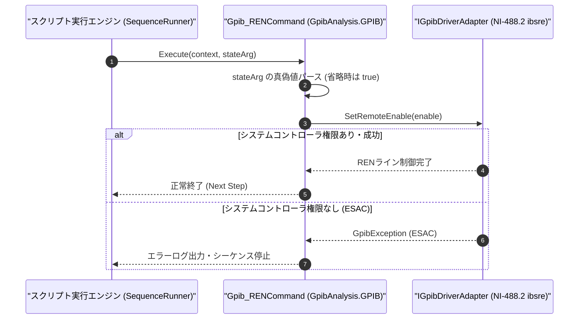

# コマンドリファレンス：Gpib_REN

---

## 概要

**Gpib_REN** は、GPIB バス上の **REN（Remote Enable）単一制御ライン** をアサート（有効化: リモート制御許可）またはデアサート（無効化: 全機器ローカル制御復帰）するバス制御コマンドです。

> 💡 **補足**: IEEE 488 規格において、測定器を PC からのリモート制御状態に移行させるための前提となるハードウェア制御ライン（NI-488.2 `ibsre` 相当）を制御します。

---

## 💡 書式・パラメータ仕様

### コマンド構文

```csv
,SEQUENCE,Gpib_REN, "[State: 1 / 0 / ON / OFF / true / false]"
```

### パラメータ（引数）一覧

| 引数位置 | パラメータ名 | 必須/任意 | 型・制約 | 説明 |
| :---: | :--- | :---: | :--- | :--- |
| 第1引数 | `State` | 任意 | `1` / `0` / `ON` / `OFF` / `true` / `false`（既定値: `1`［ON］） | `1` / `ON` / `true` 指定時は REN ラインをアサート（リモート有効）し、`0` / `OFF` / `false` 指定時はデアサート（ローカル復帰）します。省略時は `1`（アサート）となります。 |

---

## 🔄 特殊置換規約・分岐規約の適用

1. **変数展開（`$` / `@` / `#`）**:
   - 第 1 引数 `State` には変数を指定可能です（例: `"$REN_FLAG"`）。
2. **レガシー別名互換**:
   - 旧表記の `GpibREN` や `GPIB_REN` は内部正規化により本 `Gpib_REN` コマンドへマッピングされます。

---

## 💡 動作例（正しい構文での記述例）

### スクリプト記述例

```csv
,SEQUENCE,Gpib_Open, "5"

; 1. RENラインをアサートしてリモート制御を有効化
,SEQUENCE,Gpib_REN, "ON"
,SEQUENCE,Gpib_Send, "VOLT 12.0"

; 2. 試験終了時にRENラインをデアサートしてフロントパネル操作を許可
,SEQUENCE,Gpib_REN, "OFF"
,SEQUENCE,Gpib_Close
,SEQUENCE,Exit
```

### 実行時の挙動・変数変化

1. `Gpib_REN, "ON"` により GPIB バスの REN ラインが Low（真）にドライブされ、続く `Gpib_Send` で測定器がリモートモード（REM 点灯）になります。
2. `Gpib_REN, "OFF"` により REN ラインが解放され、バス上の測定器が一斉にローカルモードへ戻ります。

---

## 🔄 動作フロー（シーケンス図）



---

## 🚫 エラーハンドリング・安全設計（仕様制限）

1. **システムコントローラ権限（`ESAC`）の確認**:
   - PC 側の GPIB ボードが System Controller でない場合は REN ラインを駆動できないため、`GpibException` を送出して通知します。
2. **不正な状態文字列の拒否**:
   - `1` / `0` / `ON` / `OFF` / `true` / `false` 以外の文字列が指定された場合は `ArgumentException` を送出します。

---

## 🧪 ユニットテスト仕様

### テスト実行前提条件
- **対象クラス**: `GpibAnalysis.GPIB.Gpib_RENCommand`（`Gpib_RENCommand.cs`）
- **モック環境**: `IGpibDriverAdapter` モックが注入されていること。

### テストケース一覧

| テストID | テスト観点 | 入力スクリプト | 期待される動作・検証項目 |
| :--- | :--- | :--- | :--- |
| `UT-GPIB-REN-01` | 正常系（ON指定・省略時） | `,SEQUENCE,Gpib_REN, "ON"` | `SetRemoteEnable(true)` が呼び出されること。 |
| `UT-GPIB-REN-02` | 正常系（OFF指定） | `,SEQUENCE,Gpib_REN, "OFF"` | `SetRemoteEnable(false)` が呼び出されること。 |
| `UT-GPIB-REN-03` | 異常系（不正引数） | `,SEQUENCE,Gpib_REN, "INVALID"` | `ArgumentException` が送出されること。 |

