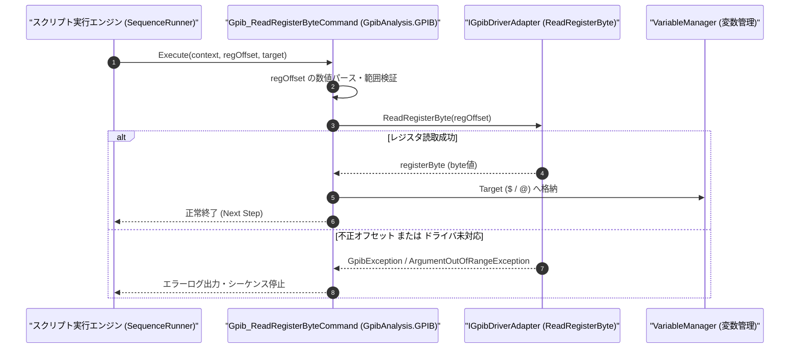

# コマンドリファレンス：Gpib_ReadRegisterByte

---

## 概要

**Gpib_ReadRegisterByte** は、GPIB コントローラチップ（NEC µPD7210 / NAT9914 / TNT4882 互換レジスタまたはドライバステータス領域）の指定オフセットアドレスから 1 バイト（8bit）のレジスタ値を直接読み取り、指定ターゲット変数へ格納する低レベル診断・制御コマンドです。

> 💡 **補足**: 通常の SCPI 通信では使用しませんが、GPIB バスライン状態（ISR1 / ISR2 / ADSR / BSR 等のハードウェアレジスタ）の詳細診断や特殊ハンドシェイク解析を行う際に使用します。

---

## 💡 書式・パラメータ仕様

### コマンド構文

```csv
,SEQUENCE,Gpib_ReadRegisterByte, "<RegisterOffset>", "<Target>"
```

### パラメータ（引数）一覧

| 引数位置 | パラメータ名 | 必須/任意 | 型・制約 | 説明 |
| :---: | :--- | :---: | :--- | :--- |
| 第1引数 | `RegisterOffset` | **必須** | 整数または16進表記（例: `"0"`, `"0x04"`） | 読み取り対象の GPIB コントローラレジスタ番号（オフセット）を指定します。 |
| 第2引数 | `Target` | **必須** | 変数名（`$` / `@`） | 読み取った 1 バイト値（10進または16進文字列）を格納するターゲット変数を指定します。 |

---

## 🔄 特殊置換規約・分岐規約の適用

1. **変数展開とターゲット格納**:
   - 第 1 引数には `$REG_OFFSET` のような変数を指定でき、読み取り結果は第 2 引数の `$REG_VAL` または `@REG_VAL` に格納されます。
2. **レガシー別名互換**:
   - 旧表記の `GpibReadRegisterByte` は内部正規化により本 `Gpib_ReadRegisterByte` コマンドへマッピングされます。

---

## 💡 動作例（正しい構文での記述例）

### スクリプト記述例

```csv
,PARAM,ADSR_VAL,0

,SEQUENCE,Gpib_Open, "5"
; GPIBコントローラのアドレスステータスレジスタ(オフセット0x04)を1バイト読み取る
,SEQUENCE,Gpib_ReadRegisterByte, "0x04", "$ADSR_VAL"
,SEQUENCE,Gpib_Close
,SEQUENCE,Exit
```

### 実行時の挙動・変数変化

1. `Gpib_ReadRegisterByte` によりオフセット `0x04` のレジスタ値が読み取られ、その 1 バイト値が `$ADSR_VAL`（および `SBuf`）へ格納されます。

---

## 🔄 動作フロー（シーケンス図）



---

## 🚫 エラーハンドリング・安全設計（仕様制限）

1. **不正なオフセットアドレスの防止**:
   - 負のオフセット値やハードウェアレジスタ空間外のアドレスが指定された場合は、`ArgumentOutOfRangeException` を送出してメモリアクセス違反を防止します。
2. **ターゲット引数必須チェック**:
   - 格納先ターゲット（第 2 引数）が省略された場合は `ArgumentException` を送出します。

---

## 🧪 ユニットテスト仕様

### テスト実行前提条件
- **対象クラス**: `GpibAnalysis.GPIB.Gpib_ReadRegisterByteCommand`（`Gpib_ReadRegisterByteCommand.cs`）
- **モック環境**: `IGpibDriverAdapter` モックが注入されていること。

### テストケース一覧

| テストID | テスト観点 | 入力スクリプト | 期待される動作・検証項目 |
| :--- | :--- | :--- | :--- |
| `UT-GPIB-RDREG-01` | 正常系（レジスタ読取） | `,SEQUENCE,Gpib_ReadRegisterByte, "0x04", "$VAL"` | `ReadRegisterByte(4)` が呼ばれ、戻り値が `$VAL` に格納されること。 |
| `UT-GPIB-RDREG-02` | 変数展開 | `,SEQUENCE,Gpib_ReadRegisterByte, "$OFF", "$VAL"` | `$OFF` の展開値でレジスタが読み取られること。 |
| `UT-GPIB-RDREG-03` | 異常系（負数オフセット） | `,SEQUENCE,Gpib_ReadRegisterByte, "-1", "$VAL"` | `ArgumentOutOfRangeException` が送出されること。 |

