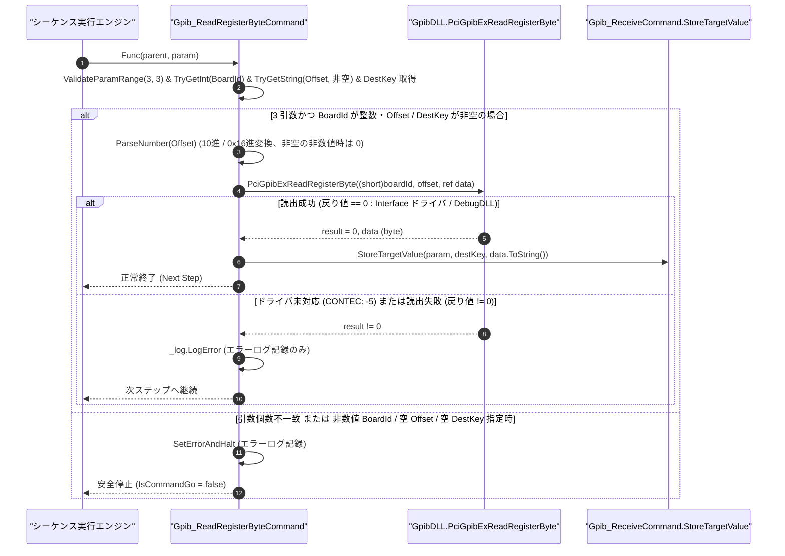

# コマンドリファレンス：Gpib_ReadRegisterByte

## 概要

**Gpib_ReadRegisterByte** は、 **Interface 社製 GPIB ドライバ（`gpc4304.dll`）専用** の低レベル診断・制御コマンドであり、指定した GPIB ボード上のコントローラチップ物理レジスタの指定オフセットアドレスから 1 バイト（8bit）の値を直接読み取り、指定ターゲット変数へ 10 進文字列として格納します。

> 💡 **補足（ドライバメーカー制限）**: 本コマンドは Interface 社製ドライバ（`gpc4304.dll`）およびデバッグシミュレーションモード（`DebugDLL == true`：テスト用固定値 `0x5A`＝`"90"` を返却）に対応しています。CONTEC 社製ドライバ（`CGPIB.DLL`）選択時に実行した場合は、未サポートエラーコード（`-5`）をログ出力して停止せず次ステップへ継続します。

---

## 💡 書式・パラメータ仕様

### コマンド構文

```csv
,SEQUENCE, [ステップキー], Gpib_ReadRegisterByte, [BoardId], "[Offset]", "[DestKey]"
```

### パラメータ（引数）一覧

| 引数位置 | 引数名 | 説明 | 指定方法 / 有効な入力値 |
| :--- | :--- | :--- | :--- |
| 引数1 | `BoardId` | 読み取り対象の GPIB コントローラボード番号（必須。`ParameterSpec` 上の制約は `0` 以上、`Func` 実行時は整数型検証を行い `(short)` キャストしてドライバ API へ渡します）。 | `0` 以上の整数（例: `0`）または `$PARAM$` 置換 |
| 引数2 | `Offset` | 読み取り対象のコントローラ ASIC 物理レジスタオフセット番号（非空必須）。※空文字 `""`（または空白）を渡した場合は `TryGetString` によりエラーコード `-10` で安全停止し、`"INVALID"` 等の非空・非数値文字列の場合に `ParseNumber` により `0` にフォールバックします。 | 10 進整数または `"0x"` 付き 16 進表記（例: `"4"`, `"0x04"`） |
| 引数3 | `DestKey` | 読み取った 1 バイト値（`0`〜`255` の 10 進文字列）を格納する対象パラメータキー名（必須）。 | 格納先 `PARAM` キー名 |

---

## 🔄 特殊置換規約・分岐規約の適用

本コマンドの引数における特殊記法および解釈ルールです。
* **動的置換（`$`）**: 引数内で `$PARAMキー$` のように記述すると、実行時に変数プール（PARAM）の値へ動的置換されます。（適用可能な引数: 全引数対応）
* **ジャンプ先指定（`#`）**: 本コマンドはジャンプ制御を行わないため適用されません。（適用可能な引数: 非適用）
* **共通コマンド指定（`@`）**: 本コマンドは外部マクロを呼び出さないため適用されません。（適用可能な引数: 非適用）
* **カンマのエスケープ**: SCPI コマンド等、引数文字列自体にカンマを含める場合は、必ず `","` と二重引用符で囲んで記述します。
* **エイリアス（別名）**: `ReadRegisterByte`, `GpibReadRegisterByte`

---

## 💡 動作例（正しい構文での記述例）

### スクリプト記述例

※COMMAND ブロック配下の子要素行（PARAM, SEQUENCE）は必ず行頭カンマ（`,`）から開始してください（行頭スペースのみでは認識されません）。なお、`;` で始まる行やクォート外の `;` 以降はコメントとして自動除去されます。

```csv
COMMAND, "READ_ASIC_ADSR", "ADSR_VAL"
,PARAM, "ADSR_VAL", Work, "レジスタ読取値", "0"
,SEQUENCE, 010, Gpib_Open, 0
; ボード 0 のオフセット 0x04 レジスタを 1 バイト読み取り ADSR_VAL へ格納 (Interface 専用)
,SEQUENCE, 020, Gpib_ReadRegisterByte, 0, "0x04", "ADSR_VAL"
,SEQUENCE, 030, Gpib_Close, 0
,SEQUENCE, 040, Exit
```

### 実行時の挙動・変数変化

* **実行前の状態**: GPIB ボード `0` がオープン済みで、`"ADSR_VAL"` が `"0"` の状態。
* **実行後の状態**: ステップ `020` の実行によりオフセット `0x04` の物理レジスタ 1 バイト値が読み出され、10 進整数文字列（デバッグシミュレーション時は `"90"`）として `"ADSR_VAL"` に格納されます。

---

## 🔄 動作フロー（シーケンス図）



---

## 🚫 エラーハンドリング・安全設計（仕様制限）

1. **3 引数必須および `BoardId`・非空文字列バリデーション保護**:
   - `ValidateParamRange(3, 3)` により引数が 3 個ちょうどでない場合（エラーコード `-10`）、第 1 引数 `BoardId` に整数変換できない非数値文字列が指定された場合（エラーコード `-11`）、または第 2 引数 `Offset` もしくは第 3 引数 `DestKey` に空文字（空白）が指定された場合（`TryGetString` エラーコード `-10`）は、`SetErrorAndHalt` によりエラーログを記録して安全停止します。
2. **CONTEC ドライバ環境および物理読出失敗時の非停止ログ記録**:
   - CONTEC ドライバ環境で実行された場合（ドライバ戻り値 `-5`）や、範囲外ボード ID 指定等による実機読出失敗時（戻り値 `!= 0`）は `_log.LogError` を記録しますが、例外送出や強制停止は行わず次ステップへ継続します（なお `DebugDLL == true` 時はテスト用固定値 `"90"` が格納されます）。また、`Offset` に `"INVALID"` 等の非空・非数値文字列が渡された場合は `ParseNumber` が安全に `0` を返します。

---

## 🧪 ユニットテスト仕様

本コマンドクラス（`Gpib_ReadRegisterByteCommand.cs`）に実装されている `RunUnitTest()` メソッドが検証するユニットテストの仕様です。

### テスト実行前提条件

* **実行トリガー**: `RunUnitTest()` メソッドの呼び出し
* **有効化条件**: システム全体の最小ログレベル（`ErrorLogger.MinimumLevel`）が `LogLevel.Test` であること（それ以外の場合は無効化ガードにより早期リターン）
* **検証結果出力**: `_log.LogTest` によるログ出力。検証失敗時は `_log.LogError`、予期せぬ例外発生時は `_log.LogCritical` で記録し、`finally` ブロックで `GpibDLL.DebugDLL` および `GpibDLL.DebugReceiveData` を元の状態へ復元します。

### テストケース一覧

| No | テストカテゴリ | テスト条件（入力値） | 期待される結果（出力値） | 検証の目的 / 観点 |
| :---: | :--- | :--- | :--- | :--- |
| **1** | 正常系 | `ParseNumber("10")` による 10 進数表記オフセット解析を実行 | 整数 `10` が返却される | 10 進数レジスタオフセット文字列の変換検証 |
| **2** | 正常系 | `ParseNumber("0x10")` 解析、および `("0", "0x04", "REG_VAL")` を指定して `Func` を実行 | `16` に変換され、`!HasError` で `Variables["REG_VAL"]` にデバッグ読取値 `"90"` が格納される | 16 進数オフセット解析および物理レジスタ読出・変数格納の検証 |
| **3** | 異常系 | `ParseNumber(null)`・`ParseNumber("INVALID")` 解析、および不正ボード ID `("INVALID", "0", "REG_VAL")` で `Func` を実行 | 数値解析は `0` を返し、`Func` は `HasError == true`・`IsCommandGo == false` で安全停止する | 異常文字列フォールバックおよび不正 `BoardId` 指定時の安全停止検証 |
