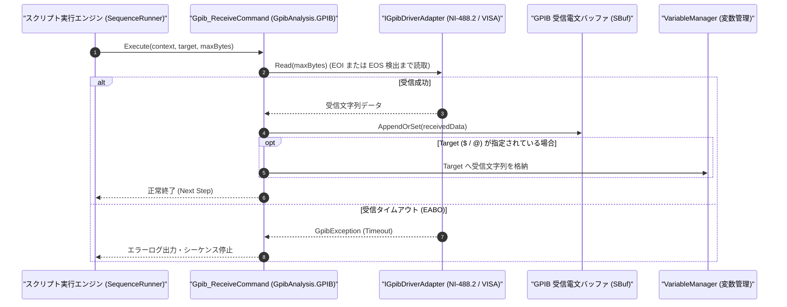

# コマンドリファレンス：Gpib_Receive

---

## 概要

**Gpib_Receive** は、オープン中の GPIB デバイスから応答電文を受信し、GPIB 内部受信電文バッファ（`SBuf`）へ格納するとともに、第 1 引数で指定されたターゲット変数（`$` / `@`）へ受信文字列を直接格納するコマンドです。

> 💡 **補足**: EOI（End Or Identify）アサートまたは EOS（End Of String: `LF` 等）検出までデータを読み取ります。

---

## 💡 書式・パラメータ仕様

### コマンド構文

```csv
,SEQUENCE,Gpib_Receive, "[Target]", "[MaxByteCount: 65536]"
```

### パラメータ（引数）一覧

| 引数位置 | パラメータ名 | 必須/任意 | 型・制約 | 説明 |
| :---: | :--- | :---: | :--- | :--- |
| 第1引数 | `Target` | 任意 | 変数名（`$` / `@`） | 受信した文字列データを格納するターゲット変数を指定します。省略時は内部受信バッファ `SBuf` のみに格納されます。 |
| 第2引数 | `MaxByteCount` | 任意 | 整数（バイト数、既定値: `65536`） | 1 回の受信で読み取る最大バイト数を指定します。 |

---

## 🔄 特殊置換規約・分岐規約の適用

1. **格納先ターゲット（`$` / `@`）と `SBuf` の同期更新**:
   - 第 1 引数に `$RES_STR` や `@RECV_DATA` を指定すると、受信データが `SBuf` に格納されると同時に該当変数へも格納されます。
2. **レガシー別名互換**:
   - 旧表記の `GpibReceive` や `GPIB_RECEIVE` は内部正規化により本 `Gpib_Receive` コマンドへマッピングされます。

---

## 💡 動作例（正しい構文での記述例）

### スクリプト記述例

```csv
,PARAM,MEAS_RESULT,

,SEQUENCE,Gpib_Open, "8"
; 1. 測定開始トリガコマンドを送信し、測定完了時間(500ms)待機
,SEQUENCE,Gpib_Send, "INIT;FETCH?"
,SEQUENCE,Wait, "500"

; 2. 測定器からの応答を受信して $MEAS_RESULT へ格納
,SEQUENCE,Gpib_Receive, "$MEAS_RESULT"

,SEQUENCE,Gpib_Close
,SEQUENCE,Exit
```

### 実行時の挙動・変数変化

1. `Gpib_Send` で `"INIT;FETCH?"` を送信し、500ms 待機します。
2. `Gpib_Receive` により測定器からの応答データが読み取られ、`SBuf` および `$MEAS_RESULT`（末尾改行除去済み）へ格納されます。

---

## 🔄 動作フロー（シーケンス図）



---

## 🚫 エラーハンドリング・安全設計（仕様制限）

1. **受信タイムアウト（`EABO`）の検出**:
   - 測定器が Talker としてデータを出力しない場合、規定タイムアウト時間で安全に中断し、バスハングアップを防止します。
2. **末尾改行コードの正規化**:
   - 変数格納時には測定器固有の終端改行（`CR+LF` または `LF`）をトリムし、`Judge` コマンド等での数値・文字列比較で不一致が起きないようにします。

---

## 🧪 ユニットテスト仕様

### テスト実行前提条件
- **対象クラス**: `GpibAnalysis.GPIB.Gpib_ReceiveCommand`（`Gpib_ReceiveCommand.cs`）
- **モック環境**: 疑似応答を返す `IGpibDriverAdapter` モックが注入されていること。

### テストケース一覧

| テストID | テスト観点 | 入力スクリプト | 期待される動作・検証項目 |
| :--- | :--- | :--- | :--- |
| `UT-GPIB-RECV-01` | 正常受信（変数格納あり） | `,SEQUENCE,Gpib_Receive, "$RES"` | 受信データが `SBuf` と `$RES` の双方に格納されること。 |
| `UT-GPIB-RECV-02` | 正常受信（引数省略・SBufのみ） | `,SEQUENCE,Gpib_Receive` | 受信データが `SBuf` に格納され、後続の `Set_Data` で取得できること。 |
| `UT-GPIB-RECV-03` | 異常系（タイムアウト） | モックが `EABO` を返す設定時 | `GpibException` が送出されること。 |

