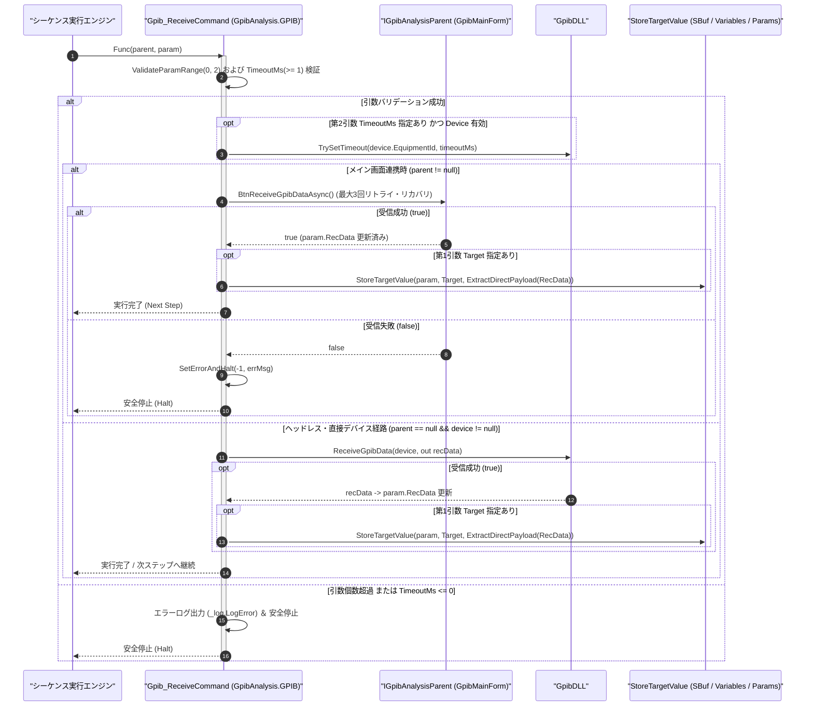

# コマンドリファレンス：Gpib_Receive

## 概要

**Gpib_Receive** は、接続中の GPIB デバイスから応答電文を受信して内部受信バッファ（`RecData`）を更新し、第 1 引数で格納先キーが指定されている場合は整形済み受信文字列をターゲット変数（`SBuf` / `Variables` / `PARAM`）へ格納する GPIB 通信制御系コマンドです。  
第 2 引数で受信タイムアウト時間（`TimeoutMs`）をミリ秒単位で個別指定でき、測定応答に時間を要するコマンドの受信制御にも対応しています。

> 💡 **補足**: 変数格納時にはログ装飾プレフィックス（`[ 日時 ] R:` や `R:`）および末尾の改行コード（`CR` / `LF`）が自動的に除去された本体文字列が保存されます。また、実機ドライバからの物理受信時（`GpibDLL.ReceiveGpibData`）には、後続の `Set_Data`（`sscanf` 風書式解析）での空白区切り誤分割を防ぐため、受信電文中の **半角スペース `' '` は自動的にアンダースコア `'_'` へ置換** されます。

---

## 💡 書式・パラメータ仕様

### コマンド構文

```csv
,SEQUENCE, [ステップキー], Gpib_Receive, "[Target]", "[TimeoutMs: 5000]"
```

### パラメータ（引数）一覧

| 引数位置 | 引数名 | 説明 | 指定方法 / 有効な入力値 |
| :--- | :--- | :--- | :--- |
| 引数1 | `Target` | 受信した文字列データを格納するターゲット変数・パラメータキー名（任意・省略時既定値: `""`）。省略時は内部受信バッファ（`RecData`）のみ更新されます。 | `PARAM` キー名（例: `"MEAS_RESULT"`） |
| 引数2 | `TimeoutMs` | 受信タイムアウト時間［ミリ秒］（任意・省略時既定値: `5000`）。指定時は受信前に `GpibDLL.TrySetTimeout` で対象機器へ設定されます。 | `1` 以上の整数（例: `"5000"`, `"3000"`）または `$PARAM$` 置換 |

---

## 🔄 特殊置換規約・分岐規約の適用

本コマンドの引数における特殊記法および解釈ルールです。
* **動的置換（`$`）**: 引数内で `$PARAMキー$` のように記述すると、実行時に変数プール（PARAM）の値へ動的置換されます。（適用可能な引数: 全引数対応）
* **ジャンプ先指定（`#`）**: 本コマンドはジャンプ制御を行わないため適用されません。（適用可能な引数: 非適用）
* **共通コマンド指定（`@`）**: 本コマンドは外部マクロを呼び出さないため適用されません。（適用可能な引数: 非適用）
* **カンマのエスケープ**: SCPI コマンド等、引数文字列自体にカンマを含める場合は、必ず `","` と二重引用符で囲んで記述します。
* **エイリアス（別名）**: `Receive`, `GpibReceive`

---

## 💡 動作例（正しい構文での記述例）

### スクリプト記述例

※COMMAND ブロック配下の子要素行（PARAM, SEQUENCE）は必ず行頭カンマ（`,`）から開始してください（行頭スペースのみでは認識されません）。なお、`;` で始まる行やクォート外の `;` 以降はコメントとして自動除去されます。

```csv
COMMAND, "SAMPLE_GPIB_RECEIVE", "MEAS_RESULT"
,PARAM, "MEAS_RESULT", Text, "測定結果", ""
,SEQUENCE, 010, Gpib_Open, "0"
; 1. 測定開始トリガコマンドを送信し、測定完了時間(500ms)待機
,SEQUENCE, 020, Gpib_Send, "INIT;FETCH?"
,SEQUENCE, 030, Wait, "500"
; 2. タイムアウト 3000ms を指定して測定器からの応答を受信し MEAS_RESULT へ格納
,SEQUENCE, 040, Gpib_Receive, "MEAS_RESULT", "3000"
,SEQUENCE, 050, Gpib_Close, "0"
,SEQUENCE, 060, Exit
```

### 実行時の挙動・変数変化

* **実行前の状態**: GPIB ボードがオープン済みであり、`"MEAS_RESULT"` が空文字列 `""` に設定されている状態。
* **実行後の状態**: ステップ `020` で `"INIT;FETCH?"` を送信して `500` ms 待機した後、ステップ `040` の `Gpib_Receive` により受信タイムアウト `3000` ms で応答電文が読み取られ、改行およびログプレフィックスを除去した測定値文字列が `"MEAS_RESULT"` に格納されます。

---

## 🔄 動作フロー（シーケンス図）



---

## 🚫 エラーハンドリング・安全設計（仕様制限）

1. **タイムアウト値（`TimeoutMs >= 1`）および引数個数の事前検証**:
   - 第 2 引数 `TimeoutMs` に `0` 以下の整数や非数値文字列が指定された場合、または 3 個以上の引数が指定された場合は、通信処理を実行せずエラーログ（`_log.LogError`）を記録して安全停止します。
2. **実行経路別のリトライ・エラー制御と受信文字正規化**:
   - メイン画面連携時（`parent != null`）の受信処理（`BtnReceiveGpibDataAsync`）では最大 3 回の自動リトライ（2 回目失敗時は SDC/IFC リカバリ送出）を行い、最終的に失敗した場合は `SetErrorAndHalt(-1, ...)` でシーケンスを安全停止します。一方、ヘッドレス経路（`parent == null && device != null`）では `GpibDLL.ReceiveGpibData` が `true` を返した場合のみ `RecData` および指定変数を更新し、`false` 時はエラーログ出力のみで停止せず次ステップへ継続します。正常受信時は物理層で半角空白 `' '` が `'_'` に置換された後、`ExtractDirectPayload` によりログ装飾（`[ 日時 ] R:` / `R:`）や末尾改行（`CR` / `LF`）を除去して変数へ保存します。

---

## 🧪 ユニットテスト仕様

本コマンドクラス（`Gpib_ReceiveCommand.cs`）に実装されている `RunUnitTest()` メソッドが検証するユニットテストの仕様です。

### テスト実行前提条件

* **実行トリガー**: `RunUnitTest()` メソッドの呼び出し
* **有効化条件**: システム全体の最小ログレベル（`ErrorLogger.MinimumLevel`）が `LogLevel.Test` であること（それ以外の場合は無効化ガードにより早期リターン）
* **検証結果出力**: `_log.LogTest` によるログ出力。検証失敗時は `_log.LogError`、予期せぬ例外発生時は `_log.LogCritical` で記録し、`finally` ブロックで `GpibDLL.DebugDLL` および `GpibDLL.DebugReceiveData` を元の状態へ復元します。

### テストケース一覧

| No | テストカテゴリ | テスト条件（入力値） | 期待される結果（出力値） | 検証の目的 / 観点 |
| :---: | :--- | :--- | :--- | :--- |
| **1** | 正常系 | `IsRetryNeeded` に失敗時 `(1, 3, false)` / `(2, 3, false)`、上限到達 `(3, 3, false)`、成功時 `(1, 3, true)` を指定 | 未満失敗時は `true`、上限到達時および成功時は `false` を返す | 受信リトライ継続判定ロジックの検証 |
| **2** | 正常系 | `GetButtonUiState(true)`（処理中）および `GetButtonUiState(false)`（待機中）を実行 | 処理中は `(false, Color.Aqua)`、待機中は `(true, Color.Gainsboro)` を返す | 受信ボタンの活性状態・背景色遷移の検証 |
| **3** | 正常系・異常系 | `CanReceiveData(true/false)` 判定、`DebugReceiveData = "MEAS_12.34"` での `("REC_KEY", "1000")` 正常受信、および範囲外タイムアウト `("REC_KEY", "0")` を実行 | オープン時のみ `true`、正常時は `Variables["REC_KEY"] == "MEAS_12.34"` となり、`"0"` 指定時は `HasError == true`・`IsCommandGo == false` で安全停止する | ポート状態判定・タイムアウト付きシミュレーション受信および範囲外 `TimeoutMs` 防護の一括検証 |
