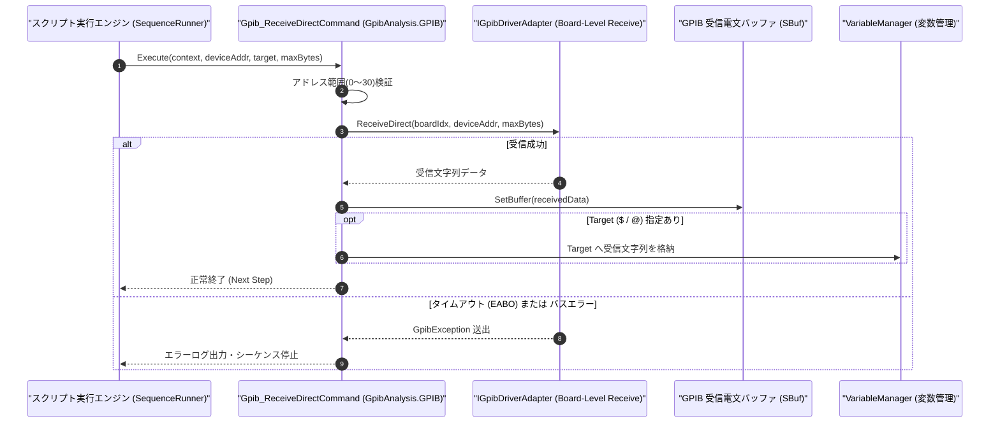

# コマンドリファレンス：Gpib_ReceiveDirect

---

## 概要

**Gpib_ReceiveDirect** は、引数で直接指定した GPIB デバイスアドレス（Primary Address: `0`〜`30`）の測定器を Talker に指定して応答電文をダイレクトに受信し、内部受信バッファ（`SBuf`）および指定ターゲット変数（`$` / `@`）へ格納するコマンドです。

> 💡 **補足**: [`Gpib_SendDirect`](./Gpib_SendDirect.Md) と組み合わせることで、複数台の GPIB 機器を切り替えたマルチデバイス計測シーケンスを簡潔に構築できます。

---

## 💡 書式・パラメータ仕様

### コマンド構文

```csv
,SEQUENCE,Gpib_ReceiveDirect, "<DeviceAddress>", "[Target]", "[MaxByteCount: 65536]"
```

### パラメータ（引数）一覧

| 引数位置 | パラメータ名 | 必須/任意 | 型・制約 | 説明 |
| :---: | :--- | :---: | :--- | :--- |
| 第1引数 | `DeviceAddress` | **必須** | 整数（`0`〜`30`） | 受信元 GPIB 機器のプライマリアドレス（PAD）を直接指定します。 |
| 第2引数 | `Target` | 任意 | 変数名（`$` / `@`） | 受信した文字列データを格納するターゲット変数を指定します。省略時は `SBuf` のみに格納されます。 |
| 第3引数 | `MaxByteCount` | 任意 | 整数（バイト数、既定値: `65536`） | 最大読み取りバイト数を指定します。 |

---

## 🔄 特殊置換規約・分岐規約の適用

1. **アドレスの変数展開とターゲットへの格納**:
   - 第 1 引数には `$DMM_ADDR` のような変数を指定でき、第 2 引数の `$RESULT` または `@BUF` へ受信データが格納されます。
2. **レガシー別名互換**:
   - 旧表記の `GpibReceiveDirect` は内部正規化により本 `Gpib_ReceiveDirect` コマンドへマッピングされます。

---

## 💡 動作例（正しい構文での記述例）

### スクリプト記述例

```csv
,PARAM,DMM1_ADDR,21
,PARAM,DMM2_ADDR,22
,PARAM,VOLT_1,0.0
,PARAM,VOLT_2,0.0

; 1. 2台のマルチメータへ同時にREAD?コマンドをダイレクト送信
,SEQUENCE,Gpib_SendDirect, "$DMM1_ADDR", "READ?"
,SEQUENCE,Gpib_SendDirect, "$DMM2_ADDR", "READ?"

; 2. それぞれのアドレスからダイレクトに測定結果を受信
,SEQUENCE,Gpib_ReceiveDirect, "$DMM1_ADDR", "$VOLT_1"
,SEQUENCE,Gpib_ReceiveDirect, "$DMM2_ADDR", "$VOLT_2"
,SEQUENCE,Exit
```

### 実行時の挙動・変数変化

1. アドレス `21` と `22` の 2 台の DMM で並行して測定が開始されます。
2. `Gpib_ReceiveDirect` により、アドレス `21` の応答が `$VOLT_1` に、アドレス `22` の応答が `$VOLT_2` にそれぞれ格納されます。

---

## 🔄 動作フロー（シーケンス図）



---

## 🚫 エラーハンドリング・安全設計（仕様制限）

1. **アドレス範囲（`0`〜`30`）の検証**:
   - 不正なプライマリアドレスが指定された場合は `ArgumentOutOfRangeException` を送出します。
2. **タイムアウト保護**:
   - 指定アドレスの機器が応答しない場合は規定タイムアウトで中断し、`GpibException` を送出します。

---

## 🧪 ユニットテスト仕様

### テスト実行前提条件
- **対象クラス**: `GpibAnalysis.GPIB.Gpib_ReceiveDirectCommand`（`Gpib_ReceiveDirectCommand.cs`）
- **モック環境**: `IGpibDriverAdapter` モックが注入されていること。

### テストケース一覧

| テストID | テスト観点 | 入力スクリプト | 期待される動作・検証項目 |
| :--- | :--- | :--- | :--- |
| `UT-GPIB-RECVDIR-01` | 正常ダイレクト受信 | `,SEQUENCE,Gpib_ReceiveDirect, "21", "$V1"` | アドレス `21` からデータが読み取られ、`$V1` と `SBuf` に格納されること。 |
| `UT-GPIB-RECVDIR-02` | SBufのみ格納 | `,SEQUENCE,Gpib_ReceiveDirect, "21"` | 受信データが `SBuf` に格納されること。 |
| `UT-GPIB-RECVDIR-03` | 異常系（不正アドレス） | `,SEQUENCE,Gpib_ReceiveDirect, "-1", "$V1"` | `ArgumentOutOfRangeException` が送出されること。 |

