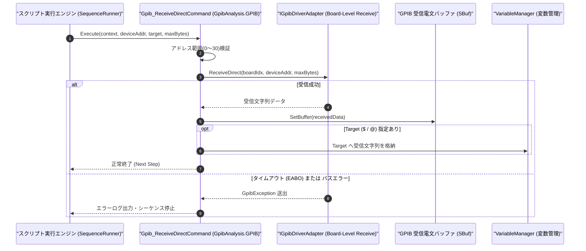

# コマンドリファレンス：Gpib_ReceiveDirect

## 概要

**Gpib_ReceiveDirect** は、引数で直接指定した GPIB デバイスアドレス（Primary Address: `0`〜`30`）の測定器を Talker に指定して応答電文をダイレクトに受信し、内部受信バッファ（`SBuf`）および指定ターゲット変数（`$` / `@`）へ格納するコマンドです。

> 💡 **補足**: [`Gpib_SendDirect`](./Gpib_SendDirect.Md) と組み合わせることで、複数台の GPIB 機器を切り替えたマルチデバイス計測シーケンスを簡潔に構築できます。

---

## 💡 書式・パラメータ仕様

### コマンド構文

```csv
,SEQUENCE, [ステップキー], Gpib_ReceiveDirect, "<DeviceAddress>", "[Target]", "[MaxByteCount: 65536]"
```

### パラメータ（引数）一覧

| 引数位置 | パラメータ名 | 必須/任意 | 型・制約 | 説明 |
| :---: | :--- | :---: | :--- | :--- |
| 第1引数 | `DeviceAddress` | **必須** | 整数（`0`〜`30`） | 受信元 GPIB 機器のプライマリアドレス（PAD）を直接指定します。 |
| 第2引数 | `Target` | 任意 | 変数名（`$` / `@`） | 受信した文字列データを格納するターゲット変数を指定します。省略時は `SBuf` のみに格納されます。 |
| 第3引数 | `MaxByteCount` | 任意 | 整数（バイト数、既定値: `65536`） | 最大読み取りバイト数を指定します。 |

---

## 🔄 特殊置換規約・分岐規約の適用

本コマンドの引数における特殊記法および解釈ルールです。
* **動的置換（`$`）**: 引数内で `$PARAMキー$` のように記述すると、実行時に変数プール（PARAM）の値へ動的置換されます。（適用可能な引数: 全引数対応）
* **ジャンプ先指定（`#`）**: 本コマンドはジャンプ制御を行わないため適用されません。（適用可能な引数: 非適用）
* **共通コマンド指定（`@`）**: 本コマンドは外部マクロを呼び出さないため適用されません。（適用可能な引数: 非適用）
* **カンマのエスケープ**: SCPI コマンド等、引数文字列自体にカンマを含める場合は、必ず `","` と二重引用符で囲んで記述します。
* **エイリアス（別名）**: `ReceiveDirect`, `GpibReceiveDirect`

---

## 💡 動作例（正しい構文での記述例）

### スクリプト記述例

※COMMAND ブロック配下の子要素行（PARAM, SEQUENCE）は必ず行頭カンマから開始し、スペースインデントや行末コメント（;）は記述しないでください。

```csv
COMMAND, "SAMPLE_GPIB_RECEIVEDIRECT", ""
,PARAM, "DMM1_ADDR", Text, "DMM1_ADDR", "21"
,PARAM, "DMM2_ADDR", Text, "DMM2_ADDR", "22"
,PARAM, "VOLT_1", Text, "VOLT_1", "0.0"
,PARAM, "VOLT_2", Text, "VOLT_2", "0.0"
; 1. 2台のマルチメータへ同時にREAD?コマンドをダイレクト送信
,SEQUENCE, 010, Gpib_SendDirect, "$DMM1_ADDR$", "READ?"
,SEQUENCE, 020, Gpib_SendDirect, "$DMM2_ADDR$", "READ?"
; 2. それぞれのアドレスからダイレクトに測定結果を受信
,SEQUENCE, 030, Gpib_ReceiveDirect, "$DMM1_ADDR$", "$VOLT_1$"
,SEQUENCE, 040, Gpib_ReceiveDirect, "$DMM2_ADDR$", "$VOLT_2$"
,SEQUENCE, 050, Exit
```

### 実行時の挙動・変数変化

* **実行前の状態**: GPIB 通信環境および対象コマンドの PARAM 初期値が設定され、ステップ実行待機中である状態。
* **実行後の状態**: アドレス `21` と `22` の 2 台の DMM で並行して測定が開始されます。 `Gpib_ReceiveDirect` により、アドレス `21` の応答が `$VOLT_1` に、アドレス `22` の応答が `$VOLT_2` にそれぞれ格納されます。

---

## 🔄 動作フロー（シーケンス図）



---

## 🚫 エラーハンドリング・安全設計（仕様制限）

1. **アドレス範囲（`0`〜`30`）の検証**:
   - 不正なプライマリアドレスが指定された場合は `ArgumentOutOfRangeException` を送出します。
2. **タイムアウト保護**:
   - 指定アドレスの機器が応答しない場合は規定タイムアウトで中断し、`GpibException` を送出します。

---

## 🧪 ユニットテスト仕様

本コマンドクラス（`Gpib_ReceiveDirectCommand.cs`）に実装されている `RunUnitTest()` メソッドが検証するユニットテストの仕様です。

### テスト実行前提条件

* **実行トリガー**: `RunUnitTest()` メソッドの呼び出し
* **有効化条件**: システム全体の最小ログレベル（`ErrorLogger.MinimumLevel`）が `LogLevel.Test` であること（それ以外の場合は無効化ガードにより早期リターン）
* **検証結果出力**: `_log.LogTest` によるログ出力。検証失敗時は `_log.LogError`、予期せぬ例外発生時は `_log.LogCritical` で記録し、`finally` ブロックで実行前のボード接続状態（`OpenGpibBoards` / `CloseGpibBoards`）、`GpibDLL.DebugDLL`、および `DebugReceiveData` を復元します。

### テストケース一覧

| No | テストカテゴリ | テスト条件（入力値） | 期待される結果（出力値） | 検証の目的 / 観点 |
| :---: | :--- | :--- | :--- | :--- |
| **1** | 正常系 | `DebugReceiveData = "DIRECT_OK"` の下で 3 引数 `("0", "1", "DIR_KEY1")`、および `GpibDevice`（`Address_1st = 2`）下の 2 引数 `("DIR_KEY2", "64")` で `Func` を実行 | 両ケースとも `!HasError` となり、`Variables["DIR_KEY1"]`・`Variables["DIR_KEY2"]` に `"DIRECT_OK"` が格納される | ボード・アドレス指定 3 引数構文およびバイト数指定 2 引数構文での直接受信検証 |
| **2** | 異常系 | 引数不足（0 引数）、不正ボード番号 `("INVALID", "1", "DIR_ERR")`、および不正アドレス `("0", "BAD_ADDR", "BAD_ADDR_KEY")` で `Func` を実行 | 0 引数・不正ボード番号時は `HasError == true`・`IsCommandGo == false` で停止し、不正アドレス時は `"BAD_ADDR_KEY"` が格納されない | 引数不足・不正ボード番号・非数値アドレス文字列に対する安全防護の検証 |
