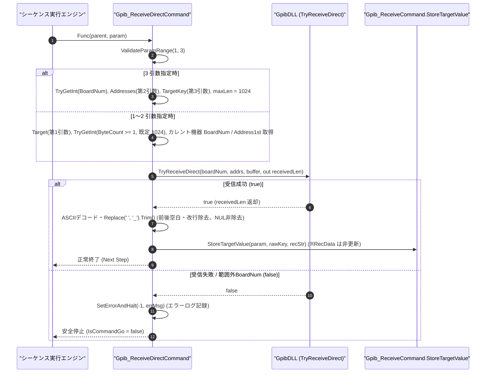

# コマンドリファレンス：Gpib_ReceiveDirect

## 概要

**Gpib_ReceiveDirect** は、機器ハンドル（`EquipmentId`）を介さず GPIB ボード番号とスレーブ機器アドレスを直接指定して応答バイト列を受信（`GpibDLL.TryReceiveDirect`）し、ASCII 文字列へ変換・整形した上で指定ターゲット変数へ直接格納するコマンドです（※通常の [`Gpib_Receive`](./Gpib_Receive.Md) とは異なり、共通受信バッファ `RecData` は更新しません）。

> 💡 **補足**: 引数の個数（ **1〜2 引数構文** と **3 引数構文** ）によって引数の役割が自動的に切り替わります。任意のアドレスを切り替えて複数機器から直接受信する場合は **3 引数構文** （`BoardNum`, `Addresses`, `TargetKey`）を使用し、カレント機器から最大受信バイト数を指定して受信する場合は **1〜2 引数構文** （`Target`, `[ByteCount]`）を使用してください（なお `ParameterSpec` メタデータ上の宣言順・引数名は `DeviceAddress`, `Target = ""`, `MaxByteCount = "65536"` ですが、`Func` 実行時は下記の構文規則に従って解釈され、受信文字列中の半角スペース `' '` はアンダースコア `'_'` へ置換された上で `Trim()` により前後の標準空白・改行 `\r`/`\n` が除去されます ※NUL 文字 `\0` は除去されません）。

---

## 💡 書式・パラメータ仕様

### コマンド構文

```csv
; 1〜2 引数構文（カレント機器のボード番号・1次アドレスを使用、最大受信バイト数指定可）
,SEQUENCE, [ステップキー], Gpib_ReceiveDirect, "<Target>", "[ByteCount: 1024]"

; 3 引数構文（GPIB ボード番号と受信元アドレスを直接指定、最大 1024 バイト）
,SEQUENCE, [ステップキー], Gpib_ReceiveDirect, <BoardNum>, "<Addresses>", "<TargetKey>"
```

### パラメータ（引数）一覧

#### ① 1〜2 引数指定時（カレント機器対象モード）

| 引数位置 | パラメータ名 | 必須/任意 | 型・制約 | 説明 |
| :---: | :--- | :---: | :--- | :--- |
| 第1引数 | `Target` | **必須** | 格納先キー名 | 受信した文字列データを格納するターゲットパラメータ・変数キー名を指定します（対象ボード・アドレスはカレント機器の `BoardNum`・`Address1st`、未設定時はボード `0`・アドレス `1` を使用）。 |
| 第2引数 | `ByteCount` | 任意 | 整数（`1` 以上、`Func` 省略時既定: `1024` / `ParameterSpec` 上の `MaxByteCount` 既定: `"65536"`） | 受信バッファの最大バイト数を指定します（※ここに変数名等の非数値文字列を渡すと型変換エラーで安全停止するため、アドレス指定時は必ず 3 引数構文を使用してください）。 |

#### ② 3 引数指定時（ボード・アドレス直接指定モード）

| 引数位置 | パラメータ名 | 必須/任意 | 型・制約 | 説明 |
| :---: | :--- | :---: | :--- | :--- |
| 第1引数 | `BoardNum` | **必須** | 整数（`0` 以上有効） | 受信に使用する GPIB インターフェースボード番号（例: `0`）を指定します（非数値時は型検証で安全停止、負数指定時は `TryReceiveDirect` が `false` を返して安全停止）。 |
| 第2引数 | `Addresses` | **必須** | カンマ区切り整数文字列 | 受信元機器のプライマリアドレス（例: `"21"` または `"1,2"`）を指定します。 |
| 第3引数 | `TargetKey` | **必須** | 格納先キー名 | 受信した文字列データを格納するターゲットパラメータ・変数キー名を指定します（最大受信バイト数は `1024` 固定）。 |

---

## 🔄 特殊置換規約・分岐規約の適用

本コマンドの引数における特殊記法および解釈ルールです。
* **動的置換（`$`）**: 引数内で `$PARAMキー$` のように記述すると、実行時に変数プール（PARAM）の値へ動的置換されます。（適用可能な引数: 全引数対応）
* **ジャンプ先指定（`#`）**: 本コマンドはジャンプ制御を行わないため適用されません。（適用可能な引数: 非適用）
* **共通コマンド指定（`@`）**: 本コマンドは外部マクロを呼び出さないため適用されません。（適用可能な引数: 非適用）
* **カンマのエスケープ**: SCPI コマンド等、引数文字列自体にカンマを含める場合は、必ず `","` と二重引用符で囲んで記述します。
* **エイリアス（別名）**: `ReceiveDirect`, `GpibReceiveDirect`

---

## 💡 動作例（正しい構文での記述例）

### スクリプト記述例

※COMMAND ブロック配下の子要素行（PARAM, SEQUENCE）は必ず行頭カンマ（`,`）から開始してください（行頭スペースのみでは認識されません）。なお、`;` で始まる行やクォート外の `;` 以降はコメントとして自動除去されます。

```csv
COMMAND, "SAMPLE_GPIB_RECEIVEDIRECT", "VOLT_1"
,PARAM, "DMM1_ADDR", Text, "DMM1アドレス", "21"
,PARAM, "DMM2_ADDR", Text, "DMM2アドレス", "22"
,PARAM, "VOLT_1", Text, "DMM1電圧値", "0.0"
,PARAM, "VOLT_2", Text, "DMM2電圧値", "0.0"
,SEQUENCE, 010, Gpib_Open, 0
; 1. ボード 0 上の 2 台のマルチメータへ 3 引数構文で READ? コマンドをダイレクト送信
,SEQUENCE, 020, Gpib_SendDirect, 0, "$DMM1_ADDR$", "READ?"
,SEQUENCE, 030, Gpib_SendDirect, 0, "$DMM2_ADDR$", "READ?"
; 2. それぞれのアドレスから 3 引数構文でダイレクトに測定結果を受信
,SEQUENCE, 040, Gpib_ReceiveDirect, 0, "$DMM1_ADDR$", "VOLT_1"
,SEQUENCE, 050, Gpib_ReceiveDirect, 0, "$DMM2_ADDR$", "VOLT_2"
,SEQUENCE, 060, Gpib_Close, 0
,SEQUENCE, 070, Exit
```

### 実行時の挙動・変数変化

* **実行前の状態**: GPIB ボード `0` がオープン済みであり、`"DMM1_ADDR"` に `"21"`、`"DMM2_ADDR"` に `"22"` が設定されている状態。
* **実行後の状態**: アドレス `21` と `22` の 2 台の DMM で並行して測定が開始され、`Gpib_ReceiveDirect` の 3 引数構文により、アドレス `21` の応答が `"VOLT_1"` に、アドレス `22` の応答が `"VOLT_2"` にそれぞれ改行除去済みで格納されます。

---

## 🔄 動作フロー（シーケンス図）



---

## 🚫 エラーハンドリング・安全設計（仕様制限）

1. **引数個数（`1`〜`3`）および数値型の事前検証**:
   - `ValidateParamRange(1, 3)` 違反（0 引数または 4 引数以上）、3 引数時の第 1 引数 `BoardNum` が非数値文字列の場合、または 2 引数時の第 2 引数 `ByteCount` が `1` 未満・非数値の場合は、`SetErrorAndHalt` によりエラーログを記録して安全停止します（負の `BoardNum` 整数を指定した場合は `TryReceiveDirect` が `false` を返して `SetErrorAndHalt(-1, errMsg)` で安全停止します）。
2. **アドレス文字列のパース保護とドライバ失敗時の安全停止**:
   - 第 2 引数 `Addresses` 内に `short` へ変換できない不正要素が含まれる場合は、`_log.LogError` を記録して変数格納を行わずにリターンします。また、物理受信（`GpibDLL.TryReceiveDirect`）がタイムアウト等で `false` を返した場合は、`SetErrorAndHalt(-1, errMsg)` により後続ステップを安全停止します。

---

## 🧪 ユニットテスト仕様

本コマンドクラス（`Gpib_ReceiveDirectCommand.cs`）に実装されている `RunUnitTest()` メソッドが検証するユニットテストの仕様です。

### テスト実行前提条件

* **実行トリガー**: `RunUnitTest()` メソッドの呼び出し
* **有効化条件**: システム全体の最小ログレベル（`ErrorLogger.MinimumLevel`）が `LogLevel.Test` であること（それ以外の場合は無効化ガードにより早期リターン）
* **検証結果出力**: `_log.LogTest` によるログ出力。検証失敗時は `_log.LogError`、予期せぬ例外発生時は `_log.LogCritical` で記録し、`finally` ブロックで実行前のボード接続状態（`OpenGpibBoards` / `CloseGpibBoards`）、`GpibDLL.DebugDLL`、および `DebugReceiveData` を復元します。

### テストケース一覧

| No | テストカテゴリ | テスト条件（入力値） | 期待される結果（出力値） | 検証の目的 / 観点 |
| :---: | :--- | :--- | :--- | :--- |
| **1** | 正常系 | `DebugReceiveData = "DIRECT_OK"` の下で 3 引数 `("0", "1", "DIR_KEY1")`、および `GpibDevice`（`Address1st = 2`）下の 2 引数 `("DIR_KEY2", "64")` で `Func` を実行 | 両ケースとも `!HasError` となり、`Variables["DIR_KEY1"]`・`Variables["DIR_KEY2"]` に `"DIRECT_OK"` が格納される | ボード・アドレス指定 3 引数構文およびバイト数指定 2 引数構文での直接受信検証 |
| **2** | 異常系 | 引数不足（0 引数）、不正ボード番号 `("INVALID", "1", "DIR_ERR")`、および不正アドレス `("0", "BAD_ADDR", "BAD_ADDR_KEY")` で `Func` を実行 | 0 引数・不正ボード番号時は `HasError == true`・`IsCommandGo == false` で停止し、不正アドレス時は `"BAD_ADDR_KEY"` が格納されない | 引数不足・不正ボード番号・非数値アドレス文字列に対する安全防護の検証 |
