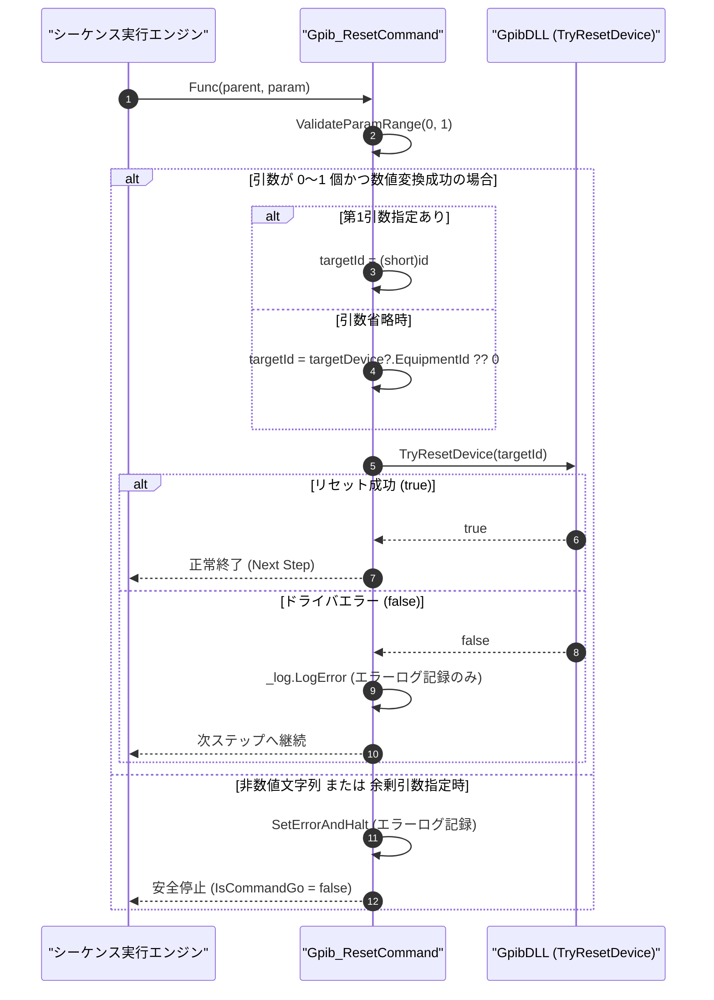

# コマンドリファレンス：Gpib_Reset

## 概要

**Gpib_Reset** は、ドライバのハードウェアリセット／デバイスクリア API（`GpibDLL.TryResetDevice`）を呼び出し、現在選択されている対象 GPIB 機器（または第 1 引数で指定したボード・機器識別子）のハードウェア通信状態をリセットするコマンドです。

> 💡 **補足**: 本コマンドはドライバ層のハードウェアリセット API のみを実行し、SCPI コマンド文字列 `"*RST;*CLS"` の自動送信や内部受信バッファ（`RecData`）の消去は行いません。測定器内部の測定レンジ設定等も工場出荷状態へ戻したい場合は、後続ステップで [`Gpib_Send`](./Gpib_Send.Md)（`Gpib_Send, "*RST;*CLS"`）を併用してください。

---

## 💡 書式・パラメータ仕様

### コマンド構文

```csv
,SEQUENCE, [ステップキー], Gpib_Reset, "[TargetId]"
```

### パラメータ（引数）一覧

| 引数位置 | パラメータ名 | 必須/任意 | 型・制約 | 説明 |
| :---: | :--- | :---: | :--- | :--- |
| 第1引数 | `DeviceAddress` / `BoardNum` | 任意 | 整数（`ParameterSpec`: `DeviceAddress` 既定値 `0`, `0`〜`30` / `Func`: 任意の整数） | リセット対象のボード番号または機器識別番号を指定します（`Func` 実行時は整数型検証のみ行い `(short)` へキャストして `GpibDLL.TryResetDevice` へ渡します）。省略時は現在選択中の対象機器の登録 ID（`targetDevice.EquipmentId`、未設定時は `0`）に対してリセットを実行します。 |

---

## 🔄 特殊置換規約・分岐規約の適用

本コマンドの引数における特殊記法および解釈ルールです。
* **動的置換（`$`）**: 引数内で `$PARAMキー$` のように記述すると、実行時に変数プール（PARAM）の値へ動的置換されます。（適用可能な引数: 全引数対応）
* **ジャンプ先指定（`#`）**: 本コマンドはジャンプ制御を行わないため適用されません。（適用可能な引数: 非適用）
* **共通コマンド指定（`@`）**: 本コマンドは外部マクロを呼び出さないため適用されません。（適用可能な引数: 非適用）
* **カンマのエスケープ**: SCPI コマンド等、引数文字列自体にカンマを含める場合は、必ず `","` と二重引用符で囲んで記述します。
* **エイリアス（別名）**: `Reset`, `GpibReset`

---

## 💡 動作例（正しい構文での記述例）

### スクリプト記述例

※COMMAND ブロック配下の子要素行（PARAM, SEQUENCE）は必ず行頭カンマ（`,`）から開始してください（行頭スペースのみでは認識されません）。なお、`;` で始まる行やクォート外の `;` 以降はコメントとして自動除去されます。

```csv
COMMAND, "SAMPLE_GPIB_RESET", "VOLT_VAL"
,PARAM, "VOLT_VAL", Work, "DC電圧測定値", ""
,SEQUENCE, 010, Gpib_Open, 0
; 1. カレント機器に対してドライバレベルのハードウェアリセットを実行し、続けて *RST;*CLS を送信
,SEQUENCE, 020, Gpib_Reset
,SEQUENCE, 030, Gpib_Send, "*RST;*CLS"
,SEQUENCE, 040, Wait, "200"
; 2. 初期状態からDC電圧レンジを設定して測定実行
,SEQUENCE, 050, Gpib_Send, "CONF:VOLT:DC 10"
,SEQUENCE, 060, Gpib_SendReceive, "READ?", "VOLT_VAL"
,SEQUENCE, 070, Gpib_Close
,SEQUENCE, 080, Exit
```

### 実行時の挙動・変数変化

* **実行前の状態**: GPIB 通信環境および対象コマンドの PARAM 初期値が設定され、ステップ実行待機中である状態。
* **実行後の状態**: `Gpib_Reset` によりカレント機器（`EquipmentId`）に対して `GpibDLL.TryResetDevice` が呼び出されてインターフェース通信状態がクリアされ、続く `Gpib_Send, "*RST;*CLS"` により測定器内部のパラメータも初期化されます。

---

## 🔄 動作フロー（シーケンス図）



---

## 🚫 エラーハンドリング・安全設計（仕様制限）

1. **引数個数（`0`〜`1`）および整数型の事前検証**:
   - `ValidateParamRange(0, 1)` 違反（2 個以上の引数指定）または第 1 引数に整数へ変換できない文字列（`"INVALID"` 等）が指定された場合は、`SetErrorAndHalt` によりエラーログを記録して安全停止します。
2. **ドライバリセット失敗時の非停止ログ記録**:
   - ハードウェアリセット API（`GpibDLL.TryResetDevice`）が `false` を返した場合は `_log.LogError` を出力しますが、例外クラッシュや強制停止は行わず次ステップへ継続します。

---

## 🧪 ユニットテスト仕様

本コマンドクラス（`Gpib_ResetCommand.cs`）に実装されている `RunUnitTest()` メソッドが検証するユニットテストの仕様です。

### テスト実行前提条件

* **実行トリガー**: `RunUnitTest()` メソッドの呼び出し
* **有効化条件**: システム全体の最小ログレベル（`ErrorLogger.MinimumLevel`）が `LogLevel.Test` であること（それ以外の場合は無効化ガードにより早期リターン）
* **検証結果出力**: `_log.LogTest` によるログ出力。検証失敗時は `_log.LogError`、予期せぬ例外発生時は `_log.LogCritical` で記録し、`finally` ブロックで `GpibDLL.DebugDLL` および `GpibDLL.DebugReceiveData` を元の状態へ復元します。

### テストケース一覧

| No | テストカテゴリ | テスト条件（入力値） | 期待される結果（出力値） | 検証の目的 / 観点 |
| :---: | :--- | :--- | :--- | :--- |
| **1** | 正常系 | `GpibDevice`（`EquipmentId = 1`）設定下での引数省略 `()` 実行、およびボード番号 `("0")` 明示指定での `Func` 実行 | 両ケースとも `!HasError` かつ `IsCommandGo == true` で物理リセットが正常完了する | 引数省略時（対象機器 ID）および ID 明示指定時のリセット動作検証 |
| **2** | 異常系 | 非数値文字列 `("INVALID")` および余剰引数 `("0", "EXTRA")` を指定して `Func` を実行 | 両ケースとも `HasError == true` かつ `IsCommandGo == false` となり安全停止する | 不正数値指定および引数個数超過時のバリデーション防護検証 |
