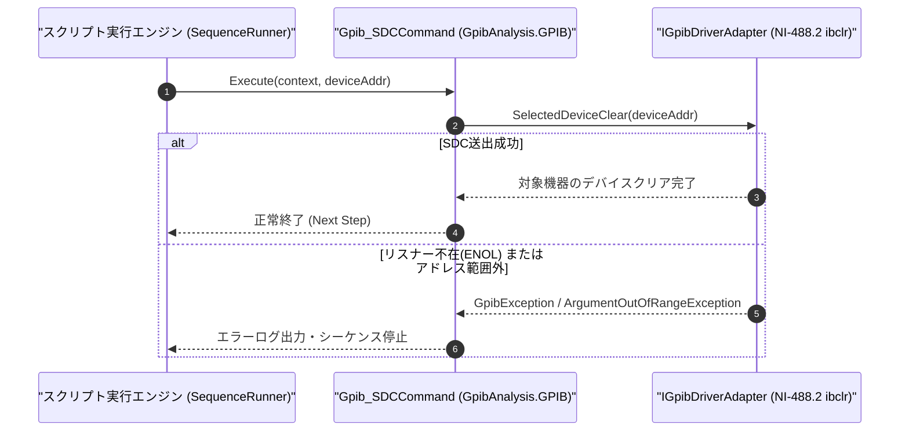

# コマンドリファレンス：Gpib_SDC

## 概要

**Gpib_SDC** は、現在オープン中の対象 GPIB デバイス（または第 1 引数で指定した特定アドレスの機器）に対してのみアドレス指定コマンド **SDC（Selected Device Clear: `0x04`）** を送出し、その機器の入出力バッファおよびコマンド解釈状態をクリアするコマンドです。

> 💡 **補足**: バス上のすべての機器をクリアする [`Gpib_DCL`](./Gpib_DCL.Md) とは異なり、他の測定器の状態に影響を与えずに特定の測定器 1 台だけをデバイスクリア（NI-488.2 `ibclr` 相当）したい場合に使用します。

---

## 💡 書式・パラメータ仕様

### コマンド構文

```csv
,SEQUENCE, [ステップキー], Gpib_SDC, "[DeviceAddress]"
```

### パラメータ（引数）一覧

| 引数位置 | パラメータ名 | 必須/任意 | 型・制約 | 説明 |
| :---: | :--- | :---: | :--- | :--- |
| 第1引数 | `DeviceAddress` | 任意 | 整数（`0`〜`30`） | SDC を送出する対象機器のプライマリアドレスを指定します。省略時は現在 `Gpib_Open` されている対象機器へ送出します。 |

---

## 🔄 特殊置換規約・分岐規約の適用

本コマンドの引数における特殊記法および解釈ルールです。
* **動的置換（`$`）**: 引数内で `$PARAMキー$` のように記述すると、実行時に変数プール（PARAM）の値へ動的置換されます。（適用可能な引数: 全引数対応）
* **ジャンプ先指定（`#`）**: 本コマンドはジャンプ制御を行わないため適用されません。（適用可能な引数: 非適用）
* **共通コマンド指定（`@`）**: 本コマンドは外部マクロを呼び出さないため適用されません。（適用可能な引数: 非適用）
* **カンマのエスケープ**: SCPI コマンド等、引数文字列自体にカンマを含める場合は、必ず `","` と二重引用符で囲んで記述します。
* **エイリアス（別名）**: `SDC`, `GpibSDC`

---

## 💡 動作例（正しい構文での記述例）

### スクリプト記述例

※COMMAND ブロック配下の子要素行（PARAM, SEQUENCE）は必ず行頭カンマから開始し、スペースインデントや行末コメント（;）は記述しないでください。

```csv
COMMAND, "SAMPLE_GPIB_SDC", ""
,SEQUENCE, 010, Gpib_Open, "22"
; 1. カレントデバイス(アドレス22)に対してSDC(Selected Device Clear)を実行
,SEQUENCE, 020, Gpib_SDC
; 2. 特定の別アドレス(アドレス10)の機器のみを指定してSDCを実行
,SEQUENCE, 030, Gpib_SDC, "10"
,SEQUENCE, 040, Gpib_Close
,SEQUENCE, 050, Exit
```

### 実行時の挙動・変数変化

* **実行前の状態**: GPIB 通信環境および対象コマンドの PARAM 初期値が設定され、ステップ実行待機中である状態。
* **実行後の状態**: 1 回目の `Gpib_SDC` により、現在オープン中のアドレス `22` の測定器の GPIB 入出力バッファがクリアされます。 2 回目の `Gpib_SDC, "10"` により、アドレス `10` の機器のみが Listener 指定された上で `SDC (0x04)` が送出されます。

---

## 🔄 動作フロー（シーケンス図）



---

## 🚫 エラーハンドリング・安全設計（仕様制限）

1. **アドレス範囲（`0`〜`30`）の検証**:
   - 第 1 引数指定時に `0`〜`30` 以外の数値が渡された場合は `ArgumentOutOfRangeException` を送出します。
2. **対象機器未応答時のエラー検出**:
   - 対象機器がバス上に存在せずハンドシェイクが成立しない場合は `GpibException` を送出します。

---

## 🧪 ユニットテスト仕様

本コマンドクラス（`Gpib_SDCCommand.cs`）に実装されている `RunUnitTest()` メソッドが検証するユニットテストの仕様です。

### テスト実行前提条件

* **実行トリガー**: `RunUnitTest()` メソッドの呼び出し
* **有効化条件**: システム全体の最小ログレベル（`ErrorLogger.MinimumLevel`）が `LogLevel.Test` であること（それ以外の場合は無効化ガードにより早期リターン）
* **検証結果出力**: `_log.LogTest` によるログ出力。検証失敗時は `_log.LogError`、予期せぬ例外発生時は `_log.LogCritical` で記録し、各テストブロックの `finally` で `GpibDeviceList.RenStatus` を元の状態へ復元します。

### テストケース一覧

| No | テストカテゴリ | テスト条件（入力値） | 期待される結果（出力値） | 検証の目的 / 観点 |
| :---: | :--- | :--- | :--- | :--- |
| **1** | 異常系 | `CanSendSdc(null)`（デバイス未指定）、および `RenStatus = false`・`Local` 状態での `CanSendSdc(device)` を実行 | 両ケースとも `false` を返す | 未設定デバイスおよびローカル制御中の SDC 誤送出防止検証 |
| **2** | 正常系 | `RenStatus = true`・`RemoteStatus = Remote` の `"TestDevice"` に対し `CanSendSdc(device)` を実行 | `true` を返す | リモート有効状態のデバイスに対する SDC 送出許可検証 |
| **3** | 正常系 | `GetButtonUiState(true)`（処理中）および `GetButtonUiState(false)`（待機中）を実行 | 処理中は `(false, Color.Aqua)`、待機中は `(true, Color.Gainsboro)` を返す | SDC ボタンの活性状態および背景色遷移の検証 |
| **4** | 異常系 | リモート条件（`RenStatus = true`, `Remote`）でもポート未オープン `CanSendSdc(device, false)` を実行 | `false` を返す | 回線クローズ時の SDC 送出ガード検証 |
