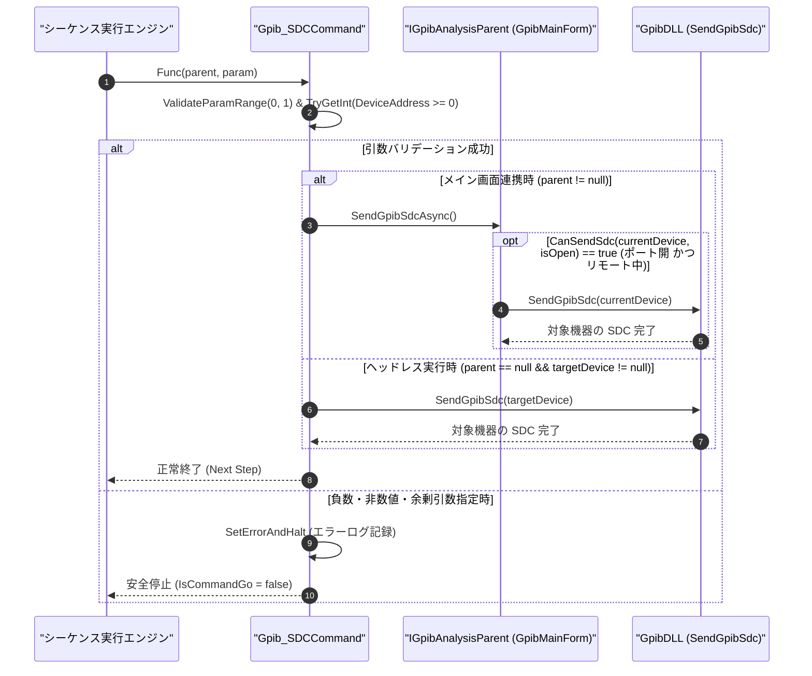

# コマンドリファレンス：Gpib_SDC

## 概要

**Gpib_SDC** は、現在選択されている対象 GPIB 機器（`GpibDevice`）1 台のみに対してアドレス指定コマンド **SDC（Selected Device Clear: `0x04`）** を送出し、その機器の入出力バッファおよびコマンド解釈状態をクリアするコマンドです。

> 💡 **補足**: バス上のすべての機器を一斉クリアする [`Gpib_DCL`](./Gpib_DCL.Md) とは異なり、他の測定器の状態に影響を与えずに現在アクティブな対象測定器 1 台だけをデバイスクリア（Interface ドライバ時は登録機器 ID に対する `PciGpibExExecSdc`）したい場合に使用します。

---

## 💡 書式・パラメータ仕様

### コマンド構文

```csv
,SEQUENCE, [ステップキー], Gpib_SDC, "[DeviceAddress]"
```

### パラメータ（引数）一覧

| 引数位置 | パラメータ名 | 必須/任意 | 型・制約 | 説明 |
| :---: | :--- | :---: | :--- | :--- |
| 第1引数 | `DeviceAddress` | 任意 | 整数（`ParameterSpec`: 既定値 `0`, `0`〜`30` / `Func`: `0` 以上） | 互換性のための任意パラメータです（`Func` 実行時は引数指定時に `0` 以上の整数であるか検証のみ行われ、実際の SDC 送出は常に現在の実行対象機器 `targetDevice` に対して実行されます）。 |

---

## 🔄 特殊置換規約・分岐規約の適用

本コマンドの引数における特殊記法および解釈ルールです。
* **動的置換（`$`）**: 引数内で `$PARAMキー$` のように記述すると、実行時に変数プール（PARAM）の値へ動的置換されます。（適用可能な引数: 全引数対応）
* **ジャンプ先指定（`#`）**: 本コマンドはジャンプ制御を行わないため適用されません。（適用可能な引数: 非適用）
* **共通コマンド指定（`@`）**: 本コマンドは外部マクロを呼び出さないため適用されません。（適用可能な引数: 非適用）
* **カンマのエスケープ**: SCPI コマンド等、引数文字列自体にカンマを含める場合は、必ず `","` と二重引用符で囲んで記述します。
* **エイリアス（別名）**: `SDC`, `GpibSDC`

---

## 💡 動作例（正しい構文での記述例）

### スクリプト記述例

※COMMAND ブロック配下の子要素行（PARAM, SEQUENCE）は必ず行頭カンマ（`,`）から開始してください（行頭スペースのみでは認識されません）。なお、`;` で始まる行やクォート外の `;` 以降はコメントとして自動除去されます。

```csv
COMMAND, "SAMPLE_GPIB_SDC", "IDN_VAL"
,PARAM, "IDN_VAL", Work, "機器識別情報", ""
,SEQUENCE, 010, Gpib_Open, 0
,SEQUENCE, 020, Gpib_REN, "ON"
; カレント機器を一度リモート状態にしてから SDC (Selected Device Clear) でバッファをクリア
,SEQUENCE, 030, Gpib_Send, "*CLS"
,SEQUENCE, 040, Gpib_SDC
,SEQUENCE, 050, Gpib_SendReceive, "*IDN?", "IDN_VAL"
,SEQUENCE, 060, Gpib_Close
,SEQUENCE, 070, Exit
```

### 実行時の挙動・変数変化

* **実行前の状態**: GPIB ボードがオープンされ、対象機器がリモート制御有効状態（`IsRemote == true`）である状態。
* **実行後の状態**: `Gpib_SDC` により、現在選択中の対象機器のみに対して Selected Device Clear（`0x04`）が送出され、対象機器の入出力バッファがクリアされます。

---

## 🔄 動作フロー（シーケンス図）



---

## 🚫 エラーハンドリング・安全設計（仕様制限）

1. **引数境界および最小値（`0` 以上）の事前検証**:
   - `ValidateParamRange(0, 1)` 違反（2 個以上の引数指定）または第 1 引数 `DeviceAddress` に負数・非数値文字列が指定された場合は、`SetErrorAndHalt` によりエラーログを記録して安全停止します。
2. **リモート状態・ポート開閉状態に応じた誤送出防止（`CanSendSdc`）**:
   - メイン画面経由の実行では、ポートがオープン中であり、かつ対象機器がリモート制御状態（`RenStatus == true` かつ `RemoteStatus == Remote`）である場合のみ SDC を送出し、ローカル操作中の機器への誤干渉を防止します。

---

## 🧪 ユニットテスト仕様

本コマンドクラス（`Gpib_SDCCommand.cs`）に実装されている `RunUnitTest()` メソッドが検証するユニットテストの仕様です。

### テスト実行前提条件

* **実行トリガー**: `RunUnitTest()` メソッドの呼び出し
* **有効化条件**: システム全体の最小ログレベル（`ErrorLogger.MinimumLevel`）が `LogLevel.Test` であること（それ以外の場合は無効化ガードにより早期リターン）
* **検証結果出力**: `_log.LogTest` によるログ出力。検証失敗時は `_log.LogError`、予期せぬ例外発生時は `_log.LogCritical` で記録し、各テストブロックの `finally` で `GpibDeviceList.RenStatus` を元の状態へ復元します。

### テストケース一覧

| No | テストカテゴリ | テスト条件（入力値） | 期待される結果（出力値） | 検証の目的 / 観点 |
| :---: | :--- | :--- | :--- | :--- |
| **1** | 異常系 | デバイス未指定で `CanSendSdc(null)` を実行 | `false` を返す | `null` デバイス時の SDC 誤送出防止検証 |
| **2** | 異常系 | `RenStatus = false`・`RemoteStatus = Local` の `"TestDevice"` に対し `CanSendSdc(device)` を実行 | `false` を返す | ローカル制御中のデバイスに対する SDC 送出抑止検証 |
| **3** | 正常系 | `RenStatus = true`・`RemoteStatus = Remote` の `"TestDevice"` に対し `CanSendSdc(device)` を実行 | `true` を返す | リモート有効状態のデバイスに対する SDC 送出許可検証 |
| **4** | 正常系 | `GetButtonUiState(true)`（処理中）および `GetButtonUiState(false)`（待機中）を実行 | 処理中は `(false, Color.Aqua)`、待機中は `(true, Color.Gainsboro)` を返す | SDC ボタンの活性状態および背景色遷移の検証 |
| **5** | 異常系 | リモート条件（`RenStatus = true`, `Remote`）でもポート未オープン `CanSendSdc(device, false)` を実行 | `false` を返す | 回線クローズ時の SDC 送出ガード検証 |
