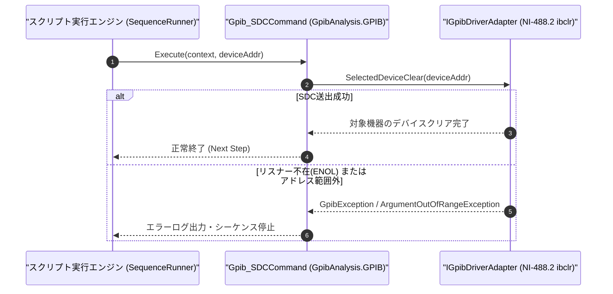

# コマンドリファレンス：Gpib_SDC

---

## 概要

**Gpib_SDC** は、現在オープン中の対象 GPIB デバイス（または第 1 引数で指定した特定アドレスの機器）に対してのみアドレス指定コマンド **SDC（Selected Device Clear: `0x04`）** を送出し、その機器の入出力バッファおよびコマンド解釈状態をクリアするコマンドです。

> 💡 **補足**: バス上のすべての機器をクリアする [`Gpib_DCL`](./Gpib_DCL.Md) とは異なり、他の測定器の状態に影響を与えずに特定の測定器 1 台だけをデバイスクリア（NI-488.2 `ibclr` 相当）したい場合に使用します。

---

## 💡 書式・パラメータ仕様

### コマンド構文

```csv
,SEQUENCE,Gpib_SDC, "[DeviceAddress]"
```

### パラメータ（引数）一覧

| 引数位置 | パラメータ名 | 必須/任意 | 型・制約 | 説明 |
| :---: | :--- | :---: | :--- | :--- |
| 第1引数 | `DeviceAddress` | 任意 | 整数（`0`〜`30`） | SDC を送出する対象機器のプライマリアドレスを指定します。省略時は現在 `Gpib_Open` されている対象機器へ送出します。 |

---

## 🔄 特殊置換規約・分岐規約の適用

1. **変数展開（`$` / `@` / `#`）**:
   - 第 1 引数 `DeviceAddress` には変数を指定可能です（例: `"$DMM_ADDR"`）。
2. **レガシー別名互換**:
   - 旧表記の `GpibSDC` や `GPIB_SDC` は内部正規化により本 `Gpib_SDC` コマンドへマッピングされます。

---

## 💡 動作例（正しい構文での記述例）

### スクリプト記述例

```csv
,SEQUENCE,Gpib_Open, "22"

; 1. カレントデバイス(アドレス22)に対してSDC(Selected Device Clear)を実行
,SEQUENCE,Gpib_SDC

; 2. 特定の別アドレス(アドレス10)の機器のみを指定してSDCを実行
,SEQUENCE,Gpib_SDC, "10"

,SEQUENCE,Gpib_Close
,SEQUENCE,Exit
```

### 実行時の挙動・変数変化

1. 1 回目の `Gpib_SDC` により、現在オープン中のアドレス `22` の測定器の GPIB 入出力バッファがクリアされます。
2. 2 回目の `Gpib_SDC, "10"` により、アドレス `10` の機器のみが Listener 指定された上で `SDC (0x04)` が送出されます。

---

## 🔄 動作フロー（シーケンス図）



---

## 🚫 エラーハンドリング・安全設計（仕様制限）

1. **アドレス範囲（`0`〜`30`）の検証**:
   - 第 1 引数指定時に `0`〜`30` 以外の数値が渡された場合は `ArgumentOutOfRangeException` を送出します。
2. **対象機器未応答時のエラー検出**:
   - 対象機器がバス上に存在せずハンドシェイクが成立しない場合は `GpibException` を送出します。

---

## 🧪 ユニットテスト仕様

### テスト実行前提条件
- **対象クラス**: `GpibAnalysis.GPIB.Gpib_SDCCommand`（`Gpib_SDCCommand.cs`）
- **モック環境**: `IGpibDriverAdapter` モックが注入されていること。

### テストケース一覧

| テストID | テスト観点 | 入力スクリプト | 期待される動作・検証項目 |
| :--- | :--- | :--- | :--- |
| `UT-GPIB-SDC-01` | 正常系（引数省略・カレント機器） | `,SEQUENCE,Gpib_SDC` | オープン中のデバイスに対する `SelectedDeviceClear` が呼ばれること。 |
| `UT-GPIB-SDC-02` | 正常系（アドレス明示指定） | `,SEQUENCE,Gpib_SDC, "10"` | アドレス `10` に対する `SelectedDeviceClear(10)` が呼ばれること。 |
| `UT-GPIB-SDC-03` | 異常系（アドレス範囲外） | `,SEQUENCE,Gpib_SDC, "40"` | `ArgumentOutOfRangeException` が送出されること。 |

