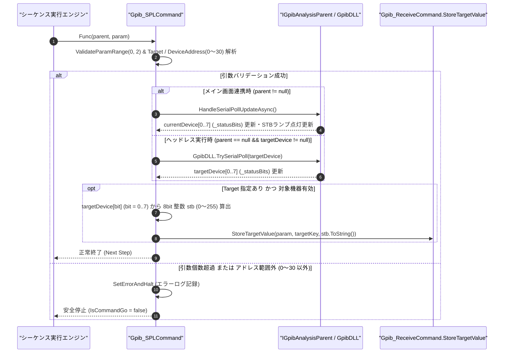

# コマンドリファレンス：Gpib_SPL

## 概要

**Gpib_SPL** は、現在選択されている対象 GPIB 機器に対して **シリアルポール（Serial Poll）** を実行し、IEEE 488.2 ステータスバイト（STB: Status Byte、ビット 6 が `RQS/MSS` サービス要求ビット、ビット 4 が `MAV` メッセージ有無ビット等）を読み取って対象機器のインデクサ `targetDevice[bit]`（内部 `_statusBits` 8 ビット状態）を更新し、指定ターゲット変数へ 10 進整数文字列（`0`〜`255`）として格納するコマンドです。

> 💡 **補足**: メイン画面連携時は `Bit7`〜`Bit0` の STB ステータス LED ランプ表示も同時に更新されます。また、取得されたステータスバイト値が格納された結果格納変数に対して `Judge` コマンド等を用いることで、RQS や MAV などのステータス条件分岐を行うことができます。

---

## 💡 書式・パラメータ仕様

### コマンド構文

```csv
,SEQUENCE, [ステップキー], Gpib_SPL, "[Target]", "[DeviceAddress]"
```

### パラメータ（引数）一覧

| 引数位置 | パラメータ名 | 必須/任意 | 型・制約 | 説明 |
| :---: | :--- | :---: | :--- | :--- |
| 第1引数 | `Target` | 任意 | 格納先キー名 | 読み取った 8bit ステータスバイト値（`0`〜`255` の 10 進文字列）を格納するターゲットパラメータ・変数キー名を指定します。省略時は対象機器のインデクサ `targetDevice[bit]`（内部 `_statusBits` 8 ビット状態）更新のみを行います（※後方互換として 2 引数で第 1 引数に数値アドレス・第 2 引数に `Target` を指定した構文も認識されます）。 |
| 第2引数 | `DeviceAddress` | 任意 | 整数（`0`〜`30`） | アドレス範囲（`0`〜`30`）の検証用任意パラメータです（実際のシリアルポールは常に現在選択中のカレント機器 `targetDevice` に対して実行されます）。 |

---

## 🔄 特殊置換規約・分岐規約の適用

本コマンドの引数における特殊記法および解釈ルールです。
* **動的置換（`$`）**: 引数内で `$PARAMキー$` のように記述すると、実行時に変数プール（PARAM）の値へ動的置換されます。（適用可能な引数: 全引数対応）
* **ジャンプ先指定（`#`）**: 本コマンドはジャンプ制御を行わないため適用されません。（適用可能な引数: 非適用）
* **共通コマンド指定（`@`）**: 本コマンドは外部マクロを呼び出さないため適用されません。（適用可能な引数: 非適用）
* **カンマのエスケープ**: SCPI コマンド等、引数文字列自体にカンマを含める場合は、必ず `","` と二重引用符で囲んで記述します。
* **エイリアス（別名）**: `SPL`, `GpibSPL`

---

## 💡 動作例（正しい構文での記述例）

### スクリプト記述例

※COMMAND ブロック配下の子要素行（PARAM, SEQUENCE）は必ず行頭カンマ（`,`）から開始してください（行頭スペースのみでは認識されません）。なお、`;` で始まる行やクォート外の `;` 以降はコメントとして自動除去されます。

```csv
COMMAND, "SAMPLE_GPIB_SPL", "STB_BYTE"
,PARAM, "STB_BYTE", Text, "ステータスバイト値", "0"
,SEQUENCE, 010, Gpib_Open, 0
,SEQUENCE, 020, Gpib_Send, "*CLS;INIT;*OPC"
; SRQまたは処理完了を待機してからシリアルポール(SPL)でステータスバイトを取得
,SEQUENCE, 030, Gpib_Wait, "SRQ", "5000"
,SEQUENCE, 040, Gpib_SPL, "STB_BYTE"
,SEQUENCE, 050, Gpib_Close
,SEQUENCE, 060, Exit
```

### 実行時の挙動・変数変化

* **実行前の状態**: GPIB 通信環境および対象コマンドの PARAM 初期値が設定され、ステップ実行待機中である状態。
* **実行後の状態**: `Gpib_SPL` の実行により対象機器に対してシリアルポールが行われ、SRQ ラインのアサートがクリアされると同時に 8 ビット状態から算出されたステータスバイト値（例: `"64"`［`0x40`: RQS ビット ON］）が `"STB_BYTE"` に格納されます。

---

## 🔄 動作フロー（シーケンス図）



---

## 🚫 エラーハンドリング・安全設計（仕様制限）

1. **引数個数（`0`〜`2`）およびアドレス範囲（`0`〜`30`）の事前検証**:
   - `ValidateParamRange(0, 2)` 違反（3 個以上の引数指定）や、2 引数指定時の `DeviceAddress` に `0`〜`30` 以外の数値・非数値が渡された場合は、`SetErrorAndHalt` によりエラーログを記録して安全停止します。
2. **ポート未オープン・デバイス未設定時の安全保護**:
   - `IsDeviceValid(device) == false` またはポートクローズ中（`CanPoll == false`）の場合は物理バスへのアクセスを安全にスキップし、例外クラッシュを防止します。

---

## 🧪 ユニットテスト仕様

本コマンドクラス（`Gpib_SPLCommand.cs`）に実装されている `RunUnitTest()` メソッドが検証するユニットテストの仕様です。

### テスト実行前提条件

* **実行トリガー**: `RunUnitTest()` メソッドの呼び出し
* **有効化条件**: システム全体の最小ログレベル（`ErrorLogger.MinimumLevel`）が `LogLevel.Test` であること（それ以外の場合は無効化ガードにより早期リターン）
* **検証結果出力**: `_log.LogTest` によるログ出力。検証失敗時は `_log.LogError`、予期せぬ例外発生時は `_log.LogCritical` で記録し、`finally` ブロックで `GpibDLL.DebugDLL` および `GpibDLL.DebugReceiveData` を元の状態へ復元します。

### テストケース一覧

| No | テストカテゴリ | テスト条件（入力値） | 期待される結果（出力値） | 検証の目的 / 観点 |
| :---: | :--- | :--- | :--- | :--- |
| **1** | 異常系 | `IsDeviceValid(null)` 判定、および余剰引数 `("1", "STB_KEY", "EXTRA")` を指定して `Func` を実行 | `IsDeviceValid` が `false` を返し、`Func` は `HasError == true`・`IsCommandGo == false` で安全停止する | `null` デバイスガードおよび引数個数超過（`ValidateParamRange(0, 2)`）時の安全停止検証 |
| **2** | 正常系 | 有効な `"TestDevice"` での `IsDeviceValid(device)` 判定および `("STB_VAL")` 指定での `Func` 実行 | `IsDeviceValid` が `true` を返し、`!HasError` で `Variables["STB_VAL"]` に STB 文字列が格納される | シリアルポール実行およびステータスバイト格納の検証 |
| **3** | 正常系 | `GetButtonUiState(true)`（処理中）および `GetButtonUiState(false)`（待機中）を実行 | 処理中は `(false, Color.Aqua)`、待機中は `(true, Color.Gainsboro)` を返す | SPL ボタンの活性状態および背景色遷移の検証 |
| **4** | 正常系 | 有効デバイスに対し `CanPoll(device, true)`（オープン中）および `CanPoll(device, false)`（クローズ中）を実行 | オープン時は `true`、クローズ時は `false` を返す | ポートオープン状態に応じたシリアルポール実行可否判定の検証 |
