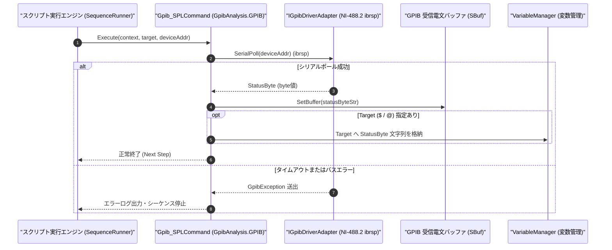

# コマンドリファレンス：Gpib_SPL

---

## 概要

**Gpib_SPL** は、対象 GPIB デバイスに対して **シリアルポール（Serial Poll: `SPE [0x18]` → ステータスバイト読取 → `SPD [0x19]`）** を実行し、IEEE 488.2 ステータスバイト（STB: Status Byte、ビット 6 が `RQS/MSS` サービス要求ビット、ビット 4 が `MAV` メッセージ有無ビット等）を 1 バイト読み取って指定ターゲット変数へ格納するコマンドです。

> 💡 **補足**: NI-488.2 の `ibrsp` 相当の処理を実行し、測定器が SRQ（サービスリクエスト）を発行した原因の特定や、測定完了（OPC / MAV ビット）の確認に使用します。

---

## 💡 書式・パラメータ仕様

### コマンド構文

```csv
,SEQUENCE,Gpib_SPL, "[Target]", "[DeviceAddress]"
```

### パラメータ（引数）一覧

| 引数位置 | パラメータ名 | 必須/任意 | 型・制約 | 説明 |
| :---: | :--- | :---: | :--- | :--- |
| 第1引数 | `Target` | 任意 | 変数名（`$` / `@`） | 読み取った 8bit ステータスバイト値（10進または16進文字列）を格納するターゲット変数を指定します。省略時は内部受信バッファ `SBuf` に格納されます。 |
| 第2引数 | `DeviceAddress` | 任意 | 整数（`0`〜`30`） | シリアルポール対象のプライマリアドレスを指定します。省略時は現在オープン中のデバイスを対象とします。 |

---

## 🔄 特殊置換規約・分岐規約の適用

1. **ターゲット変数への格納と `Judge` 連携**:
   - 第 1 引数に `$STB_VAL` を指定すると、取得したステータスバイト値を用いて後続の `Judge` コマンドで条件分岐を行えます。
2. **レガシー別名互換**:
   - 旧表記の `GpibSPL` や `GPIB_SPL` は内部正規化により本 `Gpib_SPL` コマンドへマッピングされます。

---

## 💡 動作例（正しい構文での記述例）

### スクリプト記述例

```csv
,PARAM,STB_BYTE,0

,SEQUENCE,Gpib_Open, "8"
,SEQUENCE,Gpib_Send, "*CLS;INIT;*OPC"

; SRQまたは処理完了を待機してからシリアルポール(SPL)でステータスバイトを取得
,SEQUENCE,Gpib_Wait, "SRQ", "5000"
,SEQUENCE,Gpib_SPL, "$STB_BYTE"

,SEQUENCE,Gpib_Close
,SEQUENCE,Exit
```

### 実行時の挙動・変数変化

1. `Gpib_SPL` の実行により対象デバイス（アドレス `8`）に対してシリアルポールが行われ、SRQ ラインのアサートがクリアされると同時にステータスバイト値（例: `"64"`［`0x40`: RQS ビット ON］）が `$STB_BYTE` に格納されます。

---

## 🔄 動作フロー（シーケンス図）



---

## 🚫 エラーハンドリング・安全設計（仕様制限）

1. **アドレス範囲（`0`〜`30`）の検証**:
   - 第 2 引数に範囲外のアドレスが指定された場合は `ArgumentOutOfRangeException` を送出します。
2. **タイムアウト保護**:
   - 対象機器がシリアルポールに応答しない場合はタイムアウト例外を送出して停止します。

---

## 🧪 ユニットテスト仕様

### テスト実行前提条件
- **対象クラス**: `GpibAnalysis.GPIB.Gpib_SPLCommand`（`Gpib_SPLCommand.cs`）
- **モック環境**: `IGpibDriverAdapter` モックがステータスバイト（例: `0x40`）を返すよう設定されていること。

### テストケース一覧

| テストID | テスト観点 | 入力スクリプト | 期待される動作・検証項目 |
| :--- | :--- | :--- | :--- |
| `UT-GPIB-SPL-01` | 正常系（カレント機器SPL） | `,SEQUENCE,Gpib_SPL, "$STB"` | `SerialPoll` が呼ばれ、戻り値が `$STB` と `SBuf` に格納されること。 |
| `UT-GPIB-SPL-02` | 正常系（アドレス指定SPL） | `,SEQUENCE,Gpib_SPL, "$STB", "12"` | アドレス `12` に対して `SerialPoll(12)` が呼ばれること。 |
| `UT-GPIB-SPL-03` | 異常系（不正アドレス） | `,SEQUENCE,Gpib_SPL, "$STB", "31"` | `ArgumentOutOfRangeException` が送出されること。 |

