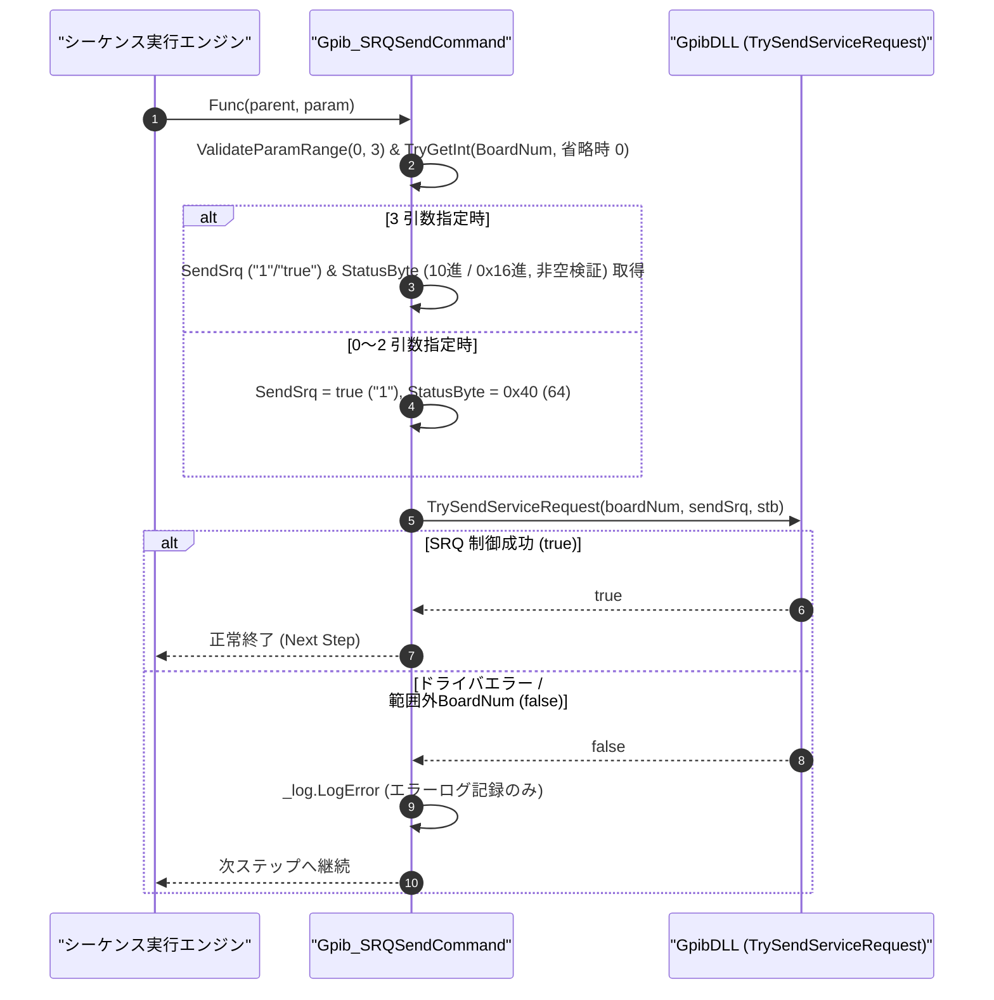

# コマンドリファレンス：Gpib_SRQSend

## 概要

**Gpib_SRQSend** は、PC 側の GPIB インターフェースボードがスレーブ（非コントローラ／測定器エミュレータ）として動作している際に、シリアルポール応答用のステータスバイト（STB）をセットして **SRQ（Service Request）要求ライン** をマスターコントローラへ向けて送出・解除（`GpibDLL.TrySendServiceRequest`）するコマンドです。

> 💡 **補足**: PC を GPIB スレーブ機器（擬似測定器）として動作させ、外部の GPIB マスターへ処理完了やエラー発生を通知する用途に使用します。任意のステータスバイト値（`"0x50"` 等）を指定したい場合や SRQ ラインを取り下げたい場合（`SendSrq = "0"`）は、 **必ず 3 引数構文** で指定してください（0〜2 引数時は `SendSrq = "1"`, `StatusByte = "0x40"` の既定値で動作します）。

---

## 💡 書式・パラメータ仕様

### コマンド構文

```csv
; 0〜1 引数短縮構文（BoardNum 省略時 0、SendSrq = "1"［送出ON］、StatusByte = "0x40" 既定）
,SEQUENCE, [ステップキー], Gpib_SRQSend, "[BoardNum: 0]"

; 3 引数完全構文（SRQ ON/OFF フラグおよび任意のステータスバイトを指定）
,SEQUENCE, [ステップキー], Gpib_SRQSend, <BoardNum>, "<SendSrq: 1 / 0>", "<StatusByte>"
```

### パラメータ（引数）一覧

| 引数位置 | 引数名 | 説明 | 指定方法 / 有効な入力値 |
| :--- | :--- | :--- | :--- |
| 引数1 | `BoardNum` | SRQ 制御を行う対象の GPIB ボード番号（任意・省略時既定値: `0` 固定）。※ `AnalysisParam.TryGetInt` は 10 進数および `"0x"` / `"&H"` 付き 16 進表記に対応しているため、`"INVALID"` 等の非数値文字列を渡した場合のみ型変換エラー（`-11`）で安全停止し、負の整数や `"0x50"`（＝整数 `80`）のような範囲外ボード番号を渡した場合は `TrySendServiceRequest` が `false` を返して `_log.LogError` を記録し次ステップへ継続します。 | `0` 以上の整数（10 進または `"0x"` / `"&H"` 16 進表記、例: `0`）または `$PARAM$` 置換 |
| 引数2 | `SendSrq` | **3 引数指定時** ：SRQ ライン送出フラグ（`"1"` または `"true"`［大文字・小文字非区別］＝送出アサート、それ以外＝送出停止）。※ 0〜2 引数時は既定値 `"1"` が使用されます。 | `"1"` / `"true"` または `"0"` / `"false"` |
| 引数3 | `StatusByte` | **3 引数指定時** ：設定するステータスバイト値（非空必須）。※ 0〜2 引数時は既定値 `"0x40"`（`64`）が使用されます。 | 10 進整数または `"0x"` 付き 16 進表記（例: `"0x50"`, `"64"`, `"0x00"`） |

---

## 🔄 特殊置換規約・分岐規約の適用

本コマンドの引数における特殊記法および解釈ルールです。
* **動的置換（`$`）**: 引数内で `$PARAMキー$` のように記述すると、実行時に変数プール（PARAM）の値へ動的置換されます。（適用可能な引数: 全引数対応）
* **ジャンプ先指定（`#`）**: 本コマンドはジャンプ制御を行わないため適用されません。（適用可能な引数: 非適用）
* **共通コマンド指定（`@`）**: 本コマンドは外部マクロを呼び出さないため適用されません。（適用可能な引数: 非適用）
* **カンマのエスケープ**: SCPI コマンド等、引数文字列自体にカンマを含める場合は、必ず `","` と二重引用符で囲んで記述します。
* **エイリアス（別名）**: `SRQSend`, `GpibSRQSend`

---

## 💡 動作例（正しい構文での記述例）

### スクリプト記述例

※COMMAND ブロック配下の子要素行（PARAM, SEQUENCE）は必ず行頭カンマ（`,`）から開始してください（行頭スペースのみでは認識されません）。なお、`;` で始まる行やクォート外の `;` 以降はコメントとして自動除去されます。

```csv
COMMAND, "SAMPLE_GPIB_SRQSEND", ""
,PARAM, "STB_MAV_RQS", Text, "SRQステータスバイト", "0x50"
,SEQUENCE, 010, Gpib_Open, 0
; 1. ボード 0 に対し 3 引数構文で RQS(0x40)+MAV(0x10)=0x50 をセットして SRQ を送出(1)
,SEQUENCE, 020, Gpib_SRQSend, 0, "1", "$STB_MAV_RQS$"
; 2. マスターからのシリアルポール待機後、3 引数構文で SRQ 送出を停止(0)し STB を 0x00 にクリア
,SEQUENCE, 030, Wait, "1000"
,SEQUENCE, 040, Gpib_SRQSend, 0, "0", "0x00"
,SEQUENCE, 050, Gpib_Close
,SEQUENCE, 060, Exit
```

### 実行時の挙動・変数変化

* **実行前の状態**: GPIB ボード `0` がオープンされ、`"STB_MAV_RQS"` に `"0x50"` が設定されている状態。
* **実行後の状態**: ステップ `020` の `Gpib_SRQSend, 0, "1", "$STB_MAV_RQS$"` によりステータスバイト `0x50`（`80`）で SRQ 送出が有効化されます。ステップ `040` の `Gpib_SRQSend, 0, "0", "0x00"` によりステータスバイトが `0x00` に更新され、SRQ 送出が解除されます。

---

## 🔄 動作フロー（シーケンス図）



---

## 🚫 エラーハンドリング・安全設計（仕様制限）

1. **引数個数（`0`〜`3`）・`BoardNum` 整数検証・`StatusByte` 検証**:
   - `ValidateParamRange(0, 3)` 違反（4 個以上の引数指定：エラーコード `-10`）、第 1 引数 `BoardNum` に非数値文字列（`"INVALID"` 等：エラーコード `-11` ※ `"0x50"` 等の 16 進表記は `TryGetInt` により整数 `80` へ正常変換されます）が渡された場合、または 3 引数指定時に第 2 引数 `SendSrq` もしくは第 3 引数 `StatusByte` が空文字列（エラーコード `-10`）の場合は、`SetErrorAndHalt` によりエラーログを記録して安全停止します。また、`StatusByte` に `"0x..."` 形式で不正 16 進文字や `short` 範囲外（`"0xFFFF"` 等）を渡した場合は `Convert.ToInt16` の例外捕捉により `SetErrorAndHalt(-1, ex.Message)` で停止し、`"0x"` なしの非数値文字列（`"INVALID"` 等）を渡した場合は `short.TryParse` 失敗により `_log.LogError` を出力して停止せずリターンします。
2. **ドライバ送出失敗・範囲外ボード番号時の非停止ログ記録**:
   - 負の `BoardNum` 整数や上限超過のボード番号（例: `"0x50"`＝`80`）を指定した場合、またはスレーブモード非対応状態・ハードウェアエラーにより `GpibDLL.TrySendServiceRequest` が `false` を返した場合は `_log.LogError` を出力しますが、例外送出や強制停止は行わず次ステップへ進みます。

---

## 🧪 ユニットテスト仕様

本コマンドクラス（`Gpib_SRQSendCommand.cs`）に実装されている `RunUnitTest()` メソッドが検証するユニットテストの仕様です。

### テスト実行前提条件

* **実行トリガー**: `RunUnitTest()` メソッドの呼び出し
* **有効化条件**: システム全体の最小ログレベル（`ErrorLogger.MinimumLevel`）が `LogLevel.Test` であること（それ以外の場合は無効化ガードにより早期リターン）
* **検証結果出力**: `_log.LogTest` によるログ出力。検証失敗時は `_log.LogError`、予期せぬ例外発生時は `_log.LogCritical` で記録し、`finally` ブロックで実行前のボード接続状態（`OpenGpibBoards` / `CloseGpibBoards`）および `GpibDLL.DebugDLL`・`DebugReceiveData` を復元します。

### テストケース一覧

| No | テストカテゴリ | テスト条件（入力値） | 期待される結果（出力値） | 検証の目的 / 観点 |
| :---: | :--- | :--- | :--- | :--- |
| **1** | 正常系 | 引数省略（0 引数）および 3 引数指定 `("0", "1", "0x40")` で `Func` を実行 | 両ケースとも `!HasError` かつ `IsCommandGo == true` で SRQ 送出・STB 設定が完了する | 既定値実行および 16 進ステータスバイト明示指定での SRQ 制御検証 |
| **2** | 異常系 | 不正ボード番号 `("INVALID")`、空 STB `("0", "1", "")`、および余剰引数 `("0", "1", "0x40", "EXTRA")` で `Func` を実行 | 3 ケースすべて `HasError == true` かつ `IsCommandGo == false` となり安全停止する | 不正 `BoardNum`・空 `StatusByte`・引数個数超過時の安全停止検証 |
