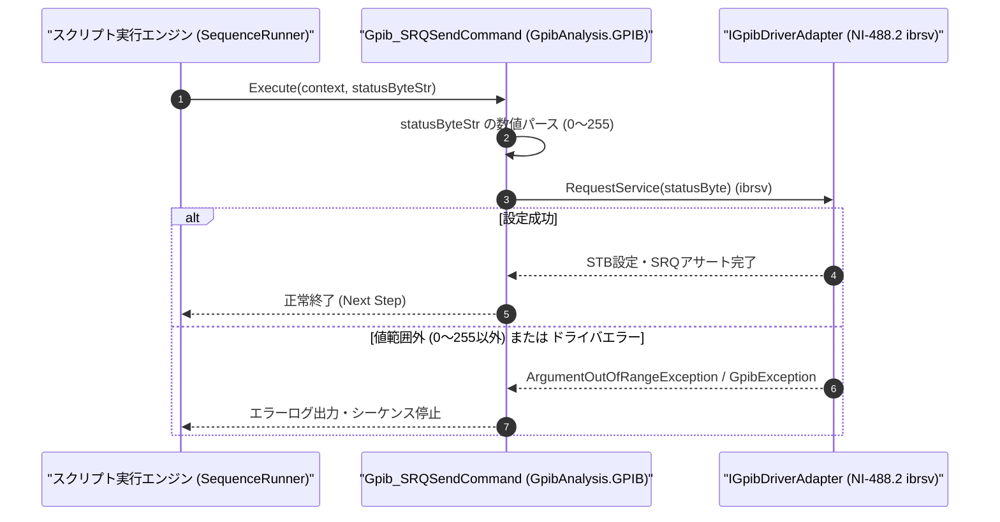

# コマンドリファレンス：Gpib_SRQSend

## 概要

**Gpib_SRQSend** は、PC 側の GPIB インターフェースボードがスレーブ（非コントローラ／測定器エミュレータ）として動作している際に、シリアルポール応答用のステータスバイト（STB）をセットして **SRQ（Service Request）要求ライン** をマスターコントローラへ向けてアサート（NI-488.2 `ibrsv` 相当）するコマンドです。

> 💡 **補足**: PC を GPIB スレーブ機器（擬似測定器）として動作させ、外部の GPIB マスターへ処理完了やエラー発生を通知する用途に使用します。

---

## 💡 書式・パラメータ仕様

### コマンド構文

```csv
,SEQUENCE, [ステップキー], Gpib_SRQSend, "[BoardNum: 0]", "[SendSrq: 1]", "[StatusByte: 0x40]"
```

### パラメータ（引数）一覧

| 引数位置 | 引数名 | 説明 | 指定方法 / 有効な入力値 |
| :--- | :--- | :--- | :--- |
| 引数1 | `BoardNum` | SRQ 制御を行う対象の GPIB ボード番号（任意・既定値: `0`）。 | `0` 以上の整数（例: `0`）または `$PARAM$` 置換 |
| 引数2 | `SendSrq` | SRQ ライン送出フラグ（任意・既定値: `"1"`＝送出、`"0"`＝停止）。 | `"1"` / `"true"`（アサート）または `"0"` / `"false"`（解除） |
| 引数3 | `StatusByte` | 設定する 8bit ステータスバイト値（任意・既定値: `"0x40"`）。 | 整数または 16 進表記（例: `"0x40"`, `"64"`） |

---

## 🔄 特殊置換規約・分岐規約の適用

本コマンドの引数における特殊記法および解釈ルールです。
* **動的置換（`$`）**: 引数内で `$PARAMキー$` のように記述すると、実行時に変数プール（PARAM）の値へ動的置換されます。（適用可能な引数: 全引数対応）
* **ジャンプ先指定（`#`）**: 本コマンドはジャンプ制御を行わないため適用されません。（適用可能な引数: 非適用）
* **共通コマンド指定（`@`）**: 本コマンドは外部マクロを呼び出さないため適用されません。（適用可能な引数: 非適用）
* **カンマのエスケープ**: SCPI コマンド等、引数文字列自体にカンマを含める場合は、必ず `","` と二重引用符で囲んで記述します。
* **エイリアス（別名）**: `SRQSend`, `GpibSRQSend`

---

## 💡 動作例（正しい構文での記述例）

### スクリプト記述例

※COMMAND ブロック配下の子要素行（PARAM, SEQUENCE）は必ず行頭カンマから開始し、スペースインデントや行末コメント（;）は記述しないでください。

```csv
COMMAND, "SAMPLE_GPIB_SRQSEND", ""
,PARAM, "STB_MAV_RQS", Text, "STB_MAV_RQS", "0x50"
,SEQUENCE, 010, Gpib_Open, "1"
; 1. RQSビット(0x40) + MAVビット(0x10) = 0x50 をセットしてマスターへSRQを送出
,SEQUENCE, 020, Gpib_SRQSend, "$STB_MAV_RQS$"
; 2. マスターからのシリアルポール完了後、SRQ要求をクリア(0x00)
,SEQUENCE, 030, Wait, "1000"
,SEQUENCE, 040, Gpib_SRQSend, "0x00"
,SEQUENCE, 050, Gpib_Close
,SEQUENCE, 060, Exit
```

### 実行時の挙動・変数変化

* **実行前の状態**: GPIB 通信環境および対象コマンドの PARAM 初期値が設定され、ステップ実行待機中である状態。
* **実行後の状態**: `Gpib_SRQSend, "$STB_MAV_RQS"` によりステータスバイト `0x50`（ビット 6 = `1`）がボードレジスタに書き込まれ、GPIB バスの SRQ ラインがアサートされます。 `Gpib_SRQSend, "0x00"` によりステータスバイトが `0x00` に更新され、SRQ 要求が取り下げられます。

---

## 🔄 動作フロー（シーケンス図）



---

## 🚫 エラーハンドリング・安全設計（仕様制限）

1. **1 バイト範囲（`0`〜`255`）の検証**:
   - `0`〜`255`（`0x00`〜`0xFF`）の範囲を超える数値や非数値が指定された場合は `ArgumentOutOfRangeException` / `FormatException` を送出します。
2. **未オープン時の実行防止**:
   - GPIB ボードが開かれていない状態で実行された場合は `InvalidOperationException` を送出します。

---

## 🧪 ユニットテスト仕様

本コマンドクラス（`Gpib_SRQSendCommand.cs`）に実装されている `RunUnitTest()` メソッドが検証するユニットテストの仕様です。

### テスト実行前提条件

* **実行トリガー**: `RunUnitTest()` メソッドの呼び出し
* **有効化条件**: システム全体の最小ログレベル（`ErrorLogger.MinimumLevel`）が `LogLevel.Test` であること（それ以外の場合は無効化ガードにより早期リターン）
* **検証結果出力**: `_log.LogTest` によるログ出力。検証失敗時は `_log.LogError`、予期せぬ例外発生時は `_log.LogCritical` で記録し、`finally` ブロックで実行前のボード接続状態（`OpenGpibBoards` / `CloseGpibBoards`）および `GpibDLL.DebugDLL`・`DebugReceiveData` を復元します。

### テストケース一覧

| No | テストカテゴリ | テスト条件（入力値） | 期待される結果（出力値） | 検証の目的 / 観点 |
| :---: | :--- | :--- | :--- | :--- |
| **1** | 正常系 | 引数省略（0 引数）および 3 引数指定 `("0", "1", "0x40")` で `Func` を実行 | 両ケースとも `!HasError` かつ `IsCommandGo == true` で SRQ 送出・STB 設定が完了する | 既定値実行および 16 進ステータスバイト明示指定での SRQ 制御検証 |
| **2** | 異常系 | 不正ボード番号 `("INVALID")`、空 STB `("0", "1", "")`、および余剰引数 `("0", "1", "0x40", "EXTRA")` で `Func` を実行 | 3 ケースすべて `HasError == true` かつ `IsCommandGo == false` となり安全停止する | 不正 `BoardNum`・空 `StatusByte`・引数個数超過時の安全停止検証 |
