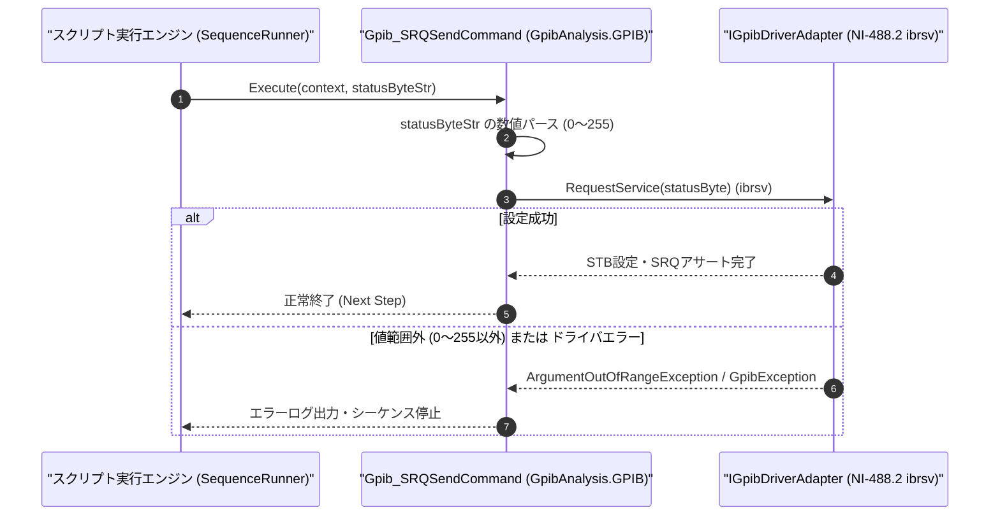

# コマンドリファレンス：Gpib_SRQSend

---

## 概要

**Gpib_SRQSend** は、PC 側の GPIB インターフェースボードがスレーブ（非コントローラ／測定器エミュレータ）として動作している際に、シリアルポール応答用のステータスバイト（STB）をセットして **SRQ（Service Request）要求ライン** をマスターコントローラへ向けてアサート（NI-488.2 `ibrsv` 相当）するコマンドです。

> 💡 **補足**: PC を GPIB スレーブ機器（擬似測定器）として動作させ、外部の GPIB マスターへ処理完了やエラー発生を通知する用途に使用します。

---

## 💡 書式・パラメータ仕様

### コマンド構文

```csv
,SEQUENCE,Gpib_SRQSend, "<StatusByte: 0x40等>"
```

### パラメータ（引数）一覧

| 引数位置 | パラメータ名 | 必須/任意 | 型・制約 | 説明 |
| :---: | :--- | :---: | :--- | :--- |
| 第1引数 | `StatusByte` | **必須** | 整数または16進表記（`0`〜`255`、例: `"64"`, `"0x40"`） | シリアルポール応答レジスタに設定する 8bit ステータスバイト値を指定します。ビット 6（`0x40`: RQS ビット）が `1` の場合に SRQ ラインがアサートされます。 |

---

## 🔄 特殊置換規約・分岐規約の適用

1. **変数展開（`$` / `@` / `#`）**:
   - 第 1 引数 `StatusByte` には変数を指定可能です（例: `"$MY_STB"`）。
2. **レガシー別名互換**:
   - 旧表記の `GpibSRQSend` や `GPIB_SRQSEND` は内部正規化により本 `Gpib_SRQSend` コマンドへマッピングされます。

---

## 💡 動作例（正しい構文での記述例）

### スクリプト記述例

```csv
,PARAM,STB_MAV_RQS,0x50

,SEQUENCE,Gpib_Open, "1"
; 1. RQSビット(0x40) + MAVビット(0x10) = 0x50 をセットしてマスターへSRQを送出
,SEQUENCE,Gpib_SRQSend, "$STB_MAV_RQS"

; 2. マスターからのシリアルポール完了後、SRQ要求をクリア(0x00)
,SEQUENCE,Wait, "1000"
,SEQUENCE,Gpib_SRQSend, "0x00"
,SEQUENCE,Gpib_Close
,SEQUENCE,Exit
```

### 実行時の挙動・変数変化

1. `Gpib_SRQSend, "$STB_MAV_RQS"` によりステータスバイト `0x50`（ビット 6 = `1`）がボードレジスタに書き込まれ、GPIB バスの SRQ ラインがアサートされます。
2. `Gpib_SRQSend, "0x00"` によりステータスバイトが `0x00` に更新され、SRQ 要求が取り下げられます。

---

## 🔄 動作フロー（シーケンス図）



---

## 🚫 エラーハンドリング・安全設計（仕様制限）

1. **1 バイト範囲（`0`〜`255`）の検証**:
   - `0`〜`255`（`0x00`〜`0xFF`）の範囲を超える数値や非数値が指定された場合は `ArgumentOutOfRangeException` / `FormatException` を送出します。
2. **未オープン時の実行防止**:
   - GPIB ボードが開かれていない状態で実行された場合は `InvalidOperationException` を送出します。

---

## 🧪 ユニットテスト仕様

### テスト実行前提条件
- **対象クラス**: `GpibAnalysis.GPIB.Gpib_SRQSendCommand`（`Gpib_SRQSendCommand.cs`）
- **モック環境**: `IGpibDriverAdapter` モックが注入されていること。

### テストケース一覧

| テストID | テスト観点 | 入力スクリプト | 期待される動作・検証項目 |
| :--- | :--- | :--- | :--- |
| `UT-GPIB-SRQSEND-01` | 正常系（16進指定） | `,SEQUENCE,Gpib_SRQSend, "0x40"` | `RequestService(0x40)` が呼び出されること。 |
| `UT-GPIB-SRQSEND-02` | 正常系（10進指定） | `,SEQUENCE,Gpib_SRQSend, "64"` | `RequestService(64)` が呼び出されること。 |
| `UT-GPIB-SRQSEND-03` | 異常系（範囲外値） | `,SEQUENCE,Gpib_SRQSend, "512"` | `ArgumentOutOfRangeException` が送出されること。 |

