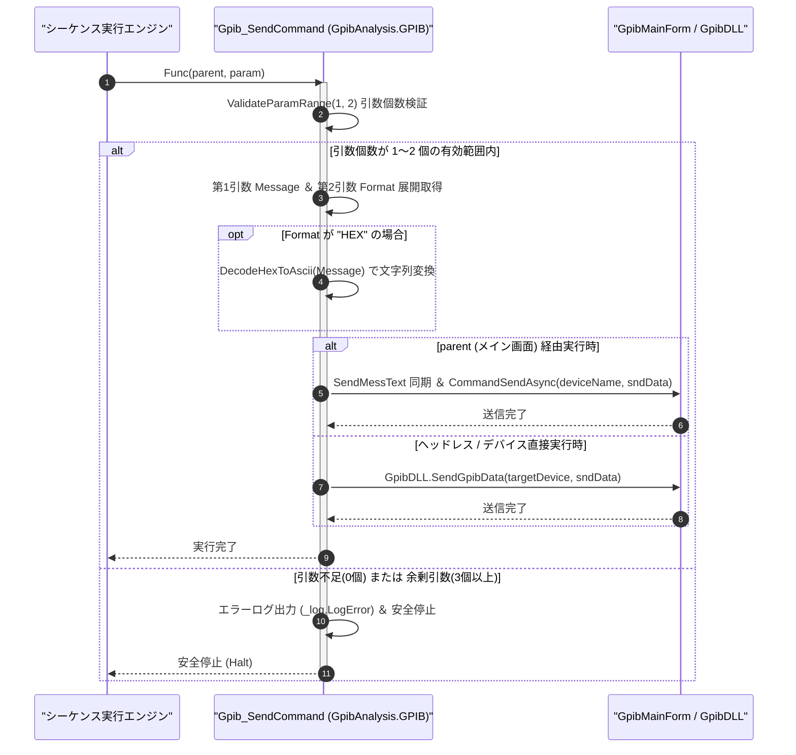

# コマンドリファレンス：Gpib_Send

## 概要

**Gpib_Send** は、接続中の対象 GPIB デバイスに対して SCPI コマンド文字列または HEX（16 進数）デコード電文を物理送信する GPIB 通信制御系コマンドです。  
第 2 引数 `Format` により通常のテキスト送信（`"ASCII"`）と 16 進バイト列デコード送信（`"HEX"`）を切り替え可能であり、メイン画面経由の実行時には UI 送信欄同期および通信異常時の自動復旧リトライと連動します。

> 💡 **補足**: 送信後に引き続いて応答を受信したい場合は [`Gpib_SendReceive`](./Gpib_SendReceive.Md) を使用し、送信のみを行う設定・制御コマンド（`*RST`, `VOLT 5.0`, `OUTP ON` 等）には本 `Gpib_Send` を使用します。

---

## 💡 書式・パラメータ仕様

### コマンド構文

```csv
,SEQUENCE, [ステップキー], Gpib_Send, "<Message>", "[Format: ASCII]"
```

### パラメータ（引数）一覧

| 引数位置 | 引数名 | 説明 | 指定方法 / 有効な入力値 |
| :--- | :--- | :--- | :--- |
| 引数1 | `Message` | GPIB 機器へ送信するコマンド文字列または 16 進データ文字列（必須）。 | SCPI 文字列（例: `"*RST;*CLS"`, `"VOLT $OUTPUT_VOLT$"`）または 16 進文字列（例: `"2A434C53"`） |
| 引数2 | `Format` | 送信データの解釈形式（任意・省略時既定値: `"ASCII"`）。`"HEX"` 指定時は `Message` の 16 進バイト表記（空白・`-`・`,`・先頭 `0x` 許容）をデコードして送信します。 | `"ASCII"` または `"HEX"`（大文字・小文字非区別）、`$PARAM$` 置換可 |

---

## 🔄 特殊置換規約・分岐規約の適用

本コマンドの引数における特殊記法および解釈ルールです。
* **動的置換（`$`）**: 引数内で `$PARAMキー$` のように記述すると、実行時に変数プール（PARAM）の値へ動的置換されます。（適用可能な引数: 全引数対応）
* **ジャンプ先指定（`#`）**: 本コマンドはジャンプ制御を行わないため適用されません。（適用可能な引数: 非適用）
* **共通コマンド指定（`@`）**: 本コマンドは外部マクロを呼び出さないため適用されません。（適用可能な引数: 非適用）
* **カンマのエスケープ**: SCPI コマンド等、引数文字列自体にカンマを含める場合は、必ず `","` と二重引用符で囲んで記述します。
* **エイリアス（別名）**: `Send`, `GpibSend`

---

## 💡 動作例（正しい構文での記述例）

### スクリプト記述例

※COMMAND ブロック配下の子要素行（PARAM, SEQUENCE）は必ず行頭カンマ（`,`）から開始してください（行頭スペースのみでは認識されません）。なお、`;` で始まる行やクォート外の `;` 以降はコメントとして自動除去されます。

```csv
COMMAND, "SAMPLE_GPIB_SEND", ""
,PARAM, "OUTPUT_VOLT", Text, "出力電圧", "5.00"
,PARAM, "CURR_LIMIT", Text, "制限電流", "1.50"
,SEQUENCE, 010, Gpib_Open, "0"
; 1. 既定の ASCII 形式で機器リセットコマンドを送信
,SEQUENCE, 020, Gpib_Send, "*RST"
; 2. HEX 形式を指定して "*CLS" (0x2A 0x43 0x4C 0x53) をデコード送信
,SEQUENCE, 030, Gpib_Send, "2A 43 4C 53", "HEX"
; 3. 変数展開を用いて出力電圧・制限電流を設定し、出力を ON にする
,SEQUENCE, 040, Gpib_Send, "VOLT $OUTPUT_VOLT$", "ASCII"
,SEQUENCE, 050, Gpib_Send, "CURR $CURR_LIMIT$"
,SEQUENCE, 060, Gpib_Send, "OUTP ON"
,SEQUENCE, 070, Gpib_Close, "0"
,SEQUENCE, 080, Exit
```

### 実行時の挙動・変数変化

* **実行前の状態**: GPIB ボードがオープンされ、`"OUTPUT_VOLT"` に `"5.00"`、`"CURR_LIMIT"` に `"1.50"` が設定されている状態。
* **実行後の状態**: ステップ `020` で `"*RST"` がそのまま ASCII 送信され、ステップ `030` では `Format` に `"HEX"` が指定されているため `"2A 43 4C 53"` が `"*CLS"` へデコードされて送信されます。続くステップ `040`〜`060` で変数展開後の設定コマンドが対象機器へ順次送出されます。

---

## 🔄 動作フロー（シーケンス図）



---

## 🚫 エラーハンドリング・安全設計（仕様制限）

1. **引数個数バリデーションによる誤実行防止**:
   - `ValidateParamRange(1, 2)` により、送信文字列 `Message` が省略された場合（0 引数）や 3 個以上の引数が指定された場合は、エラーログを記録して安全に停止します。
2. **HEX デコード時のフォールバック保護と通信例外捕捉**:
   - `Format` に `"HEX"` が指定された際、奇数桁や非 16 進文字が含まれる場合は例外クラッシュを起こさず元の文字列へ安全にフォールバックします。また、物理送信中に予期せぬ例外が発生した場合は `_log.LogCritical` を記録し `SetErrorAndHalt(-1, ...)` でシーケンスを安全停止します。

---

## 🧪 ユニットテスト仕様

本コマンドクラス（`Gpib_SendCommand.cs`）に実装されている `RunUnitTest()` メソッドが検証するユニットテストの仕様です。

### テスト実行前提条件

* **実行トリガー**: `RunUnitTest()` メソッドの呼び出し
* **有効化条件**: システム全体の最小ログレベル（`ErrorLogger.MinimumLevel`）が `LogLevel.Test` であること（それ以外の場合は無効化ガードにより早期リターン）
* **検証結果出力**: `_log.LogTest` によるログ出力。検証失敗時は `_log.LogError`、予期せぬ例外発生時は `_log.LogCritical` で記録し、`finally` ブロックで `GpibDLL.DebugDLL` および `GpibDLL.DebugReceiveData` を元の状態へ復元します。

### テストケース一覧

| No | テストカテゴリ | テスト条件（入力値） | 期待される結果（出力値） | 検証の目的 / 観点 |
| :---: | :--- | :--- | :--- | :--- |
| **1** | 正常系・異常系 | `CanSendCommand` にデバイス `null`・空コマンド `""`・未接続 `false`、および `("Dev1", "*IDN?", true)` を指定 | 異常条件 3 パターンはすべて `false`、有効条件は `true` を返す | 送信開始前のデバイス・コマンド・ポート状態検証 |
| **2** | 正常系 | `IsRetryNeeded` に失敗時 `(1, 3, false)` / `(2, 3, false)`、上限到達 `(3, 3, false)`、成功時 `(1, 3, true)` を指定 | 未満失敗時は `true`、上限到達時および成功時は `false` を返す | 送信エラー発生時のリトライ継続判定の検証 |
| **3** | 正常系・異常系 | `GetButtonUiState(true)` / `(false)` 判定、`DecodeHexToAscii("4142")` 実行、および引数なし（0 引数）シーケンスでの `Func` 実行 | UI 状態が `(false, Color.Aqua)` / `(true, Color.Gainsboro)`、HEX デコードが `"AB"` となり、0 引数 `Func` は `HasError == true`・`IsCommandGo == false` で安全停止する | ボタン UI 状態遷移・HEX デコード変換・必須引数 `Message` 欠落時のエラー停止一括検証 |
