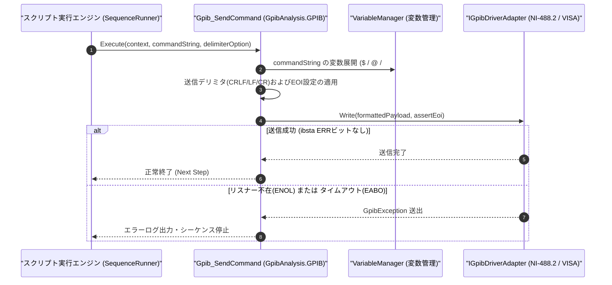

# コマンドリファレンス：Gpib_Send

---

## 概要

**Gpib_Send** は、オープン中の GPIB デバイス（または指定アドレスの測定器）に対して SCPI コマンドや制御文字列を送信するコマンドです。
設定に応じて送信末デリミタ（`CR+LF` / `LF`）および EOI（End Or Identify）単一ラインアサートが自動的に付与されます。

> 💡 **補足**: 送信後に即座に応答を受信したい場合は [`Gpib_SendReceive`](./Gpib_SendReceive.Md) を使用し、送信のみを行う設定コマンド（`*RST`, `OUTP ON` 等）には本 `Gpib_Send` を使用します。

---

## 💡 書式・パラメータ仕様

### コマンド構文

```csv
,SEQUENCE,Gpib_Send, "<CommandString>", "[Delimiter/EOI]"
```

### パラメータ（引数）一覧

| 引数位置 | パラメータ名 | 必須/任意 | 型・制約 | 説明 |
| :---: | :--- | :---: | :--- | :--- |
| 第1引数 | `CommandString` | **必須** | 文字列 | GPIB 機器へ送信する SCPI コマンドまたは文字列データを指定します。 |
| 第2引数 | `Delimiter/EOI` | 任意 | `CRLF` / `LF` / `CR` / `EOI` / `NONE`（既定値: 環境設定値 `CRLF+EOI`） | 送信終端デリミタおよび EOI ラインの制御方式を個別指定します。省略時はデフォルト設定に従います。 |

---

## 🔄 特殊置換規約・分岐規約の適用

1. **変数展開（`$` / `@` / `#`）の完全サポート**:
   - 第 1 引数に `"SOUR:VOLT $SET_VOLT"` や `"@SCPI_CMD"` を指定すると、実行時に変数値へ展開されてから送信されます。
2. **カンマを含む SCPI コマンドの保護**:
   - `"CONF:VOLT:DC 10,0.001"` のようにカンマを含む SCPI コマンドは、ダブルクォーテーション `""` で囲むことで単一の第 1 引数として保護されます。
3. **レガシー別名互換**:
   - 旧表記の `GpibSend` や `GPIB_SEND` は内部正規化により本 `Gpib_Send` コマンドへマッピングされます。

---

## 💡 動作例（正しい構文での記述例）

### スクリプト記述例

```csv
,PARAM,OUTPUT_VOLT,5.00
,PARAM,CURR_LIMIT,1.50

,SEQUENCE,Gpib_Open, "6"
; 1. 機器のリセットとステータスクリア
,SEQUENCE,Gpib_Send, "*RST;*CLS"

; 2. 変数展開を用いて出力電圧・制限電流を設定し、出力をON
,SEQUENCE,Gpib_Send, "VOLT $OUTPUT_VOLT"
,SEQUENCE,Gpib_Send, "CURR $CURR_LIMIT"
,SEQUENCE,Gpib_Send, "OUTP ON"

,SEQUENCE,Gpib_Close
,SEQUENCE,Exit
```

### 実行時の挙動・変数変化

1. `*RST;*CLS` が送信され、電源装置が初期化されます。
2. `$OUTPUT_VOLT` が `5.00` に展開され、`"VOLT 5.00\r\n"`（＋EOI アサート）が GPIB バスへ送出されます。

---

## 🔄 動作フロー（シーケンス図）



---

## 🚫 エラーハンドリング・安全設計（仕様制限）

1. **未オープン時の送信防止**:
   - `Gpib_Open` が実行されていない状態で呼び出された場合、`InvalidOperationException` を送出して停止します。
2. **GPIB バスエラー（`ENOL`: リスナー不在 / `EABO`: タイムアウト）の即時検出**:
   - 対象機器の電源 OFF 等でハンドシェイクが完了しない場合、ドライバのステータスレジスタ（`ibsta` / `iberr`）を検査して即座に通信例外を送出します。

---

## 🧪 ユニットテスト仕様

### テスト実行前提条件
- **対象クラス**: `GpibAnalysis.GPIB.Gpib_SendCommand`（`Gpib_SendCommand.cs`）
- **モック環境**: オープン状態の `IGpibDriverAdapter` モックが注入されていること。

### テストケース一覧

| テストID | テスト観点 | 入力スクリプト | 期待される動作・検証項目 |
| :--- | :--- | :--- | :--- |
| `UT-GPIB-SEND-01` | 正常送信・変数展開 | `,SEQUENCE,Gpib_Send, "VOLT $V"` | 変数展開後の文字列がモックドライバの `Write` へ渡されること。 |
| `UT-GPIB-SEND-02` | カンマ含有SCPI送信 | `,SEQUENCE,Gpib_Send, "CONF:VOLT 10,0.01"` | カンマで分割されず `"CONF:VOLT 10,0.01"` 全体が送信されること。 |
| `UT-GPIB-SEND-03` | 異常系（バスタイムアウト） | モックが `EABO` エラーを返す設定時 | `GpibException` が捕捉され、エラーステータスが記録されて停止すること。 |

