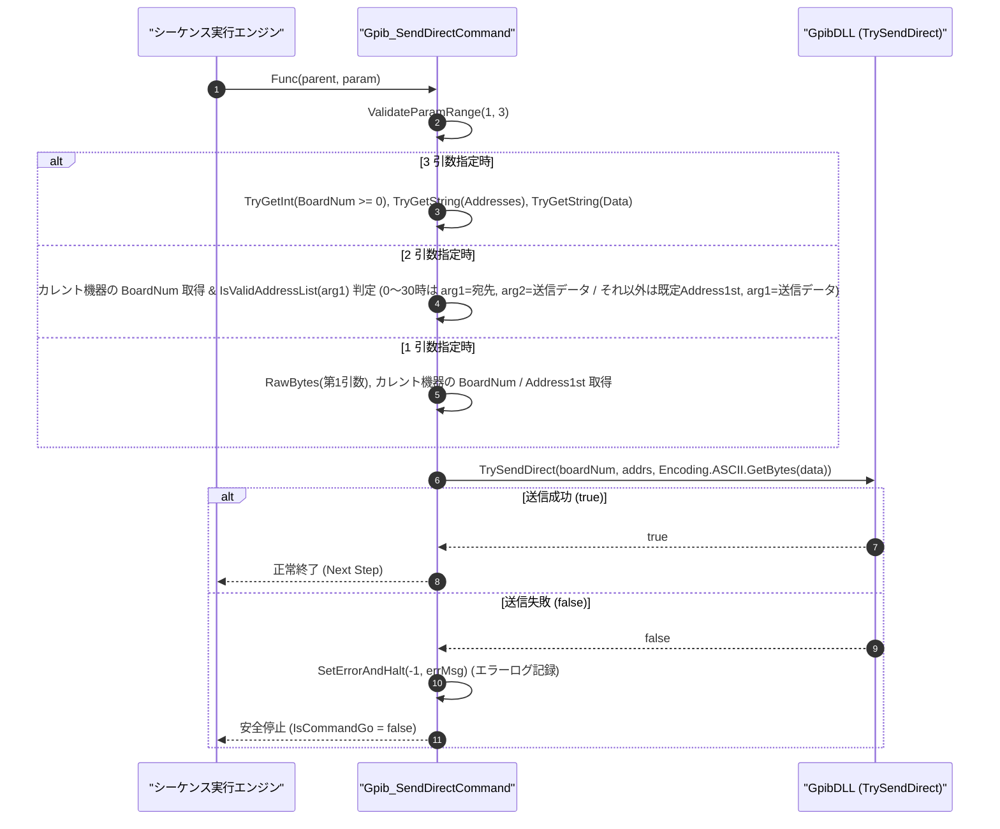

# コマンドリファレンス：Gpib_SendDirect

## 概要

**Gpib_SendDirect** は、機器ハンドル（`EquipmentId`）を介さず GPIB ボード番号とスレーブ機器アドレスを直接指定して任意のコマンド文字列データ（ASCII バイト列）をダイレクトに送信（`GpibDLL.TrySendDirect`）するコマンドです。

> 💡 **補足**: 引数の個数（ **1 引数構文** ・ **2 引数構文** ・ **3 引数構文** ）によって引数の役割が切り替わります。ボード番号と送信先アドレス群を明示する場合は **3 引数構文** （`BoardNum`, `Addresses`, `Data`）、カレント機器のボード上で送信先アドレス群（`0`〜`30`）と送信データを指定する場合は **2 引数構文** （`DeviceAddress`, `CommandString`）、カレント機器のボード・1 次アドレスへそのまま直接送信する場合は **1 引数構文** （`RawBytes`）を使用してください（なお `ParameterSpec` メタデータ上の宣言は `DeviceAddress`, `CommandString = ""`, `AssertEOI = "true"` ですが、`Func` 実行時は下記の引数個数ルールに従って処理されます）。

---

## 💡 書式・パラメータ仕様

### コマンド構文

```csv
; 1 引数構文（カレント機器のボード番号・1次アドレスへ直接送信）
,SEQUENCE, [ステップキー], Gpib_SendDirect, "<RawBytes>"

; 2 引数構文（カレント機器のボード番号を使用、送信先アドレスリスト 0〜30 指定）
,SEQUENCE, [ステップキー], Gpib_SendDirect, "<DeviceAddress>", "<CommandString>"

; 3 引数構文（GPIB ボード番号と送信先アドレス群を明示指定して直接送信）
,SEQUENCE, [ステップキー], Gpib_SendDirect, <BoardNum>, "<Addresses>", "<Data>"
```

### パラメータ（引数）一覧

#### ① 1 引数指定時（カレント機器対象モード）

| 引数位置 | パラメータ名 | 必須/任意 | 型・制約 | 説明 |
| :---: | :--- | :---: | :--- | :--- |
| 第1引数 | `RawBytes` | **必須** | 文字列（空文字許容） | カレント機器（`BoardNum`・`Address1st`、未設定時はボード `0`・アドレス `1`）へ直接送信するコマンド文字列を指定します。 |

#### ② 2 引数指定時（カレント機器ボード・宛先アドレス判定モード）

| 引数位置 | パラメータ名 | 必須/任意 | 型・制約 | 説明 |
| :---: | :--- | :---: | :--- | :--- |
| 第1引数 | `DeviceAddress` | **必須** | `0`〜`30` のカンマ区切りアドレス文字列（または送信文字列） | 第 1 引数の全要素が `0`〜`30` の整数アドレスリスト（例: `"4"` や `"1,2"`）である場合はカレント機器の `BoardNum` 上の **送信先アドレスリスト** として扱われ、第 2 引数が送信データとなります。それ以外（例: `"*RST"` 等）の場合はカレント機器の `Address1st`（未設定時 `1`）に対する送信データとして扱われます。 |
| 第2引数 | `CommandString` | **必須** | 文字列（空文字許容） | 第 1 引数が有効なアドレスリスト（`0`〜`30`）と判定された場合に送信されるコマンド文字列を指定します。 |

#### ③ 3 引数指定時（ボード・アドレス直接指定モード）

| 引数位置 | パラメータ名 | 必須/任意 | 型・制約 | 説明 |
| :---: | :--- | :---: | :--- | :--- |
| 第1引数 | `BoardNum` | **必須** | 整数（`min: 0`） | 送信に使用する GPIB インターフェースボード番号（例: `0`）を指定します（非数値時はエラーコード `-11`、負数指定時は `TryGetInt` の最小値検証エラー `-12` により事前安全停止）。 |
| 第2引数 | `Addresses` | **必須** | カンマ区切り整数文字列（空文字不可） | 送信先 GPIB 機器のプライマリアドレス（例: `"4"`、複数台同時指定時は `"1,2"`）を指定します。 |
| 第3引数 | `Data` | **必須** | 文字列（空文字許容） | 指定アドレスの機器へ送信するコマンド文字列を指定します。 |

---

## 🔄 特殊置換規約・分岐規約の適用

本コマンドの引数における特殊記法および解釈ルールです。
* **動的置換（`$`）**: 引数内で `$PARAMキー$` のように記述すると、実行時に変数プール（PARAM）の値へ動的置換されます。（適用可能な引数: 全引数対応）
* **ジャンプ先指定（`#`）**: 本コマンドはジャンプ制御を行わないため適用されません。（適用可能な引数: 非適用）
* **共通コマンド指定（`@`）**: 本コマンドは外部マクロを呼び出さないため適用されません。（適用可能な引数: 非適用）
* **カンマのエスケープ**: SCPI コマンド等、引数文字列自体にカンマを含める場合は、必ず `","` と二重引用符で囲んで記述します。
* **エイリアス（別名）**: `SendDirect`, `GpibSendDirect`

---

## 💡 動作例（正しい構文での記述例）

### スクリプト記述例

※COMMAND ブロック配下の子要素行（PARAM, SEQUENCE）は必ず行頭カンマ（`,`）から開始してください（行頭スペースのみでは認識されません）。なお、`;` で始まる行やクォート外の `;` 以降はコメントとして自動除去されます。

```csv
COMMAND, "SAMPLE_GPIB_SENDDIRECT", ""
,PARAM, "PSU_ADDR", Text, "電源アドレス", "4"
,PARAM, "DMM_ADDR", Text, "DMMアドレス", "22"
,SEQUENCE, 010, Gpib_Open, 0
; 1. ボード 0・アドレス 4 の電源装置へ 3 引数構文で直接出力 ON コマンドを送信
,SEQUENCE, 020, Gpib_SendDirect, 0, "$PSU_ADDR$", "OUTP ON"
; 2. ボード 0・アドレス 22 のマルチメータへ 3 引数構文で直接トリガ設定コマンドを送信
,SEQUENCE, 030, Gpib_SendDirect, 0, "$DMM_ADDR$", "TRIG:SOUR IMM"
,SEQUENCE, 040, Gpib_Close, 0
,SEQUENCE, 050, Exit
```

### 実行時の挙動・変数変化

* **実行前の状態**: GPIB ボード `0` がオープン済みであり、`"PSU_ADDR"` に `"4"`、`"DMM_ADDR"` に `"22"` が設定されている状態。
* **実行後の状態**: 1 回目の `Gpib_SendDirect`（3 引数構文）でボード `0` の GPIB アドレス `4` に対して `"OUTP ON"` がダイレクト送信され、2 回目の `Gpib_SendDirect` でアドレス `22` に対して `"TRIG:SOUR IMM"` がダイレクト送信されます。

---

## 🔄 動作フロー（シーケンス図）



---

## 🚫 エラーハンドリング・安全設計（仕様制限）

1. **引数個数（`1`〜`3`）およびボード番号の事前検証**:
   - `ValidateParamRange(1, 3)` 違反（0 引数または 4 引数以上：エラーコード `-10`）、3 引数指定時の第 1 引数 `BoardNum` に非数値文字列（エラーコード `-11`）または負の整数（`min: 0` 違反：エラーコード `-12`）が渡された場合、あるいは第 2 引数 `Addresses` が空文字列（エラーコード `-10`）の場合は、物理送信を行う前に `SetErrorAndHalt` によりエラーログを記録して安全停止します。
2. **アドレス文字列のパース保護と物理送信失敗時の安全停止**:
   - 第 2 引数 `Addresses` 内に `short` へ変換できない要素が含まれる場合は `_log.LogError` を記録して送出をスキップします。また、バスエラーや未接続により `GpibDLL.TrySendDirect` が `false` を返した場合は、`SetErrorAndHalt(-1, errMsg)` によりシーケンスを安全停止します。

---

## 🧪 ユニットテスト仕様

本コマンドクラス（`Gpib_SendDirectCommand.cs`）に実装されている `RunUnitTest()` メソッドが検証するユニットテストの仕様です。

### テスト実行前提条件

* **実行トリガー**: `RunUnitTest()` メソッドの呼び出し
* **有効化条件**: システム全体の最小ログレベル（`ErrorLogger.MinimumLevel`）が `LogLevel.Test` であること（それ以外の場合は無効化ガードにより早期リターン）
* **検証結果出力**: `_log.LogTest` によるログ出力。検証失敗時は `_log.LogError`、予期せぬ例外発生時は `_log.LogCritical` で記録し、`finally` ブロックで実行前のボード接続状態（`OpenGpibBoards` / `CloseGpibBoards`）および `GpibDLL.DebugDLL`・`DebugReceiveData` を復元します。

### テストケース一覧

| No | テストカテゴリ | テスト条件（入力値） | 期待される結果（出力値） | 検証の目的 / 観点 |
| :---: | :--- | :--- | :--- | :--- |
| **1** | 正常系 | 3 引数指定 `("0", "1,2", "*CLS")`、および `GpibDevice`（`BoardNum = 0`, `Address1st = 1`）設定下の 1 引数指定 `("*RST")` で `Func` を実行 | 両ケースとも `!HasError` かつ `IsCommandGo == true` で直接送信が完了する | 複数アドレス 3 引数指定および既定デバイス 1 引数指定の直接送信検証 |
| **2** | 異常系 | 引数不足（0 引数）、余剰引数 `("0", "1", "*CLS", "EXTRA")`、および不正ボード番号 `("INVALID", "1", "*CLS")` で `Func` を実行 | 3 ケースすべて `HasError == true` かつ `IsCommandGo == false` となり安全停止する | 引数個数範囲（`1`〜`3`）およびボード番号型変換のバリデーション検証 |
