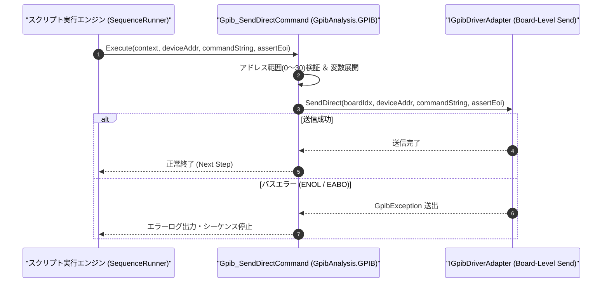

# コマンドリファレンス：Gpib_SendDirect

## 概要

**Gpib_SendDirect** は、事前の `Gpib_Open` でバインドされた対象機器設定に依存せず、引数で直接指定した GPIB ボード番号・デバイスアドレスに対して任意のコマンド文字列または生バイト列（デリミタ無加工を含む）をダイレクトに送信するコマンドです。

> 💡 **補足**: 複数台の GPIB 測定器（電源・DMM・オシロスコープ等）が同一バス上に接続されている環境で、特定のアドレスの機器へ単発コマンドを直接送出したい場合に便利です。

---

## 💡 書式・パラメータ仕様

### コマンド構文

```csv
,SEQUENCE, [ステップキー], Gpib_SendDirect, "<DeviceAddress>", "<CommandString>", "[AssertEOI: true]"
```

### パラメータ（引数）一覧

| 引数位置 | パラメータ名 | 必須/任意 | 型・制約 | 説明 |
| :---: | :--- | :---: | :--- | :--- |
| 第1引数 | `DeviceAddress` | **必須** | 整数（`0`〜`30`） | 送信先 GPIB 機器のプライマリアドレス（PAD）を直接指定します。 |
| 第2引数 | `CommandString` | **必須** | 文字列 | 送信するコマンドデータまたは生文字列を指定します。 |
| 第3引数 | `AssertEOI` | 任意 | `true` / `false` / `1` / `0`（既定値: `true`） | 最終バイト送信時に EOI ラインをアサートするかどうかを指定します。 |

---

## 🔄 特殊置換規約・分岐規約の適用

本コマンドの引数における特殊記法および解釈ルールです。
* **動的置換（`$`）**: 引数内で `$PARAMキー$` のように記述すると、実行時に変数プール（PARAM）の値へ動的置換されます。（適用可能な引数: 全引数対応）
* **ジャンプ先指定（`#`）**: 本コマンドはジャンプ制御を行わないため適用されません。（適用可能な引数: 非適用）
* **共通コマンド指定（`@`）**: 本コマンドは外部マクロを呼び出さないため適用されません。（適用可能な引数: 非適用）
* **カンマのエスケープ**: SCPI コマンド等、引数文字列自体にカンマを含める場合は、必ず `","` と二重引用符で囲んで記述します。
* **エイリアス（別名）**: `SendDirect`, `GpibSendDirect`

---

## 💡 動作例（正しい構文での記述例）

### スクリプト記述例

※COMMAND ブロック配下の子要素行（PARAM, SEQUENCE）は必ず行頭カンマから開始し、スペースインデントや行末コメント（;）は記述しないでください。

```csv
COMMAND, "SAMPLE_GPIB_SENDDIRECT", ""
,PARAM, "PSU_ADDR", Text, "PSU_ADDR", "4"
,PARAM, "DMM_ADDR", Text, "DMM_ADDR", "22"
; 1. アドレス4の電源装置へ直接出力ONコマンドを送信
,SEQUENCE, 010, Gpib_SendDirect, "$PSU_ADDR$", "OUTP ON"
; 2. アドレス22のマルチメータへ直接トリガ設定コマンドを送信
,SEQUENCE, 020, Gpib_SendDirect, "$DMM_ADDR$", "TRIG:SOUR IMM"
,SEQUENCE, 030, Exit
```

### 実行時の挙動・変数変化

* **実行前の状態**: GPIB 通信環境および対象コマンドの PARAM 初期値が設定され、ステップ実行待機中である状態。
* **実行後の状態**: 1 回目の `Gpib_SendDirect` で GPIB アドレス `4` に対して `"OUTP ON"` がダイレクト送信されます。 2 回目の `Gpib_SendDirect` で GPIB アドレス `22` に対して `"TRIG:SOUR IMM"` がダイレクト送信されます。

---

## 🔄 動作フロー（シーケンス図）



---

## 🚫 エラーハンドリング・安全設計（仕様制限）

1. **アドレス範囲（`0`〜`30`）の検証**:
   - 第 1 引数に `0`〜`30` 以外の値が指定された場合は、バス送出前に `ArgumentOutOfRangeException` を送出します。
2. **リスナー不在（`ENOL`）の検出**:
   - 指定したアドレスに機器が存在しない場合は `GpibException` を送出して停止します。

---

## 🧪 ユニットテスト仕様

本コマンドクラス（`Gpib_SendDirectCommand.cs`）に実装されている `RunUnitTest()` メソッドが検証するユニットテストの仕様です。

### テスト実行前提条件

* **実行トリガー**: `RunUnitTest()` メソッドの呼び出し
* **有効化条件**: システム全体の最小ログレベル（`ErrorLogger.MinimumLevel`）が `LogLevel.Test` であること（それ以外の場合は無効化ガードにより早期リターン）
* **検証結果出力**: `_log.LogTest` によるログ出力。検証失敗時は `_log.LogError`、予期せぬ例外発生時は `_log.LogCritical` で記録し、`finally` ブロックで実行前のボード接続状態（`OpenGpibBoards` / `CloseGpibBoards`）および `GpibDLL.DebugDLL`・`DebugReceiveData` を復元します。

### テストケース一覧

| No | テストカテゴリ | テスト条件（入力値） | 期待される結果（出力値） | 検証の目的 / 観点 |
| :---: | :--- | :--- | :--- | :--- |
| **1** | 正常系 | 3 引数指定 `("0", "1,2", "*CLS")`、および `GpibDevice`（`BoardNum = 0`, `Address_1st = 1`）設定下の 1 引数指定 `("*RST")` で `Func` を実行 | 両ケースとも `!HasError` かつ `IsCommandGo == true` で直接送信が完了する | 複数アドレス 3 引数指定および既定デバイス 1 引数指定の直接送信検証 |
| **2** | 異常系 | 引数不足（0 引数）、余剰引数 `("0", "1", "*CLS", "EXTRA")`、および不正ボード番号 `("INVALID", "1", "*CLS")` で `Func` を実行 | 3 ケースすべて `HasError == true` かつ `IsCommandGo == false` となり安全停止する | 引数個数範囲（`1`〜`3`）およびボード番号型変換のバリデーション検証 |
