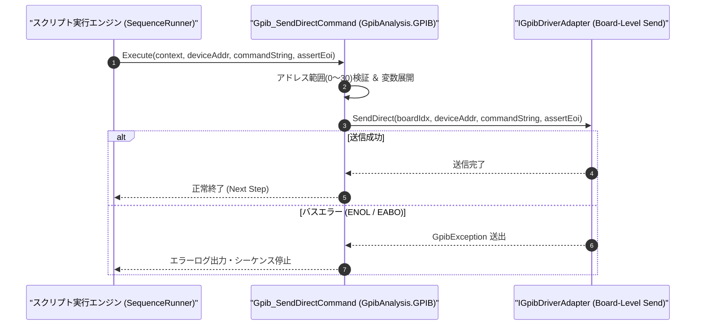

# コマンドリファレンス：Gpib_SendDirect

---

## 概要

**Gpib_SendDirect** は、事前の `Gpib_Open` でバインドされた対象機器設定に依存せず、引数で直接指定した GPIB ボード番号・デバイスアドレスに対して任意のコマンド文字列または生バイト列（デリミタ無加工を含む）をダイレクトに送信するコマンドです。

> 💡 **補足**: 複数台の GPIB 測定器（電源・DMM・オシロスコープ等）が同一バス上に接続されている環境で、特定のアドレスの機器へ単発コマンドを直接送出したい場合に便利です。

---

## 💡 書式・パラメータ仕様

### コマンド構文

```csv
,SEQUENCE,Gpib_SendDirect, "<DeviceAddress>", "<CommandString>", "[AssertEOI: true]"
```

### パラメータ（引数）一覧

| 引数位置 | パラメータ名 | 必須/任意 | 型・制約 | 説明 |
| :---: | :--- | :---: | :--- | :--- |
| 第1引数 | `DeviceAddress` | **必須** | 整数（`0`〜`30`） | 送信先 GPIB 機器のプライマリアドレス（PAD）を直接指定します。 |
| 第2引数 | `CommandString` | **必須** | 文字列 | 送信するコマンドデータまたは生文字列を指定します。 |
| 第3引数 | `AssertEOI` | 任意 | `true` / `false` / `1` / `0`（既定値: `true`） | 最終バイト送信時に EOI ラインをアサートするかどうかを指定します。 |

---

## 🔄 特殊置換規約・分岐規約の適用

1. **アドレスおよび送信データの変数展開**:
   - 第 1 引数・第 2 引数ともに `$` / `@` / `#` による変数展開が適用されます。
2. **レガシー別名互換**:
   - 旧表記の `GpibSendDirect` は内部正規化により本 `Gpib_SendDirect` コマンドへマッピングされます。

---

## 💡 動作例（正しい構文での記述例）

### スクリプト記述例

```csv
,PARAM,PSU_ADDR,4
,PARAM,DMM_ADDR,22

; 1. アドレス4の電源装置へ直接出力ONコマンドを送信
,SEQUENCE,Gpib_SendDirect, "$PSU_ADDR", "OUTP ON"

; 2. アドレス22のマルチメータへ直接トリガ設定コマンドを送信
,SEQUENCE,Gpib_SendDirect, "$DMM_ADDR", "TRIG:SOUR IMM"
,SEQUENCE,Exit
```

### 実行時の挙動・変数変化

1. 1 回目の `Gpib_SendDirect` で GPIB アドレス `4` に対して `"OUTP ON"` がダイレクト送信されます。
2. 2 回目の `Gpib_SendDirect` で GPIB アドレス `22` に対して `"TRIG:SOUR IMM"` がダイレクト送信されます。

---

## 🔄 動作フロー（シーケンス図）



---

## 🚫 エラーハンドリング・安全設計（仕様制限）

1. **アドレス範囲（`0`〜`30`）の検証**:
   - 第 1 引数に `0`〜`30` 以外の値が指定された場合は、バス送出前に `ArgumentOutOfRangeException` を送出します。
2. **リスナー不在（`ENOL`）の検出**:
   - 指定したアドレスに機器が存在しない場合は `GpibException` を送出して停止します。

---

## 🧪 ユニットテスト仕様

### テスト実行前提条件
- **対象クラス**: `GpibAnalysis.GPIB.Gpib_SendDirectCommand`（`Gpib_SendDirectCommand.cs`）
- **モック環境**: `IGpibDriverAdapter` モックが注入されていること。

### テストケース一覧

| テストID | テスト観点 | 入力スクリプト | 期待される動作・検証項目 |
| :--- | :--- | :--- | :--- |
| `UT-GPIB-SENDDIR-01` | 正常ダイレクト送信 | `,SEQUENCE,Gpib_SendDirect, "4", "OUTP ON"` | アドレス `4` 宛に `"OUTP ON"` が送信されること。 |
| `UT-GPIB-SENDDIR-02` | EOI制御指定 | `,SEQUENCE,Gpib_SendDirect, "4", "RAW_DATA", "false"` | `assertEoi = false` でドライバメソッドが呼ばれること。 |
| `UT-GPIB-SENDDIR-03` | 異常系（不正アドレス） | `,SEQUENCE,Gpib_SendDirect, "99", "OUTP ON"` | `ArgumentOutOfRangeException` が送出されること。 |

