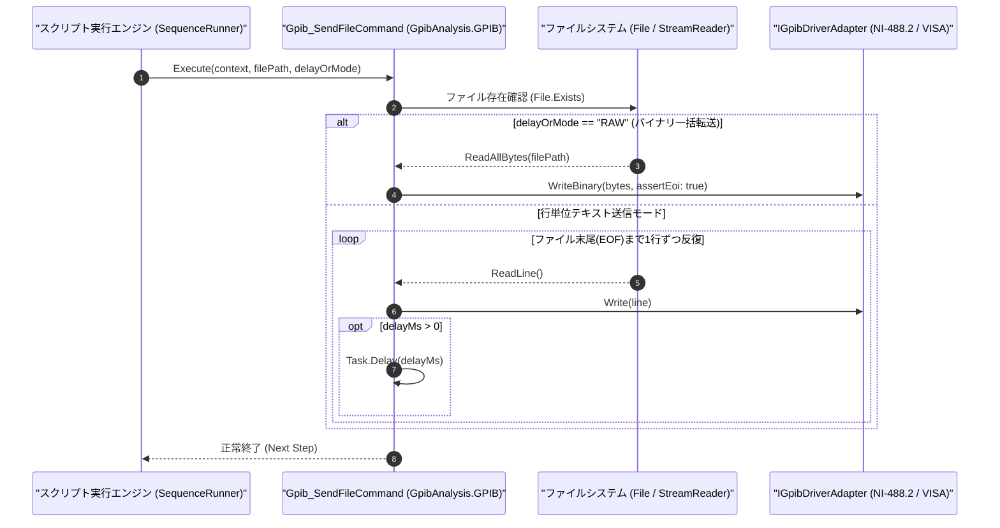

# コマンドリファレンス：Gpib_SendFile

---

## 概要

**Gpib_SendFile** は、指定された外部ファイル（SCPI コマンドリストファイル、任意波形データファイル、または校正テーブルファイル等）の内容を読み込み、オープン中の GPIB デバイスへ送信するコマンドです。
テキスト行単位の逐次送信モードと、ファイル全体を一括ストリーム転送するモード（NI-488.2 `ibwrtf` 相当）の双方に対応しています。

> 💡 **補足**: 大量の初期設定 SCPI コマンド群や任意波形ジェネレータ（AWG）への波形データ転送に使用します。

---

## 💡 書式・パラメータ仕様

### コマンド構文

```csv
,SEQUENCE,Gpib_SendFile, "<FilePath>", "[DelayMsOrMode: 0]"
```

### パラメータ（引数）一覧

| 引数位置 | パラメータ名 | 必須/任意 | 型・制約 | 説明 |
| :---: | :--- | :---: | :--- | :--- |
| 第1引数 | `FilePath` | **必須** | 文字列（ファイルパス） | 送信するファイルのパス（相対パスまたは絶対パス）を指定します。 |
| 第2引数 | `DelayMsOrMode` | 任意 | 整数（行間ミリ秒）または `"RAW"` / `"LINE"`（既定値: `"0"`） | ・数値（例: `"50"`）または `"LINE"`：テキストファイルを 1 行ずつ読み込み、指定ミリ秒間隔で送信します。<br>・`"RAW"`（または `"BINARY"`）：ファイル全体をバイナリストリームとして一括送信（最終バイトで EOI アサート）します。 |

---

## 🔄 特殊置換規約・分岐規約の適用

1. **ファイルパスの変数展開（`$` / `@` / `#`）**:
   - 第 1 引数に `"$WAVE_DIR\arb_wave1.dat"` のような変数を指定できます。
2. **レガシー別名互換**:
   - 旧表記の `GpibSendFile` や `GPIB_SENDFILE` は内部正規化により本 `Gpib_SendFile` コマンドへマッピングされます。

---

## 💡 動作例（正しい構文での記述例）

### スクリプト記述例

```csv
,PARAM,SETUP_FILE,.\scpi\awg_init.txt

,SEQUENCE,Gpib_Open, "10"
; 1. SCPI初期設定リストファイルを1行ごとに20ms間隔で逐次送信
,SEQUENCE,Gpib_SendFile, "$SETUP_FILE", "20"

; 2. バイナリ波形データファイルをRAWモードで一括転送
,SEQUENCE,Gpib_SendFile, ".\scpi\sine_1024pts.bin", "RAW"

,SEQUENCE,Gpib_Close
,SEQUENCE,Exit
```

### 実行時の挙動・変数変化

1. 1 回目の `Gpib_SendFile` では、`.\scpi\awg_init.txt` の各行が 20ms のインターバルを挟みながら順番に GPIB 送信されます。
2. 2 回目の `Gpib_SendFile` では、`sine_1024pts.bin` の全バイト列が一括で GPIB バスへ送出されます。

---

## 🔄 動作フロー（シーケンス図）



---

## 🚫 エラーハンドリング・安全設計（仕様制限）

1. **ファイル不在時の事前検証**:
   - 指定されたファイルが存在しない場合は、GPIB バスへ 1 バイトも送出する前に `FileNotFoundException` を送出して停止します。
2. **コメント行・空行の安全な扱い**:
   - テキスト行送信モード時、空行による測定器側のシンタックスエラーを防ぐため、空行は自動スキップされます。

---

## 🧪 ユニットテスト仕様

### テスト実行前提条件
- **対象クラス**: `GpibAnalysis.GPIB.Gpib_SendFileCommand`（`Gpib_SendFileCommand.cs`）
- **モック環境**: テスト用一時ファイルおよび `IGpibDriverAdapter` モックが準備されていること。

### テストケース一覧

| テストID | テスト観点 | 入力スクリプト | 期待される動作・検証項目 |
| :--- | :--- | :--- | :--- |
| `UT-GPIB-SENDFILE-01` | 正常系（行単位送信） | `,SEQUENCE,Gpib_SendFile, "scpi3lines.txt", "10"` | 3 行の SCPI コマンドが順番に `Write` されること。 |
| `UT-GPIB-SENDFILE-02` | 正常系（RAW一括送信） | `,SEQUENCE,Gpib_SendFile, "wave.bin", "RAW"` | バイナリ配列全体が 1 回の `WriteBinary` で送信されること。 |
| `UT-GPIB-SENDFILE-03` | 異常系（ファイル不在） | `,SEQUENCE,Gpib_SendFile, "not_exist.txt"` | `FileNotFoundException` が送出されること。 |

