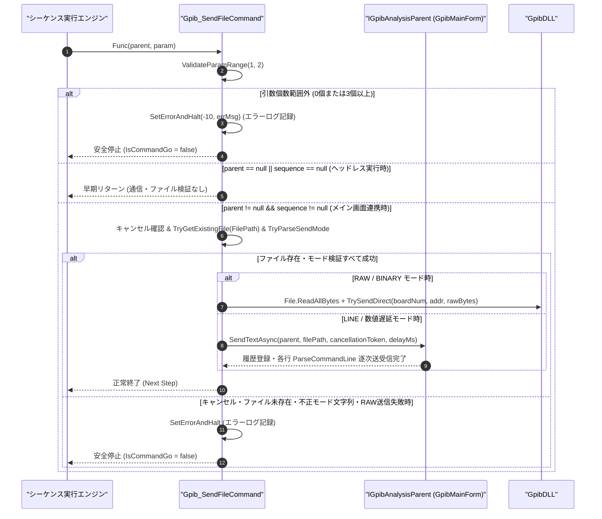

# コマンドリファレンス：Gpib_SendFile

## 概要

**Gpib_SendFile** は、メイン画面（`IGpibAnalysisParent`）連携下において、指定された外部ファイル（SCPI コマンドリストファイル、またはバイナリ波形データファイル等）を読み込み、接続中の GPIB 機器へ送信するコマンドです。
テキスト行単位の逐次送受信モード（機器切り替え指定対応）と、ファイル全体をバイナリとして一括直接転送するモード（`"RAW"` / `"BINARY"`）の双方に対応しています。

> 💡 **補足**: テキスト行送信モードでは、ファイル内に `<機器名> >> S:<コマンド>` や `<機器名> >> R:` と記述することで複数機器の切り替え送受信も可能であり、送信したファイルはメイン画面ツールバー **`[テキストファイルの送信]`** の履歴メニュー（最大 10 件）へ自動登録されます。なお、`parent == null`（メイン画面非連携のヘッドレス単体実行時）は通信を行わず即時リターンします。

---

## 💡 書式・パラメータ仕様

### コマンド構文

```csv
,SEQUENCE, [ステップキー], Gpib_SendFile, "<FilePath>", "[DelayMsOrMode: 0]"
```

### パラメータ（引数）一覧

| 引数位置 | パラメータ名 | 必須/任意 | 型・制約 | 説明 |
| :---: | :--- | :---: | :--- | :--- |
| 第1引数 | `FilePath` | **必須** | 文字列（実在ファイルパス） | 送信するファイルのパスを指定します（メイン画面連携時に実在確認 `TryGetExistingFile` が行われ、未存在時は安全停止します）。 |
| 第2引数 | `DelayMsOrMode` | 任意 | `0` 以上の整数 または `"LINE"` / `"RAW"` / `"BINARY"`（既定値: `"0"`） | ・`0` 以上の整数（例: `"50"`）または `"LINE"`：テキストファイルを 1 行ずつ読み込み、指定ミリ秒間隔（最小 `1` ms 保証：`"0"` や `"LINE"` 指定時は `1` ms）で逐次実行します。<br>・`"RAW"` または `"BINARY"`：ファイル全バイト列を読み込み、カレント機器へ `GpibDLL.TrySendDirect` でバイナリ一括送信します。 |

### テキスト送信ファイル内の行構文（`LINE` / 数値モード時）

* `<機器名> >> S:<コマンド>`：指定した `<機器名>` の機器へ `<コマンド>` を送信します。
* `<機器名> >> R:`：指定した `<機器名>` のタブを選択して応答データを受信します。
* `S:<コマンド>` または通常の文字列行：現在選択中の機器へコマンドを送信します（空白のみの行は自動スキップされます）。

---

## 🔄 特殊置換規約・分岐規約の適用

本コマンドの引数における特殊記法および解釈ルールです。
* **動的置換（`$`）**: 引数内で `$PARAMキー$` のように記述すると、実行時に変数プール（PARAM）の値へ動的置換されます。（適用可能な引数: 全引数対応）
* **ジャンプ先指定（`#`）**: 本コマンドはジャンプ制御を行わないため適用されません。（適用可能な引数: 非適用）
* **共通コマンド指定（`@`）**: 本コマンドは外部マクロを呼び出さないため適用されません。（適用可能な引数: 非適用）
* **カンマのエスケープ**: SCPI コマンド等、引数文字列自体にカンマを含める場合は、必ず `","` と二重引用符で囲んで記述します。
* **エイリアス（別名）**: `SendFile`, `GpibSendFile`

---

## 💡 動作例（正しい構文での記述例）

### スクリプト記述例

※COMMAND ブロック配下の子要素行（PARAM, SEQUENCE）は必ず行頭カンマ（`,`）から開始してください（行頭スペースのみでは認識されません）。なお、`;` で始まる行やクォート外の `;` 以降はコメントとして自動除去されます。

```csv
COMMAND, "SAMPLE_GPIB_SENDFILE", ""
,PARAM, "SETUP_FILE", Text, "初期設定ファイル", ".\scpi\awg_init.txt"
,SEQUENCE, 010, Gpib_Open, 0
; 1. SCPI初期設定リストファイルを1行ごとに20ms間隔で逐次送信
,SEQUENCE, 020, Gpib_SendFile, "$SETUP_FILE$", "20"
; 2. バイナリ波形データファイルをRAWモードで一括転送
,SEQUENCE, 030, Gpib_SendFile, ".\scpi\sine_1024pts.bin", "RAW"
,SEQUENCE, 040, Gpib_Close
,SEQUENCE, 050, Exit
```

### 実行時の挙動・変数変化

* **実行前の状態**: メイン画面連携下で GPIB 通信ポートがオープンされ、対象ファイルが存在する状態。
* **実行後の状態**: 1 回目の `Gpib_SendFile` ではキャンセルダイアログ表示のもと `.\scpi\awg_init.txt` の各行が `20` ms 間隔で順次実行され、送信履歴へ追加されます。 2 回目の `Gpib_SendFile` では `sine_1024pts.bin` の全バイト列がカレント機器へダイレクト一括送信されます。

---

## 🔄 動作フロー（シーケンス図）



---

## 🚫 エラーハンドリング・安全設計（仕様制限）

1. **実在ファイル検証およびモード文字列検証**:
   - 指定されたファイルが存在しない場合（`TryGetExistingFile` 失敗）や、第 2 引数に `"RAW"` / `"BINARY"` / `"LINE"` / `0` 以上の整数以外の文字列が渡された場合は、バスへ送出する前に `_log.LogError` を記録し `SetErrorAndHalt` で安全停止します。
2. **空行スキップおよび途中キャンセル保護**:
   - テキスト行送信モードでは空行・空白行は自動スキップされ、大量行の送信中もキャンセルダイアログ（`CommonCancelForm`）から安全に途中中断できます。

---

## 🧪 ユニットテスト仕様

本コマンドクラス（`Gpib_SendFileCommand.cs`）に実装されている `RunUnitTest()` メソッドが検証するユニットテストの仕様です。

### テスト実行前提条件

* **実行トリガー**: `RunUnitTest()` メソッドの呼び出し
* **有効化条件**: システム全体の最小ログレベル（`ErrorLogger.MinimumLevel`）が `LogLevel.Test` であること（それ以外の場合は無効化ガードにより早期リターン）
* **検証結果出力**: `_log.LogTest` によるログ出力。検証失敗時は `_log.LogError`、予期せぬ例外発生時は `_log.LogCritical` で記録し、`finally` ブロックでテスト用一時ファイル（`tempFile`）の削除および `GpibDLL.DebugDLL`・`DebugReceiveData` の復元を行います。

### テストケース一覧

| No | テストカテゴリ | テスト条件（入力値） | 期待される結果（出力値） | 検証の目的 / 観点 |
| :---: | :--- | :--- | :--- | :--- |
| **1** | 正常系 | `ParseCommandLine("DEV1 >> R:", "DEF_DEV", "R:", "S:")` を実行 | `commandType == "R"`・`targetDevice == "DEV1"`・`commandContent == ""` を返す | デバイス指定付き受信コマンド行の構文解析検証 |
| **2** | 正常系 | `ParseCommandLine("DEV2 >> S:*IDN?", "DEF_DEV", "R:", "S:")` を実行 | `commandType == "S"`・`targetDevice == "DEV2"`・`commandContent == "*IDN?"` を返す | デバイス指定付き送信コマンド行の構文解析検証 |
| **3** | 正常系 | `ParseCommandLine` に `"S:COMMAND1"`・`"COMMAND2"`・`null` を指定して実行 | それぞれ `("S", "DEF_DEV", "COMMAND1")`・`("Plain", "DEF_DEV", "COMMAND2")`・`("Plain", "DEF_DEV", "")` を返す | 既定デバイス送信行・プレーン行・`null` 入力時の解析検証 |
| **4** | 正常系・異常系 | `TryParseSendMode` に `"RAW"` / `"LINE"` / `"25"` / `"INVALID_MODE"` を指定し、さらに 0 引数で `Func` を実行 | 有効モード 3 種は正常解析、`"INVALID_MODE"` は `false` を返し、0 引数 `Func` は `HasError == true`・`IsCommandGo == false` で安全停止する | 送信モード・遅延時間パースおよび必須ファイルパス欠落時の安全停止検証 |
