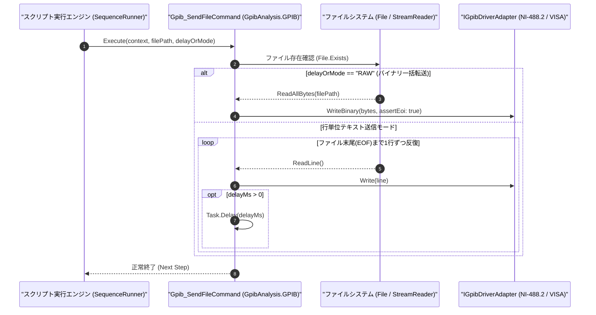

# コマンドリファレンス：Gpib_SendFile

## 概要

**Gpib_SendFile** は、指定された外部ファイル（SCPI コマンドリストファイル、任意波形データファイル、または校正テーブルファイル等）の内容を読み込み、オープン中の GPIB デバイスへ送信するコマンドです。
テキスト行単位の逐次送信モードと、ファイル全体を一括ストリーム転送するモード（NI-488.2 `ibwrtf` 相当）の双方に対応しています。

> 💡 **補足**: 大量の初期設定 SCPI コマンド群や任意波形ジェネレータ（AWG）への波形データ転送に使用します。

---

## 💡 書式・パラメータ仕様

### コマンド構文

```csv
,SEQUENCE, [ステップキー], Gpib_SendFile, "<FilePath>", "[DelayMsOrMode: 0]"
```

### パラメータ（引数）一覧

| 引数位置 | パラメータ名 | 必須/任意 | 型・制約 | 説明 |
| :---: | :--- | :---: | :--- | :--- |
| 第1引数 | `FilePath` | **必須** | 文字列（ファイルパス） | 送信するファイルのパス（相対パスまたは絶対パス）を指定します。 |
| 第2引数 | `DelayMsOrMode` | 任意 | 整数（行間ミリ秒）または `"RAW"` / `"LINE"`（既定値: `"0"`） | ・数値（例: `"50"`）または `"LINE"`：テキストファイルを 1 行ずつ読み込み、指定ミリ秒間隔で送信します。<br>・`"RAW"`（または `"BINARY"`）：ファイル全体をバイナリストリームとして一括送信（最終バイトで EOI アサート）します。 |

---

## 🔄 特殊置換規約・分岐規約の適用

本コマンドの引数における特殊記法および解釈ルールです。
* **動的置換（`$`）**: 引数内で `$PARAMキー$` のように記述すると、実行時に変数プール（PARAM）の値へ動的置換されます。（適用可能な引数: 全引数対応）
* **ジャンプ先指定（`#`）**: 本コマンドはジャンプ制御を行わないため適用されません。（適用可能な引数: 非適用）
* **共通コマンド指定（`@`）**: 本コマンドは外部マクロを呼び出さないため適用されません。（適用可能な引数: 非適用）
* **カンマのエスケープ**: SCPI コマンド等、引数文字列自体にカンマを含める場合は、必ず `","` と二重引用符で囲んで記述します。
* **エイリアス（別名）**: `SendFile`, `GpibSendFile`

---

## 💡 動作例（正しい構文での記述例）

### スクリプト記述例

※COMMAND ブロック配下の子要素行（PARAM, SEQUENCE）は必ず行頭カンマから開始し、スペースインデントや行末コメント（;）は記述しないでください。

```csv
COMMAND, "SAMPLE_GPIB_SENDFILE", ""
,PARAM, "SETUP_FILE", Text, "SETUP_FILE", ".\scpi\awg_init.txt"
,SEQUENCE, 010, Gpib_Open, "10"
; 1. SCPI初期設定リストファイルを1行ごとに20ms間隔で逐次送信
,SEQUENCE, 020, Gpib_SendFile, "$SETUP_FILE$", "20"
; 2. バイナリ波形データファイルをRAWモードで一括転送
,SEQUENCE, 030, Gpib_SendFile, ".\scpi\sine_1024pts.bin", "RAW"
,SEQUENCE, 040, Gpib_Close
,SEQUENCE, 050, Exit
```

### 実行時の挙動・変数変化

* **実行前の状態**: GPIB 通信環境および対象コマンドの PARAM 初期値が設定され、ステップ実行待機中である状態。
* **実行後の状態**: 1 回目の `Gpib_SendFile` では、`.\scpi\awg_init.txt` の各行が 20ms のインターバルを挟みながら順番に GPIB 送信されます。 2 回目の `Gpib_SendFile` では、`sine_1024pts.bin` の全バイト列が一括で GPIB バスへ送出されます。

---

## 🔄 動作フロー（シーケンス図）



---

## 🚫 エラーハンドリング・安全設計（仕様制限）

1. **ファイル不在時の事前検証**:
   - 指定されたファイルが存在しない場合は、GPIB バスへ 1 バイトも送出する前に `FileNotFoundException` を送出して停止します。
2. **コメント行・空行の安全な扱い**:
   - テキスト行送信モード時、空行による測定器側のシンタックスエラーを防ぐため、空行は自動スキップされます。

---

## 🧪 ユニットテスト仕様

本コマンドクラス（`Gpib_SendFileCommand.cs`）に実装されている `RunUnitTest()` メソッドが検証するユニットテストの仕様です。

### テスト実行前提条件

* **実行トリガー**: `RunUnitTest()` メソッドの呼び出し
* **有効化条件**: システム全体の最小ログレベル（`ErrorLogger.MinimumLevel`）が `LogLevel.Test` であること（それ以外の場合は無効化ガードにより早期リターン）
* **検証結果出力**: `_log.LogTest` によるログ出力。検証失敗時は `_log.LogError`、予期せぬ例外発生時は `_log.LogCritical` で記録し、`finally` ブロックでテスト用一時ファイル（`tempFile`）の削除および `GpibDLL.DebugDLL`・`DebugReceiveData` の復元を行います。

### テストケース一覧

| No | テストカテゴリ | テスト条件（入力値） | 期待される結果（出力値） | 検証の目的 / 観点 |
| :---: | :--- | :--- | :--- | :--- |
| **1** | 正常系 | `ParseCommandLine("DEV1 >> R:", "DEF_DEV", "R:", "S:")` を実行 | `commandType == "R"`・`targetDevice == "DEV1"`・`commandContent == ""` を返す | デバイス指定付き受信コマンド行の構文解析検証 |
| **2** | 正常系 | `ParseCommandLine("DEV2 >> S:*IDN?", "DEF_DEV", "R:", "S:")` を実行 | `commandType == "S"`・`targetDevice == "DEV2"`・`commandContent == "*IDN?"` を返す | デバイス指定付き送信コマンド行の構文解析検証 |
| **3** | 正常系 | `ParseCommandLine` に `"S:COMMAND1"`・`"COMMAND2"`・`null` を指定して実行 | それぞれ `("S", "DEF_DEV", "COMMAND1")`・`("Plain", "DEF_DEV", "COMMAND2")`・`("Plain", "DEF_DEV", "")` を返す | 既定デバイス送信行・プレーン行・`null` 入力時の解析検証 |
| **4** | 正常系・異常系 | `TryParseSendMode` に `"RAW"` / `"LINE"` / `"25"` / `"INVALID_MODE"` を指定し、さらに 0 引数で `Func` を実行 | 有効モード 3 種は正常解析、`"INVALID_MODE"` は `false` を返し、0 引数 `Func` は `HasError == true`・`IsCommandGo == false` で安全停止する | 送信モード・遅延時間パースおよび必須ファイルパス欠落時の安全停止検証 |
